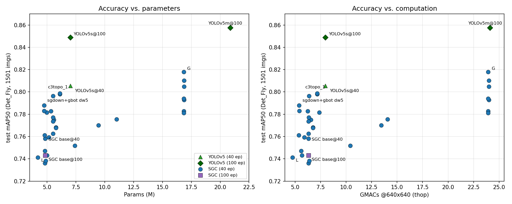

# SGC-YOLOv5 实验报告：Det_Fly 单类无人机检测

| 项目 | 内容 |
|:--|:--|
| 工程目录 | `experiments/detection/project2_2611` |
| 数据集 | Det_Fly（单类 `drone`），train 7000 / val 1500 / test 1501，输入 640×640，batch 16 |
| 实验时间 | 2026-11-02 ～ 2026-11-17，共 52 次正式训练 |
| 报告日期 | 2026-11-17（2026-11-17 补充多 seed 与结构消融，见 §5.11） |

> **口径说明**：除特别注明外，精度均为 **test 集**结果（1501 张），checkpoint 按**验证集 mAP50-95 最优**选取（见 `trainer/trainer.py`）。参数量取自 `train.log` 的「参数量」行；计算量为 thop 在 1×3×640×640 输入上统计的 **GMACs**（与前期表格口径一致，常用 GFLOPs ≈ 2×GMACs）。

---

## 1. 摘要

- **精度最高的 SGC 变体是 G**（主卷积 k=3，廉价 dw=1，groups_ratio=4）：test mAP50 **0.818**。但参数 16.84M、计算量 23.93 GMACs，分别是 YOLOv5s 的 2.4 倍和 3.0 倍，属于**精度向方案，不是轻量化方案**。
- **训练轮数是关键口径**：40 epoch 下 G 比 YOLOv5s（0.805）高 1.3 点（均为单 seed，SGC 的 seed 标准差约 2 点，该差距不能判定为优势）；但 YOLOv5s 训练 100 epoch 可达 **0.849**，此时 G 低 3.1 点。SGC 基础版从 40 → 100 epoch 由 0.758 降到 0.743，验证损失在约 40 epoch 后回升，呈现过拟合迹象。
- **轻量化推荐** `c3_sgdown_gbot_dw5`（C3 拓扑 + SGhost 下采样 + Ghost 瓶颈，3×3 段廉价 dw=5）：**4.74M / 5.40 GMACs**，相对 YOLOv5s@40 参数量与计算量各减少约 32%。**精度代价被低估**：此前的“低 1.7 点”来自单 seed 对照（0.788 对 0.805）；3-seed 均值 0.766 对 YOLOv5s 3-seed 均值 0.808，**低 4.3 点（mAP50）、3.7 点（mAP50-95）**（见 §5.11）。
- **此前的主要掉点源是残差拓扑**：SDGhost 的「单路压缩 + 整块残差」比 YOLO C3 的「双路 + concat」低约 3 点。改为 C3 拓扑后（`c3topo_1`，0.799）与标准 C3 骨干（M，0.798）持平，且二者参数量与计算量完全一致，可作为实现正确性的校验。
- **Ghost 瓶颈的损失主要来自 3×3 段感受野不足**：廉价 dw 从 1 增至 7，mAP50 由 0.763 升至 0.796；但与 SGhost 下采样叠加时，dw=7 不再带来提升。
- **SGC-m（13.52M）训练失败**：AMP 开启 + lr 0.01 出现 NaN；AMP 关闭 + lr 0.005 则长期 mAP 为 0。与卷积核大小无直接关系（s 版 k=3 变体训练正常）。
- **统计噪声约 0.2～1.8 点**：同配置同 seed 的重复实验（m2l 系列 V1/V2）验证集 mAP50-95 相差最多 1.8 点。小于 1 点的排序差异不应作为结论。
- **seed 噪声比此前估计的更大**（2026-11-17 补充）：本模型 3 个 seed 的 test mAP50 为 0.750～0.788，标准差约 2 点；YOLOv5s 为 0.805～0.811，标准差约 0.3 点。单 seed 比较的分辨率约 4 点。
- **结构消融（2026-11-17，seed 42 单次）**：去 DFC、去全部 CBAM、P3 去 SAM 在噪声范围内不能判为掉点；去 DFC 在 CPU 上快约 10%，去 CBAM 在 GPU 上快约 16%。残差改恒等偏低但仍在 seed 范围内，加速有限。详见 §5.11。

---

## 2. 实验设置

### 2.1 数据集

- Det_Fly，单类 `drone`；train 7000 / val 1500 / test 1501 张。
- 前期统计显示绝大多数目标小于 32×32 像素，小目标为主。

### 2.2 统一训练配置

| 项目 | 设置 |
|:--|:--|
| 优化器 | SGD，lr0 = 0.01，momentum 0.937，weight_decay 5e-4 |
| 学习率 | linear 衰减至 lr0 × 0.01；warmup 3 epoch |
| 训练轮数 | **40**（SGC 消融统一预算）；YOLOv5 基线另有 100 epoch；个别 SGC 为 100 / 200 epoch（见 5.8） |
| 数据增强 | Mosaic（p=1.0）+ 水平翻转（p=0.5） |
| 精度与平滑 | AMP 开启；EMA 开启（decay 0.9999，tau 2000） |
| 随机种子 | 42（2026-11-17 起补充 seed 43 / 44 的对照，见 §5.11） |
| 损失增益 | box 0.05，obj 1.0，cls 0.5（日志中 nc=1 时为 0.0063，即 YOLOv5 惯例按 nc/80 缩放），anchor_t 4.0，balance [4.0, 1.0, 0.4] |
| 测试设置 | conf 0.001，IoU 0.6，max_det 300 |

### 2.3 指标

- **mAP50、mAP50-95、P、R**：test 集，`analyze.py --split test`。
- **参数量**：`train.log` 的「参数量」行。
- **分桶 AP**（2026-11-17 起）：按 GT 面积分为 <24²、24²–32²、32²–96²，由 `size_ap_multi.py` 计算（COCO 式忽略规则）；整体 mAP 与 `analyze.py` 一致。
- **GMACs**：thop，eval 模式，单张 640×640 输入。YOLOv5s 统计值 7.97 与前期记录一致。

---

## 3. 模型与参数说明

### 3.1 基线

- **YOLOv5s / YOLOv5m**：仓库标准实现（Conv + C3 + SPPF + Detect），见 `src/models/detection/YOLO/yolov5.py`。规模系数：s 为 depth 0.33 / width 0.50；m 为 depth 0.67 / width 0.75。

### 3.2 SGC-YOLOv5 总体结构

- **Backbone**：Stem（Conv 6×6，s2）→ 4 个阶段，每阶段为「下采样 + SDGhost × n」，最后一阶段接 SPPF。下采样默认为 SGhostConv 3×3 s2，可切换为标准 Conv。s 规模下 n = 1 / 2 / 3 / 1，P3 / P4 / P5 通道为 128 / 256 / 512。
- **Neck**：PANet 结构（上采样拼接 + 融合块 + GSConv 3×3 s2 下采样）。融合块可选 VOVGCSP（通道切分）、VOVGCSPYolo（YOLO C3 式双路投影）或标准 C3。
- **注意力**：三个输出尺度后各接一个 CBAM。
- **Head**：YOLOv5 标准 Detect，三尺度。

### 3.3 核心模块

| 模块 | 结构要点 |
|:--|:--|
| GhostConv | 主卷积（核 k）输出 ⌈C/ratio⌉ 个本征通道；深度卷积（核 dw）生成幽灵通道；拼接得到 C 通道 |
| GBS | GhostConv + BN + SiLU，用作 1×1 Ghost 投影（`proj=ghost`） |
| SGhostConv | GhostConv + ChannelShuffle |
| Bottleneck（ghost） | SGhost1 与 DFC 注意力相乘后接 SGhost2，并带 3×3 深度卷积残差支路 |
| Bottleneck（dense） | YOLO 原版：1×1 → 3×3 + 残差 |
| SDGhost | SGC 版 C3 块。`csp=residual`：GBS1 → x + Bottleneck(x) → GBS2（单路）；`csp=yolo`：cv1 / cv2 双路投影 → Bottleneck → concat → cv3 |
| VOVGCSP | 通道切分的 Neck 融合块（原始 SGC 默认）：一半经 1×1 扩到 2 倍宽度、过 GSBottleneck、压回，另一半经 conv_reduce，拼接后输出 |
| VOVGCSPYolo | YOLO C3 式 Neck 融合块：双路 1×1 投影到 out/2，主路为 GSBottleneck（1×1 → 3×3 + 残差），concat 后 1×1 输出 |

### 3.4 超参数记号

| 记号 | 配置字段 | 含义 |
|:--|:--|:--|
| k | `kernel_size` | 主卷积核（SDGhost 第 1 层 / Bottleneck 第 1 层） |
| mid_k | `mid_kernel_size` | Bottleneck 第 2 层主卷积核；`k1x3` 即 1×1 → 3×3 |
| dw | `dw_kernel_size` | 廉价深度卷积核（SDGhost 各层） |
| mid_dw | `mid_dw_kernel_size` | Bottleneck 第 2 层的廉价深度卷积核（本轮新增） |
| g | `groups_ratio` | ChannelShuffle 参数，**每组通道数 = g，组数 = C/g** |
| e | `e` | SDGhost 的 CSP 宽度，隐藏通道 = C·e（e=0.5 为 C3 式窄通道） |
| proj | `proj_type` | 投影类型：ghost（GBS）/ conv（标准 1×1） |
| bot | `bottleneck_type` | 瓶颈类型：ghost / dense |
| csp | `csp_style` | SDGhost 拓扑：residual（单路）/ yolo（C3 双路） |
| down | `downsample_type` | 下采样类型：sghost / conv |
| vov | `vov_style` | Neck 融合块：split（VOVGCSP）/ yolo（VOVGCSPYolo） |

> **口径更正**：前期对话中曾把 g=8 的下降解释为「过度分组」，与代码不符。按 `_shuffle_groups` 的实现，组数为 C/g，g 增大意味着**组数减少、每组通道增多**。因此 g=4 优于 g=8 应表述为「混洗粒度」效应，论文中建议直接写「每组 4 通道」。

---

## 4. 实验历程

| 阶段 | 训练日期 | 目的 | 代表运行 | 正式训练次数 |
|:--|:--|:--|:--|:--:|
| 0 首代结构（40 ep） | 11-02 ～ 11-05 | SGC 基础，结构消融（NoCBAM、C3Neck、StdEarly），YOLOv5s 40 ep 基线 | SGC V4，YOLOv5s V3 | 5 |
| 0′ 100 epoch 对照 | 11-08 | 检验「训练更久是否有用」，YOLOv5s / YOLOv5m / SGC 基础各训 100 epoch | YOLOv5s V1，YOLOv5m V1，SGC V1 | 3 |
| 0″ m 规模尝试 | 11-03 ～ 11-08 | SGC-m（13.52M）训练，多次失败 | error_m/V5、V7 等 | 5 |
| 1 Ghost 参数 | 11-05 ～ 11-07 | 主卷积核 k、廉价核 dw、groups_ratio 组合 | A–H | 8 |
| 2 结构替换 | 11-08 ～ 11-11 | 1×1→3×3 瓶颈、CSP 窄通道、VOVGCSPYolo、标准骨干 | I–N，K–M | 6 |
| 3 M→L 阶梯 | 11-11 ～ 11-12 | 从标准骨干逐步退化为 SGC 骨干 | m2l_1/2/3（含 V2 复现） | 6 |
| 4 C3 拓扑对齐 | 11-12 | SDGhost 残差拓扑改为 C3 双路 | c3topo_1/2/3 | 3 |
| 5 Ghost 逐步加回 | 11-12 ～ 11-13 | 在 c3topo_1 上单独加回 SGhost 下采样与 Ghost 瓶颈，调 mid_dw；200 epoch 长训 1 次 | c3_* 系列 | 8 |
| 6 多 seed 与结构消融 | 11-17 | 本模型与 YOLOv5s 补 seed 43/44；本模型去 CBAM、P3 去 SAM、去 DFC、残差恒等（seed 42） | 2026-11-17_001～008 | 8 |

另有 YOLOv8 与若干 `_smoke_*`、`test_num_worker` 运行，仅为冒烟或调试记录，不计入结果。

---

## 5. 结果

以下表格中，mAP、P、R 均为 test 集结果，保留 3 位小数；参数量与 GMACs 保留 2 位小数；Δ 单位为 mAP50 百分点。

### 5.1 基线与训练预算

| 模型 | 轮数 | 参数量 (M) | GMACs (G) | mAP50 | mAP50-95 | P | R | Δ mAP50 vs YOLOv5s@40 |
|:--|:--:|:--:|:--:|:--:|:--:|:--:|:--:|:--:|
| YOLOv5s（V3） | 40 | 7.02 | 7.97 | 0.805 | 0.494 | 0.920 | 0.771 | — |
| YOLOv5s（V1） | 100 | 7.02 | 7.97 | **0.849** | **0.537** | 0.917 | 0.823 | +4.4 |
| YOLOv5m（V1） | 100 | 20.87 | 24.11 | 0.858 | 0.550 | 0.918 | 0.810 | +5.3 |
| SGC 基础（V4） | 40 | 4.85 | 6.32 | 0.758 | 0.444 | 0.917 | 0.712 | −4.7 |
| SGC 基础（V1） | 100 | 4.85 | 6.32 | 0.743 | 0.429 | 0.887 | 0.694 | −6.2 |

**要点**：同一结构（SGC 基础）从 40 → 100 epoch 下降 1.5 点，而 YOLOv5s 上升 4.3 点。两组 100 epoch 与 40 epoch 的 `num_workers` 设置不同（24 与 4），理论上不改变训练设定，但严格对照应统一。

### 5.2 结构消融（40 epoch）

| 模型 | 相对 SGC 基础（V4）的改动 | 参数量 | GMACs | mAP50 | mAP50-95 | P | R | Δ vs V4 |
|:--|:--|:--:|:--:|:--:|:--:|:--:|:--:|:--:|
| SGC 基础（V4） | — | 4.85 | 6.32 | 0.758 | 0.444 | 0.917 | 0.712 | — |
| NoCBAM | 去掉输出端 CBAM | 4.81 | 6.31 | 0.736 | 0.434 | 0.890 | 0.692 | −2.2 |
| C3Neck | Neck 融合块：VOVGCSP → 标准 C3（保留 GSConv、CBAM） | 4.79 | 5.36 | 0.761 | 0.448 | 0.889 | 0.746 | +0.3 |
| StdEarly | 骨干 stage2/3 改为标准 Conv + C3 | 4.97 | 7.38 | 0.782 | 0.463 | 0.905 | 0.740 | +2.4 |

**结论**：
- NoCBAM 下降 2.2 点，但这是旧配置上的单 seed 对照，在 SGC 的 seed 噪声（约 2 点）之内，不能判定 CBAM 有效。当前配置下去掉全部 CBAM 的结果见 §5.11。
- Neck 换成标准 C3 后精度基本持平（+0.3），计算量更低，说明 VOVGCSP 在本数据集上没有精度优势。
- 浅层改为标准 Conv + C3 提升 2.4 点，但计算量升至 7.38 GMACs。

### 5.3 Ghost 参数消融 A–H（40 epoch）

| ID | k | dw | g | 参数量 (M) | GMACs (G) | mAP50 | mAP50-95 | P | R |
|:--:|:--:|:--:|:--:|:--:|:--:|:--:|:--:|:--:|:--:|
| A | 1 | 3 | 2 | 4.87 | 6.39 | 0.738 | 0.431 | 0.913 | 0.687 |
| B | 3 | 3 | 2 | 16.87 | 24.01 | 0.793 | 0.478 | 0.935 | 0.762 |
| C | 3 | 3 | 4 | 16.87 | 24.01 | 0.805 | 0.494 | 0.908 | 0.774 |
| D | 3 | 1 | 2 | 16.84 | 23.93 | 0.783 | 0.471 | 0.926 | 0.740 |
| E | 3 | 1 | 3 | 16.84 | 23.93 | 0.781 | 0.461 | 0.920 | 0.754 |
| F | 3 | 3 | 8 | 16.87 | 24.01 | 0.810 | 0.481 | 0.914 | 0.769 |
| **G** | **3** | **1** | **4** | 16.84 | 23.93 | **0.818** | **0.489** | **0.935** | **0.773** |
| H | 3 | 1 | 8 | 16.84 | 23.93 | 0.794 | 0.465 | 0.931 | 0.756 |

**结论**：
1. **主卷积核是关键**。只改 dw（A，k=1）得 0.738，比基础版（0.758）低 2.0；把 k 从 1 改为 3（D，g=2）则得 0.783，高 2.5。1×1 主卷积只做逐像素通道混合，对小目标缺少空间感受野。
2. **k=3 吃掉了 Ghost 的参数优势**。主卷积参数变为 9 倍，SGC 从 4.85M 增至 16.84M，计算量从 6.32 增至 23.93 GMACs。
3. **groups_ratio 的影响随 dw 而变**。dw=1 时 g=4 最优（G 0.818，对比 H 的 g=8 为 0.794；D→G 的 g 从 2 增至 4 提升 3.5 点）；dw=3 时 g=8 略优于 g=4（F 0.810 对比 C 0.805）。
4. **dw 1 与 3 的差异在约 ±1.5 点内**（G vs C、H vs F），接近重复实验噪声（见 5.9），不宜作为确定结论。

### 5.4 Bottleneck 与 Neck 拓扑（I–N，40 epoch）

| ID | 设置 | 参数量 (M) | GMACs (G) | mAP50 | mAP50-95 | P | R |
|:--:|:--|:--:|:--:|:--:|:--:|:--:|:--:|
| I | 瓶颈 1×1 → 3×3（全宽），dw=1，g=4 | 9.45 | 13.45 | 0.770 | 0.464 | 0.916 | 0.751 |
| J | I + CSP 窄通道（e=0.5） | 7.40 | 10.40 | 0.752 | 0.449 | 0.906 | 0.711 |
| K | G 骨干 + VOVGCSPYolo Neck | 11.03 | 14.07 | 0.776 | 0.453 | 0.925 | 0.748 |
| L | J 骨干 + VOVGCSPYolo Neck | 4.21 | 4.74 | 0.741 | 0.428 | 0.908 | 0.696 |
| M | 标准 Conv + C3 骨干 + VOVGCSPYolo Neck | 6.11 | 7.17 | 0.798 | 0.484 | 0.910 | 0.764 |
| N | L 的 SDGhost 瓶颈换为稠密 1×1 → 3×3 | 4.81 | 5.60 | 0.747 | 0.448 | 0.910 | 0.720 |

**结论**：
- 1×1 → 3×3 瓶颈（I）相比 G 的 k=3 主卷积，参数减少 7.4M，精度下降 4.8 点。
- CSP 窄通道（J）相对 I 减少约 2.05M 参数、3.05 GMACs，精度下降 1.8 点。
- Neck 换成 VOVGCSPYolo 并非中性：K 相对 G 下降 4.2 点，L 相对 J 下降 1.1 点。
- 标准骨干加同一 Neck（M）达到 0.798，说明**骨干**是精度与轻量化的分水岭。
- 只把 L 的瓶颈换成稠密（N）仅提升 0.6 点，瓶颈算子本身不是主因（见 5.5）。

### 5.5 M → L 阶梯分解（m2l，40 epoch，test 为 V1）

| 步骤 | 相对上一步的改动 | 参数量 (M) | GMACs (G) | mAP50 | mAP50-95 | P | R | Δ（相对上一步） |
|:--|:--|:--:|:--:|:--:|:--:|:--:|:--:|:--:|
| M | 基准：标准骨干 + VOVGCSPYolo | 6.11 | 7.17 | 0.798 | 0.484 | 0.910 | 0.764 | — |
| m2l_1 | SDGhost 改为**残差拓扑**，投影 conv，瓶颈 dense | 5.76 | 6.75 | 0.768 | 0.462 | 0.899 | 0.751 | **−3.0** |
| m2l_2 | 投影改为 ghost（GBS） | 5.59 | 6.54 | 0.775 | 0.471 | 0.917 | 0.732 | +0.7 |
| m2l_3 | 瓶颈改为 ghost | 4.99 | 5.68 | 0.743 | 0.430 | 0.921 | 0.691 | **−3.2** |
| L | 下采样改为 SGhost | 4.21 | 4.74 | 0.741 | 0.428 | 0.908 | 0.696 | −0.2 |

**结论**：M → L 共下降 5.7 点，可分解为：残差拓扑 −3.0、Ghost 瓶颈 −3.2。投影改 ghost（+0.7）与 SGhost 下采样（−0.2）在噪声范围内。前两项远超重复实验噪声，结论可信。

### 5.6 C3 拓扑对齐（c3topo，40 epoch）

| ID | 设置 | 参数量 (M) | GMACs (G) | mAP50 | mAP50-95 | P | R | 相对上一档 |
|:--:|:--|:--:|:--:|:--:|:--:|:--:|:--:|:--:|
| c3topo_1 | C3 双路 + 投影 conv + 瓶颈 dense + Conv 下采样 | 6.11 | 7.17 | **0.799** | 0.483 | 0.905 | 0.769 | 相对 m2l_1：**+3.1** |
| c3topo_2 | + 投影改为 ghost | 5.77 | 6.76 | 0.768 | 0.462 | 0.907 | 0.730 | −3.1 |
| c3topo_3 | + 瓶颈改为 ghost | 5.17 | 5.90 | 0.759 | 0.455 | 0.911 | 0.724 | −0.9 |

**结论**：
- **实现校验**：c3topo_1 与标准骨干 M 的参数量与 GMACs 完全一致（6.11M / 7.17G），精度仅差 0.1 点。这说明它就是「在 SDGhost 框架中实现的 YOLO C3」，C3 拓扑的实现是正确的。
- 残差拓扑的 −3.0 完全来自拓扑本身：算子相同，c3topo_1 比 m2l_1 高 3.1 点。
- C3 拓扑下，投影改为 ghost 的代价变大（−3.1）。推测原因是 C3 依赖两路投影的独立性，Ghost 投影的本征与廉价特征彼此相关，削弱了这种独立性；此为假设，需消融验证。
- C3 拓扑下，瓶颈改为 ghost 只下降 0.9 点（残差拓扑下为 3.2 点），说明拓扑对齐后 Ghost 瓶颈的代价显著降低。

### 5.7 Ghost 逐步加回（以 c3topo_1 为基线，40 epoch）

| ID | 相对 c3topo_1 的改动 | 参数量 (M) | GMACs (G) | mAP50 | mAP50-95 | P | R | Δ vs c3topo_1 | Δ vs YOLOv5s@40 |
|:--:|:--|:--:|:--:|:--:|:--:|:--:|:--:|:--:|:--:|
| c3topo_1 | —（基线） | 6.11 | 7.17 | 0.799 | 0.483 | 0.905 | 0.769 | — | −0.6 |
| c3_sgdown | 下采样 → SGhost | 5.33 | 6.23 | 0.783 | 0.479 | 0.910 | 0.744 | −1.6 | −2.2 |
| c3_ghostbot | 瓶颈 → Ghost（mid_dw=1） | 5.51 | 6.31 | 0.763 | 0.466 | 0.911 | 0.728 | −3.6 | −4.2 |
| c3_ghostbot_dw3 | 同上，mid_dw=3 | 5.52 | 6.32 | 0.774 | 0.458 | 0.909 | 0.749 | −2.5 | −3.1 |
| c3_ghostbot_dw5 | 同上，mid_dw=5 | 5.52 | 6.34 | 0.777 | 0.463 | 0.919 | 0.736 | −2.2 | −2.8 |
| c3_ghostbot_dw7 | 同上，mid_dw=7 | 5.53 | 6.37 | 0.796 | 0.468 | 0.920 | 0.768 | −0.3 | −0.9 |
| c3_sgdown_gbot_dw5 | 下采样 SGhost + 瓶颈 Ghost（mid_dw=5） | **4.74** | **5.40** | 0.788 | 0.470 | 0.892 | 0.762 | −1.1 | −1.7 |
| c3_sgdown_gbot_dw7 | 同上，mid_dw=7 | 4.75 | 5.43 | 0.783 | 0.479 | 0.936 | 0.724 | −1.6 | −2.2 |

> 注：本表所有 Δ 均为单 seed 结果。SGC 的 seed 标准差约 2 点，差值在 3 点以内的比较不能判定方向；3-seed 结果见 §5.11。

**结论**：
1. **SGhost 下采样**：下降 1.6 点，减少 0.78M 参数、0.94 GMACs，是性价比较好的一项。
2. **Ghost 瓶颈的感受野决定恢复程度**：mid_dw 从 1 增至 3、5、7，mAP50 为 0.763 → 0.774 → 0.777 → 0.796，单调上升。mid_dw=7 基本回到基线（−0.3），但参数只减少 0.58M。
3. **两者叠加存在负交互**：mid_dw=5 叠加 SGhost 得 0.788，是轻量推荐；mid_dw=7 叠加后降到 0.783，召回从 0.762 降到 0.724，P 升到 0.936，表现为「保守、漏检增多」。
4. `c3_sgdown_gbot_dw5` 相对 `c3_sgdown`（5.33M，0.783）再减少 0.59M 参数，精度 +0.5（噪声内）。也就是说，在该配置下加入 Ghost 瓶颈几乎不伤精度。

### 5.8 训练轮数与稳定性

| 模型 | 轮数 | 验证集最优（epoch） | test mAP50 | 现象 |
|:--|:--:|:--|:--:|:--|
| YOLOv5s | 40 | mAP50-95 0.499（E40） | 0.805 | 末期仍在上升 |
| YOLOv5s | 100 | mAP50-95 0.531（E100） | 0.849 | 验证损失单调下降（E40 0.0214 → E100 0.0188） |
| SGC 基础 | 40 | mAP50-95 0.444（E40） | 0.758 | — |
| SGC 基础 | 100 | mAP50-95 0.419（E36） | 0.743 | 验证损失 E40 最低（0.0243），E80 回升到 0.0262；E36 之后未再超过 |
| c3_sgdown_gbot_dw5 | 40 | mAP50-95 0.474（E37） | 0.788 | — |
| c3_sgdown_gbot_dw5 | 200（E64 早停） | mAP50-95 0.428（E34） | 未测试 | E34 时 lr 仍约 8e-3；E45 → E48 的 mAP50 由 0.715 骤降至 0.510，之后未恢复 |

**结论**：
1. **YOLOv5 与 SGC 对训练时长的响应相反**。YOLOv5s 从 40 增至 100 epoch 提升 4.3 点；SGC 基础下降 1.5 点。SGC 的验证损失在约 40 epoch 后回升，而训练损失仍在下降，是典型的过拟合迹象。
2. **线性学习率与总轮数耦合**。同样在第 34 轮，40 epoch 日程的 lr 为 1.8e-3，200 epoch 日程为 8.4e-3，后者仍处于粗调阶段，且中途出现崩塌。因此，不能把「长日程的中间 epoch」与「短日程的终点」直接比较。
3. **40 epoch 是 SGC 的较优预算，但不是普遍结论**。论文应在统一预算下比较，并同时报告 100 epoch 的结果。

### 5.9 随机性与重复实验

| 配置 | V1 验证 mAP50-95（最优） | V2 验证 mAP50-95（最优） | 差值 |
|:--|:--:|:--:|:--:|
| m2l_1 | 0.4641 | 0.4616 | 0.0025 |
| m2l_2 | 0.4733 | 0.4556 | 0.0177 |
| m2l_3 | 0.4281 | 0.4401 | 0.0120 |

同一 seed、同一配置的两次训练，验证集 mAP50-95 相差 0.25 ～ 1.8 点（GPU 非确定性等因素）。由此得出：
- 小于约 1 点的差异不能作为结论依据。例如 m2l_1 与 m2l_2 的 +0.7，在 V2 中排序已经反转；dw 1 与 3 的比较同理。
- 3 点以上的效应（残差拓扑、Ghost 瓶颈、k 由 1 变 3）此前被认为可信，但 2026-11-17 的 seed 实验表明 SGC 的 seed 标准差约 2 点（§5.11），这些结论也应以多 seed 结果为准。“去掉 CBAM 下降 2.2 点”的旧结论已撤回。

### 5.10 SGC-m 规模训练失败

| 运行 | 轮数 | lr0 | AMP | 现象 | 结果 |
|:--|:--:|:--:|:--:|:--|:--|
| error_m/V7 | 50 | 0.01 | 开 | 第 1 轮起 loss 为 NaN，全程 NaN | 失败 |
| error_m/V5 | 40 | 0.01 | 开 | 验证损失多次为 NaN；mAP 在 E10 ～ E20 之间开始上升 | test mAP50 **0.426**（远低于 s 版） |
| m（V2） | 50 | 0.01 | 关 | 前 20 轮 mAP 接近 0（E20 为 0.0015），E49 为 0.042 | 未测试（验证 mAP50-95 为 0.019） |
| m（V1） | 50 | 0.005 | 关 | 抽查 E1 / E10 / E20 / E30 的 mAP50 均为 0，loss 几乎不降 | 人工中断 |
| m（V5） | 100 | 0.005 | 关 | 抽查 E1 / E10 / E20 / E30 / E50 / E100 的 mAP50 均为 0 | test mAP50 **0.000** |

**对照**：YOLOv5m 在同样的 lr 0.01、AMP 开启下正常收敛至 0.858；s 版 SGC（AMP 开启、lr 0.01）也正常训练。因此，问题只出现在 **SGC-m** 上。

**分析**：
- **参数规模不是直接原因**。s 版 k=3 变体（16.84M）训练正常，而 m 版（13.52M）失败，两者没有直接对应关系。「卷积核太小」的假设尚未被直接验证，因为 m 还没有用 G 的配方训练。
- **学习率与数值稳定性是主要线索**。lr 0.01 + AMP 导致 NaN；lr 0.005 时长期不学；lr 0.01 关闭 AMP 时学习极慢。可用的学习率窗口很窄。

---

### 5.11 多 seed 噪声与结构消融（2026-11-17）

**设置**：本模型（`c3_sgdown_gbot_dw5`）与 YOLOv5s 各补训 seed 43、44（40 epoch），与已有的 seed 42 合成 3-seed；结构消融为 seed 42 单次。新 run 与 V1 的 `config.yaml` 仅 seed、名称、描述与配置路径不同（已逐项比对）。test 指标由 `analyze.py --split test` 得到；<24² 等分桶 AP 由 `size_ap_multi.py` 得到（整体 mAP 与 `analyze.py` 一致）。

**表 5.11-A 三 seed 结果（test 集，std 为样本标准差）**

| 模型 | seed | mAP50 | mAP50-95 | P | R | <24² AP50 | <24² AP50-95 |
|:--|:--:|:--:|:--:|:--:|:--:|:--:|:--:|
| 本模型（V1） | 42 | 0.788 | 0.470 | 0.892 | 0.762 | 0.768 | 0.446 |
| 本模型 | 43 | 0.750 | 0.446 | 0.889 | 0.730 | 0.732 | 0.422 |
| 本模型 | 44 | 0.759 | 0.449 | 0.920 | 0.706 | 0.741 | 0.426 |
| **本模型 均值 ± std** | 3 | **0.766 ± 0.020** | **0.455 ± 0.013** | 0.900 | 0.732 | **0.747 ± 0.019** | 0.431 |
| YOLOv5s（V3） | 42 | 0.805 | 0.494 | 0.920 | 0.771 | 0.794 | 0.469 |
| YOLOv5s | 43 | 0.808 | 0.493 | 0.918 | 0.762 | 0.793 | 0.471 |
| YOLOv5s | 44 | 0.811 | 0.488 | 0.902 | 0.781 | 0.797 | 0.469 |
| **YOLOv5s 均值 ± std** | 3 | **0.808 ± 0.003** | **0.492 ± 0.003** | 0.913 | 0.771 | **0.795 ± 0.002** | 0.470 |

**表 5.11-B 结构消融（seed 42 单次）**

| 变体 | 改动 | 参数量 (M) | mAP50 | mAP50-95 | <24² AP50 | Δ vs V1 | Δ vs 3-seed 均值 |
|:--|:--|:--:|:--:|:--:|:--:|:--:|:--:|
| 本模型（V1） | 基线 | 4.74 | 0.788 | 0.470 | 0.768 | — | +2.2 |
| 去 CBAM | 去掉三尺度全部 CBAM | 4.69 | 0.787 | 0.478 | 0.766 | −0.1 | +2.1 |
| P3 去 SAM | P3 只保留 CAM，P4/P5 保持完整 CBAM | 4.74 | 0.782 | 0.469 | 0.764 | −0.6 | +1.6 |
| 去 DFC | Ghost 瓶颈去掉 DFC 门控 | 4.73 | 0.792 | 0.477 | 0.774 | +0.4 | +2.6 |
| 残差改恒等 | 残差支路 3×3 DW 改为恒等 | 4.73 | 0.754 | 0.449 | 0.736 | −3.4 | −1.1 |

Δ 单位为 mAP50 百分点；“Δ vs 3-seed 均值”以本模型三个 seed 的均值 0.766 为基准。

**表 5.11-C 推理延迟**（本机 RTX 3060 Laptop 与 14 线程 CPU，batch 1，640 输入，随机输入，不含 NMS；GPU 计时波动约 ±1 ms）

| 模型 | 参数量 (M) | GPU 延迟 (ms) | CPU 延迟 (ms) | GPU 相对 V1 | CPU 相对 V1 |
|:--|:--:|:--:|:--:|:--:|:--:|
| YOLOv5s（V3） | 7.02 | 9.1 | 98.8 | — | — |
| 本模型（V1） | 4.74 | 20.7 | 139.9 | 基线 | 基线 |
| 去 CBAM | 4.69 | 17.3 | 138.6 | −16% | −1% |
| P3 去 SAM | 4.74 | 19.8 | 135.6 | −4% | −3% |
| 去 DFC | 4.73 | 19.4 | 125.4 | −6% | −10% |
| 残差改恒等 | 4.73 | 18.8 | 138.6 | −9% | −1% |


*图：左为整体 mAP50，右为 <24² AP50（占 GT 的 91%）。蓝色为本模型 3 个 seed（阴影为范围，虚线为均值），绿色为 YOLOv5s 3 个 seed（点线为均值），红色为结构消融（seed 42 单次）。*

**结论**：
1. **seed 噪声远大于此前估计**。本模型 3 个 seed 的 mAP50 为 0.750～0.788（标准差约 2 点），YOLOv5s 为 0.805～0.811（标准差约 0.3 点）。单 seed 比较的分辨率约 4 点（2 个标准差）。
2. **轻量化的精度代价被低估**。3-seed 均值下，本模型比 YOLOv5s 低 4.3 点（mAP50）、3.7 点（mAP50-95）、4.8 点（<24² AP50）。前文的“低 1.7 点”是 V1 与 V3 两个单 seed 之间的比较，已更正。
3. **消融全部落在本模型的 seed 范围内，或仅贴着上沿**。去 DFC 为 0.792，只高出 seed 最高值 0.4 点；去全部 CBAM（0.787）与 P3 去 SAM（0.782）在噪声内；残差改恒等为 0.754，偏低但仍在 seed 范围内。没有证据表明任何消融造成掉点，也不能证明它们有益。
4. **§5.2 的“CBAM 有效，去掉后下降 2.2 点”在当前配置下不成立**。去掉全部 CBAM 后 mAP50 变化 −0.1 点（seed 42）。原 2.2 点来自旧配置的单 seed 对照，现已降级为不可判断。
5. **P3 去 SAM**：mAP50 −0.6、<24² AP50 −0.4，均在噪声内，延迟仅降 3–4%。SAM 的反向空间模式没有可测的伤害，也没有可测的收益。
6. **速度**：去 DFC 在 CPU 上快约 10%，去全部 CBAM 在 GPU 上快约 16%（CPU 无收益），残差改恒等在 GPU 上快约 9%。这些都不改变 SGC 相对 YOLOv5s 在 GPU 上慢约 2 倍的结论（GPU 2.3 倍，CPU 1.4 倍）。

**口径与局限**：
- 结构消融仅 seed 42 单次。“去 DFC + 去 CBAM”组合（参数约 4.69M）是下一个候选，需要 3 个 seed 验证，尚未训练。
- 40 epoch 预算下，所有消融 run 的最优 epoch 都是 40，仍在上升，结论只适用于该预算。
- 基线 seed 42 为 V1（2026-11-13 训练）。此后代码只新增了默认等价的开关，已验证旧 checkpoint 严格加载、参数量一致；V1 与新 run 的每 epoch 耗时分别约 71 s 与 84 s，原因未查，可能是服务器负载。
- 延迟仅在本机测得，不代表目标部署设备。

---

## 6. 参数量与计算量



*图：左为参数量，右为 GMACs，纵轴为 test mAP50。三角为 YOLOv5s@40；菱形为 YOLOv5 的 100 epoch 基线；圆点为 SGC 40 epoch；方块为 SGC 100 epoch。*

代表性候选（40 epoch，test 集）：

| 候选 | 参数量 (M) | GMACs (G) | mAP50 | 定位 |
|:--|:--:|:--:|:--:|:--|
| YOLOv5s（40 epoch） | 7.02 | 7.97 | 0.805 | 同预算基线 |
| G | 16.84 | 23.93 | **0.818** | 精度最高，计算量最大 |
| c3topo_1 | 6.11 | 7.17 | 0.799 | 与标准 C3 等价的 SGC 框架实现，参数量减少 13% |
| c3_ghostbot_dw7 | 5.53 | 6.37 | 0.796 | 瓶颈用 Ghost，精度接近基线 |
| **c3_sgdown_gbot_dw5** | **4.74** | **5.40** | 0.788（3-seed 均值 0.766） | **轻量推荐**：参数量与计算量各减少约 32%；3-seed 精度低 4.3 点（§5.11） |
| L | 4.21 | 4.74 | 0.741 | 最轻，但精度明显不足 |

---

## 7. 讨论

### 7.1 Ghost 在小目标上为什么不能「白拿」

- Ghost 的本征卷积决定空间感受野：k=1 只做通道混合（A 与基础版），k=3 才有空间聚合（D）。
- 但 k=3 使主卷积参数变为 9 倍，Ghost 的参数优势随之消失（16.84M）。
- 廉价深度卷积负责补充局部感受野：在 Ghost 瓶颈中，mid_dw 从 1 增至 7 恢复了 3.3 点。这说明瓶颈的弱点是「空间聚合不足」，而不是 Ghost 算子本身。

### 7.2 拓扑比算子更重要

- 算子相同时，残差拓扑比 C3 拓扑低 3.0 点（m2l_1 对比 c3topo_1）。
- 残差拓扑的输出是对 C/2 维中间特征做 GBS2 映射得到的，相当于在 C/2 维的子空间里扩展；C3 的输出则是两路 C/2 特征的拼接，不受此限制。这可能是残差拓扑掉点的结构性原因（推断，未直接验证）。
- 在 C3 拓扑中，把瓶颈的 dense 换成 ghost 只损失约 1 点（c3topo_2 → c3topo_3）。论文中可表述为：「C3 式双路拓扑是 SGC 块的必要条件；Ghost 算子需配套感受野设计才能替换。」
- 前期用 `analyze_compare.py` 做分层召回分析，结论为：M 与 YOLOv5s 的召回基本一致，说明 VOVGCSPYolo Neck 的特征聚合能力不是瓶颈；L 的损失主要来自 Ghost 骨干。这与上述阶梯结论一致。

### 7.3 下采样与投影

- SGhost 下采样代价约 1.6 点（c3topo_1 → c3_sgdown），换来 0.78M 参数。
- 投影改为 Ghost 的代价取决于拓扑：残差拓扑下约 +0.7（噪声内），C3 拓扑下为 −3.1。这说明投影的影响与拓扑强相关，需要在 C3 拓扑中单独做消融确认。

### 7.4 过拟合与训练预算

- SGC 基础版在 100 epoch 下验证损失回升，而 YOLOv5s 的验证损失单调下降；两者的训练损失都在下降。
- 可能原因（待验证）：Ghost / DFC 模块在 7000 张图像上的容量偏大；EMA 与长日程的交互；线性 lr 下后期泛化退化。
- 建议的诊断：比较 train / val loss 的差距，尝试 cosine 衰减、更强的数据增强或早停。

### 7.5 结论的可靠性

- 效应 ≥ 3 点的结论（残差拓扑、Ghost 瓶颈 dense → ghost、k 由 1 变 3）在单 seed 下有一定支持，但 SGC 的 seed 标准差约 2 点，尚未经多 seed 确认。“去掉 CBAM”的旧结论已撤回（§5.11）。
- 单 seed 比较的分辨率约 4 点（2 个标准差）。因此 ≤ 3 点的单 seed 比较（m2l_1 与 m2l_2、dw 1 与 3、G 与 C、各结构消融等）不能判断，需要重复实验。
- 所有结论都基于单一测试集（1501 张，单类），泛化性尚未验证。

---

## 8. 结论

1. **同预算（40 epoch）下**，SGC-G（0.818，单 seed）高于 YOLOv5s（0.805，单 seed）1.3 点；在 SGC 约 2 点的 seed 标准差下，这一差距不能判定为优势。G 的参数量与计算量分别是 YOLOv5s 的 2.4 倍和 3.0 倍，属于精度向方案。
2. **轻量化推荐** `c3_sgdown_gbot_dw5`（4.74M / 5.40 GMACs）：相对 YOLOv5s@40，参数量与计算量各减少约 32%。3-seed 均值 mAP50 为 0.766（YOLOv5s 为 0.808），精度低约 4.3 点；GPU 延迟约为 YOLOv5s 的 2.3 倍，CPU 约 1.4 倍（§5.11）。此前的“低 1.7 点”为单 seed 比较，已更正。
3. **SGC 精度损失的来源**（以 c3topo_1 为基线）：Ghost 瓶颈（mid_dw=1 时 −3.6，mid_dw=7 时 −0.3）与 SGhost 下采样（−1.6）；此前的主要因素是残差拓扑（相对 C3 为 −3.0）。
4. **不能直接把 40 epoch 的结论外推到 100 epoch**。YOLOv5s 在 100 epoch 达到 0.849，而 SGC 反而下降。若论文以 YOLOv5s@100 为基线，SGC 当前最佳（G，0.818）低 3.1 点。
5. **结构消融（seed 42 单次，§5.11）**：去 DFC 与去全部 CBAM 在噪声内未见掉点，分别带来 CPU −10% 与 GPU −16% 的延迟下降；P3 去 SAM 的精度变化在噪声内；残差改恒等偏低但仍在 seed 范围内。组合“去 DFC + 去 CBAM”是下一个轻量化候选，需要 3 个 seed 验证。

---

## 9. 局限性

1. **重复实验不足**：2026-11-17 补充了 c3_sgdown_gbot_dw5 与 YOLOv5s 各 3 个 seed；G、c3topo_1 及全部结构消融仍只有单 seed。
2. **训练预算不统一**：SGC 消融为 40 epoch，YOLOv5 基线另有 100 epoch，200 epoch 仅一次。`num_workers` 在 4 与 24 之间变化（不改变模型定义，但严格对照应统一）。
3. **数据集单一**：仅单类 Det_Fly，未在其他数据集或其他检测器上验证。
4. **效率指标不全**：2026-11-17 起测得 batch 1 的 GPU / CPU 延迟（§5.11；本机 RTX 3060 Laptop 与 14 线程 CPU，未在目标部署设备上测量）；未统计模型文件大小。计算量为 MACs（thop），换算 FLOPs 需乘 2。
5. **代码演进**：`SDGhost` 为支持 `csp_style` 调整了模块创建顺序（只影响随机初始化的顺序）。历史 checkpoint 仍可加载评估，但同 seed 重新训练不保证与历史运行逐位一致。2026-11-17 又新增 `cbam_mode`、`use_dfc`、`res_type` 三个开关，默认值与原行为一致（旧 checkpoint 严格加载，参数量不变）。2026-11-17 又新增 `cbam_mode`、`use_dfc`、`res_type` 三个开关，默认值与原行为一致（旧 checkpoint 严格加载，参数量不变）。
6. **命名混乱**：多个运行目录带 V1 / V2 / V3 后缀，有的表示同一配置的重复运行，有的表示不同训练日程。正文以附录 A 为准。
7. **前期口径更正**：groups_ratio 的解释见 §3.4。
8. **目录冗余**：`SGC_YOLOv5_c3_sgdown_gbot_dw5/runs/2026-11-13_030_SGC_c3_sgdown_gbot_dw7_s_V2/` 是 dw7 V2 的重复副本（配置为 dw7），应以 `SGC_YOLOv5_c3_sgdown_gbot_dw7/` 为准，建议删除。

---

## 10. 后续建议

1. **同预算对照（优先级最高）**：以 100 epoch 训练 G、c3topo_1、c3_sgdown_gbot_dw5。若 SGC 确实在长日程下退化，论文应明确写出训练预算；若不退化，则需修正 40 epoch 的结论。
2. **重复实验**：c3_sgdown_gbot_dw5 与 YOLOv5s 已完成 3 个 seed（§5.11）；G 与 c3topo_1 仍需 3 个 seed，给出均值 ± 标准差。
3. **补测**：m2l_1 / 2 / 3 的 V2 运行已训练但尚未测试。
4. **过拟合诊断**：绘制 SGC 的 train / val loss 曲线，尝试 cosine 衰减或更强正则化。
5. **SGC-m 复试**：启用梯度裁剪（`grad_clip_norm`，默认 0 即关闭），降低 AMP 相关风险，并配合更长 warmup；同时用 G 的配方训练 m 版，以直接检验「k 太小」的假设。
6. **工程整理**：将 GMACs 统计脚本入库；`run_ablation_sgc.sh` 目前只保留最近一批，建议维护完整清单；删除重复的运行目录。
7. **轻量化组合候选**：“去 DFC + 去 CBAM”（参数约 4.69M）按 seed 42/43/44 各训一次，与 3-seed 基线比较精度与延迟（尚未训练，待决定）。

---

## 附录 A：运行索引（均已完成 test 评估）

路径均相对于 `experiments/detection/project2_2611/`。

| 名称 | 配置（`configs/models/`） | 运行目录（`runs/` 下） | 轮数 | test mAP50 |
|:--|:--|:--|:--:|:--:|
| YOLOv5s V3 | `yolov5s.toml`（覆盖为 40） | `YOLOv5/runs/2026-10-30_002_YOLOv5s_V3` | 40 | 0.805 |
| YOLOv5s V1 | `yolov5s.toml` | `YOLOv5/runs/2026-10-30_002_YOLOv5s_V1` | 100 | 0.849 |
| YOLOv5m V1 | `yolov5m.toml` | `YOLOv5/runs/2026-11-04_001_YOLOv5m_V1` | 100 | 0.858 |
| SGC 基础 V4 | `sgc_yolov5s.toml`（覆盖为 40） | `SGC_YOLOv5/runs/2026-10-30_003_SGC_YOLOv5s_V4` | 40 | 0.758 |
| SGC 基础 V1 | `sgc_yolov5s.toml` | `SGC_YOLOv5/runs/2026-10-30_003_SGC_YOLOv5s_V1` | 100 | 0.743 |
| NoCBAM | `sgc_yolov5s_nocbam.toml` | `SGC_YOLOv5_NoCBAM/runs/2026-11-03_001_SGC_NoCBAM_s_V2` | 40 | 0.736 |
| C3Neck | `sgc_yolov5s_c3neck.toml` | `SGC_YOLOv5_C3Neck/runs/2026-11-03_002_SGC_C3Neck_s_V6` | 40 | 0.761 |
| StdEarly | `sgc_yolov5s_stdearly.toml` | `SGC_YOLOv5_StdEarly/runs/2026-11-03_003_SGC_StdEarly_s_V1` | 40 | 0.782 |
| A | `sgc_yolov5s_dw3.toml` | `SGC_YOLOv5_dw3/runs/2026-11-05_004_SGC_dw3_s_V2` | 40 | 0.738 |
| B | `sgc_yolov5s_k3dw3.toml` | `SGC_YOLOv5_k3dw3/runs/2026-11-05_005_SGC_k3dw3_s_V1` | 40 | 0.793 |
| C | `sgc_yolov5s_k3dw3_g4.toml` | `SGC_YOLOv5_k3dw3_g4/runs/2026-11-05_006_SGC_k3dw3_g4_s_V1` | 40 | 0.805 |
| D | `sgc_yolov5s_k3.toml` | `SGC_YOLOv5_k3/runs/2026-11-06_007_SGC_k3_s_V1` | 40 | 0.783 |
| E | `sgc_yolov5s_k3_g3.toml` | `SGC_YOLOv5_k3_g3/runs/2026-11-06_008_SGC_k3_g3_s_V1` | 40 | 0.781 |
| F | `sgc_yolov5s_k3dw3_g8.toml` | `SGC_YOLOv5_k3dw3_g8/runs/2026-11-06_009_SGC_k3dw3_g8_s_V1` | 40 | 0.810 |
| G | `sgc_yolov5s_k3_g4.toml` | `SGC_YOLOv5_k3_g4/runs/2026-11-07_010_SGC_k3_g4_s_V1` | 40 | 0.818 |
| H | `sgc_yolov5s_k3_g8.toml` | `SGC_YOLOv5_k3_g8/runs/2026-11-07_011_SGC_k3_g8_s_V1` | 40 | 0.794 |
| I | `sgc_yolov5s_k1x3_g4.toml` | `SGC_YOLOv5_k1x3_g4/runs/2026-11-08_012_SGC_k1x3_g4_s_V1` | 40 | 0.770 |
| J | `sgc_yolov5s_csp_k1x3_g4.toml` | `SGC_YOLOv5_csp_k1x3_g4/runs/2026-11-09_013_SGC_csp_k1x3_g4_s_V1` | 40 | 0.752 |
| K | `sgc_yolov5s_g_vovyolo.toml` | `SGC_YOLOv5_g_vovyolo/runs/2026-11-10_014_SGC_g_vovyolo_s_V1` | 40 | 0.776 |
| L | `sgc_yolov5s_j_vovyolo.toml` | `SGC_YOLOv5_j_vovyolo/runs/2026-11-10_015_SGC_j_vovyolo_s_V1` | 40 | 0.741 |
| M | `sgc_yolov5s_stdbb_vovyolo.toml` | `SGC_YOLOv5_stdbb_vovyolo/runs/2026-11-10_016_SGC_stdbb_vovyolo_s_V1` | 40 | 0.798 |
| N | `sgc_yolov5s_l_densebot.toml` | `SGC_YOLOv5_l_densebot/runs/2026-11-11_017_SGC_l_densebot_s_V1` | 40 | 0.747 |
| m2l_1 | `sgc_yolov5s_m2l_1.toml` | `SGC_YOLOv5_m2l_1/runs/2026-11-11_018_SGC_m2l_1_s_V1` | 40 | 0.768 |
| m2l_2 | `sgc_yolov5s_m2l_2.toml` | `SGC_YOLOv5_m2l_2/runs/2026-11-11_019_SGC_m2l_2_s_V1` | 40 | 0.775 |
| m2l_3 | `sgc_yolov5s_m2l_3.toml` | `SGC_YOLOv5_m2l_3/runs/2026-11-11_020_SGC_m2l_3_s_V1` | 40 | 0.743 |
| c3topo_1 | `sgc_yolov5s_c3topo_1.toml` | `SGC_YOLOv5_c3topo_1/runs/2026-11-12_021_SGC_c3topo_1_s_V1` | 40 | 0.799 |
| c3topo_2 | `sgc_yolov5s_c3topo_2.toml` | `SGC_YOLOv5_c3topo_2/runs/2026-11-12_022_SGC_c3topo_2_s_V1` | 40 | 0.768 |
| c3topo_3 | `sgc_yolov5s_c3topo_3.toml` | `SGC_YOLOv5_c3topo_3/runs/2026-11-12_023_SGC_c3topo_3_s_V1` | 40 | 0.759 |
| c3_sgdown | `sgc_yolov5s_c3_sgdown.toml` | `SGC_YOLOv5_c3_sgdown/runs/2026-11-12_024_SGC_c3_sgdown_s_V1` | 40 | 0.783 |
| c3_ghostbot | `sgc_yolov5s_c3_ghostbot.toml` | `SGC_YOLOv5_c3_ghostbot/runs/2026-11-12_025_SGC_c3_ghostbot_s_V1` | 40 | 0.763 |
| c3_ghostbot_dw3 | `sgc_yolov5s_c3_ghostbot_dw3.toml` | `SGC_YOLOv5_c3_ghostbot_dw3/runs/2026-11-12_026_SGC_c3_ghostbot_dw3_s_V1` | 40 | 0.774 |
| c3_ghostbot_dw5 | `sgc_yolov5s_c3_ghostbot_dw5.toml` | `SGC_YOLOv5_c3_ghostbot_dw5/runs/2026-11-12_027_SGC_c3_ghostbot_dw5_s_V1` | 40 | 0.777 |
| c3_ghostbot_dw7 | `sgc_yolov5s_c3_ghostbot_dw7.toml` | `SGC_YOLOv5_c3_ghostbot_dw7/runs/2026-11-13_028_SGC_c3_ghostbot_dw7_s_V1` | 40 | 0.796 |
| c3_sgdown_gbot_dw5 | `sgc_yolov5s_c3_sgdown_gbot_dw5.toml` | `SGC_YOLOv5_c3_sgdown_gbot_dw5/runs/2026-11-13_029_SGC_c3_sgdown_gbot_dw5_s_V1` | 40 | 0.788 |
| c3_sgdown_gbot_dw7 | `sgc_yolov5s_c3_sgdown_gbot_dw7.toml` | `SGC_YOLOv5_c3_sgdown_gbot_dw7/runs/2026-11-13_030_SGC_c3_sgdown_gbot_dw7_s_V2` | 40 | 0.783 |
| c3_sgdown_gbot_dw5 seed 43 | `sgc_yolov5s_c3_sgdown_gbot_dw5_seed43.toml` | `SGC_YOLOv5_c3_sgdown_gbot_dw5/runs/2026-11-17_001_SGC_c3_sgdown_gbot_dw5_s_seed43_V1` | 40 | 0.750 |
| c3_sgdown_gbot_dw5 seed 44 | `sgc_yolov5s_c3_sgdown_gbot_dw5_seed44.toml` | `SGC_YOLOv5_c3_sgdown_gbot_dw5/runs/2026-11-17_002_SGC_c3_sgdown_gbot_dw5_s_seed44_V1` | 40 | 0.759 |
| YOLOv5s seed 43 | `yolov5s_seed43.toml` | `YOLOv5/runs/2026-11-17_003_YOLOv5s_seed43_V1` | 40 | 0.808 |
| YOLOv5s seed 44 | `yolov5s_seed44.toml` | `YOLOv5/runs/2026-11-17_004_YOLOv5s_seed44_V1` | 40 | 0.811 |
| 去 CBAM（seed 42） | `sgc_yolov5s_c3_sgdown_gbot_dw5_cbam_none.toml` | `SGC_YOLOv5_c3_sgdown_gbot_dw5/runs/2026-11-17_005_SGC_c3_sgdown_gbot_dw5_s_cbamNone_V1` | 40 | 0.787 |
| P3 去 SAM（seed 42） | `sgc_yolov5s_c3_sgdown_gbot_dw5_cbam_cam_p3.toml` | `SGC_YOLOv5_c3_sgdown_gbot_dw5/runs/2026-11-17_006_SGC_c3_sgdown_gbot_dw5_s_cbamCamP3_V1` | 40 | 0.782 |
| 去 DFC（seed 42） | `sgc_yolov5s_c3_sgdown_gbot_dw5_nodfc.toml` | `SGC_YOLOv5_c3_sgdown_gbot_dw5/runs/2026-11-17_007_SGC_c3_sgdown_gbot_dw5_s_noDFC_V1` | 40 | 0.792 |
| 残差改恒等（seed 42） | `sgc_yolov5s_c3_sgdown_gbot_dw5_resid_identity.toml` | `SGC_YOLOv5_c3_sgdown_gbot_dw5/runs/2026-11-17_008_SGC_c3_sgdown_gbot_dw5_s_residIdentity_V1` | 40 | 0.754 |

**未测试或未完成的运行**：
- m2l_1 / m2l_2 / m2l_3 的 V2 复现（`…_s_V2`，已有验证集结果，尚未 test 评估）。
- `SGC_YOLOv5_c3_sgdown_gbot_dw5/runs/2026-11-13_029_…_s_V3`（200 epoch，E64 早停，验证集 mAP50-95 0.428）。
- SGC-m 系列 5 次运行（见 5.10）。

---

## 附录 B：复现命令

在仓库根目录执行（Windows 下使用 base 环境的 Python，即 `F:\Pydata\anacondai\python`）：

```bash
# 训练（示例：c3_sgdown_gbot_dw5）
python experiments/detection/project2_2611/train.py -m sgc_yolov5s_c3_sgdown_gbot_dw5

# 测试集评估
python experiments/detection/project2_2611/analyze.py -m sgc_yolov5s_c3_sgdown_gbot_dw5 -n 2026-11-13_029_SGC_c3_sgdown_gbot_dw5_s_V1 --split test --no-vis
```

`run_ablation_sgc.sh` 目前保留 2026-11-17 的批次（本模型与 YOLOv5s 的 seed 43/44，以及 4 个结构消融）；历史批次请按附录 A 的配置名逐个训练。2026-11-17 批次的命令如下：

```bash
# 测试集评估（每个 run 一条）
python experiments/detection/project2_2611/analyze.py -m sgc_yolov5s_c3_sgdown_gbot_dw5_seed43 -n 2026-11-17_001_SGC_c3_sgdown_gbot_dw5_s_seed43_V1 --split test --no-vis
# 整体 mAP 与 <24² 等分桶 AP（一次遍历多个模型）
python experiments/detection/project2_2611/size_ap_multi.py
# 推理延迟（batch 1）
python experiments/detection/project2_2611/bench_latency.py
# 汇总图
python experiments/detection/project2_2611/plot_seed_ablation.py
```
