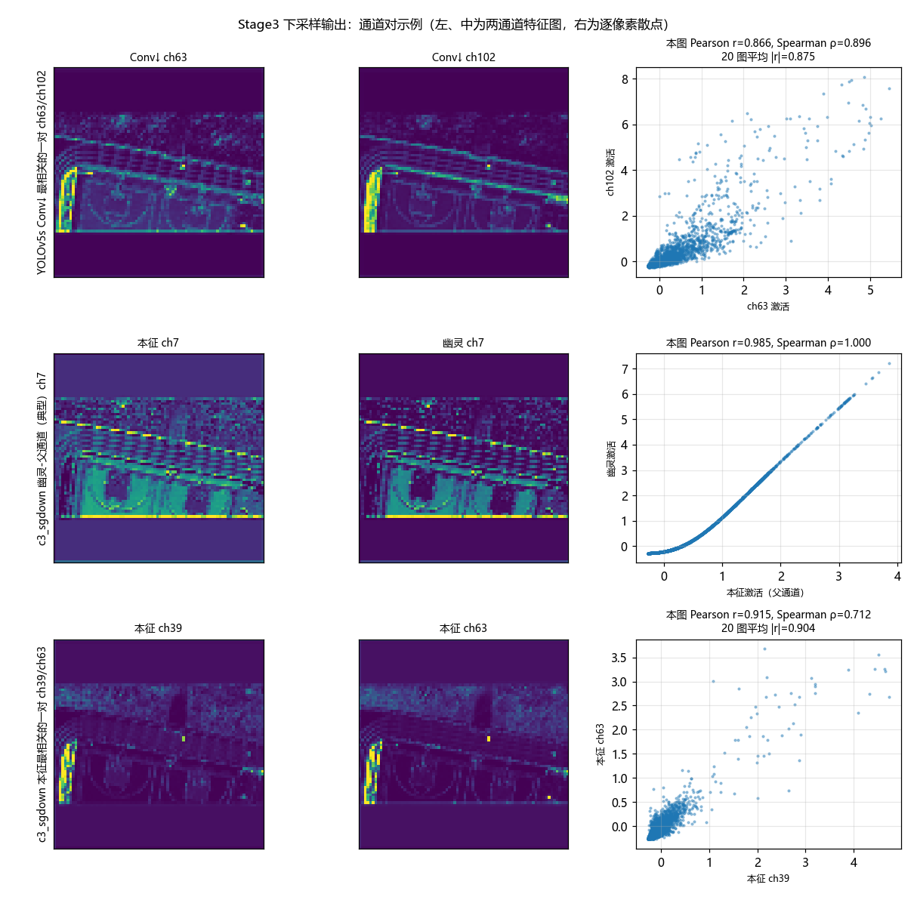
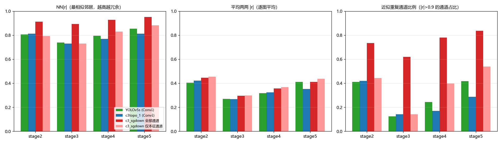
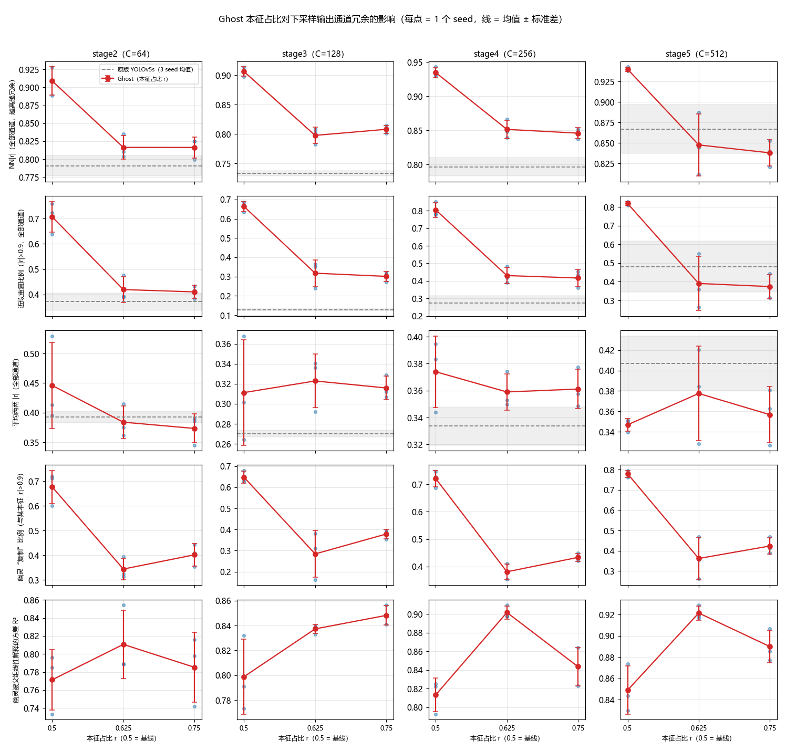

# SGC-YOLOv5 特征图可视化与冗余分析报告

| 项目 | 内容 |
|:--|:--|
| 工程目录 | `experiments/detection/project2_2611` |
| 分析对象 | `sgc_yolov5s_c3_sgdown_gbot_dw5`（run `2026-11-13_029_SGC_c3_sgdown_gbot_dw5_s_V1`，test mAP50 0.788）；对照 `c3_sgdown`、`c3topo_1`、YOLOv5s |
| 数据集 | Det_Fly（单类 `drone`），test 1501 张，输入 640×640 |
| 分析时间 | 2026-11-16 ～ 2026-11-18 |
| 报告日期 | 2026-11-17（2026-11-18 更新：补充本征占比消融与原版 YOLOv5s 参照，修正 3 seed 精度差距） |
| 代码状态 | 训练队列与结构开关已提交 `2cfa8df` 并推送 main；本报告涉及的分析脚本尚未入库（未跟踪） |

> **口径说明**：精度为 test 集结果。计算量为卷积 MACs（`profile_ghost.py`，只统计 Conv2d，不含 BN、SiLU、池化、上采样）：本模型 5.29 G，前期 thop 口径为 5.40 G。“分位”指某统计量在同一张图全部格子中的百分位（越高越突出）。“RMS”为通道均方根能量 `sqrt(mean_c x²)`。

---

## 1. 摘要

- **幽灵分支的性质由廉价卷积核决定。** `dw=1` 的幽灵（所有下采样幽灵与 SG1）与父通道的平均 |r| 为 0.88（范围 0.81–0.90），Spearman |ρ| 接近 1。它是父通道的逐点单调函数（推理时等价于 SiLU(α·父+β)），不引入新的空间信息。`dw=5` 的幽灵（SG2）平均 |r| 为 0.44（0.32–0.67），做了真实的空间变换。
- **SGhost 下采样的近似重复是结构性的。** `c3_sgdown` 在 stage3–5 的近似重复比例（|r|>0.9 的通道占比）为 0.62–0.84；YOLOv5s 为 0.12–0.42；`c3topo_1` 为 0.14–0.29。去掉幽灵父对、只看本征通道，重复比例降为 0.14–0.54，说明重复几乎全部来自幽灵–父对。三个模型的平均两两 |r| 都在 0.27–0.45，对这一差异不敏感。
- **P4 上“SDGhost 把目标响应压没了”主要是通道均值的抵消造成的。** 按通道 RMS 看，本模型块输出相对下采样的中位变化为 −0.02，60 张小目标图中**没有一张下降超过 0.3**（YOLOv5s 为 2%，`c3topo_1` 为 0%）。“时好时坏”来自目标位置通道的符号混杂，表现随图像内容变化。
- **P4 的结构性弱点在门控 Ghost 路径。** 目标能量主要由残差 3×3 DW 支路携带（RMS 分位中位 0.83–0.86），门控 Ghost 路径（SG2）在目标处的能量分位只有 0.44–0.76。
- **CBAM 的“红环白体”来自 SAM 的反向空间门控，但 SAM 只是放大器。** SAM 的 7×7 核在平均分支上的权重和为 −3.5，中心 3×3（在 P3 上约 24 px，恰好覆盖 14–24 px 目标）权重更负。框内注意力是全图最低（分位 0.00），外圈比框内高约 19%。CBAM 把框内−外圈对比度从 +5.2 降到 +4.3（−17%），仅 2% 的图外圈超过本体。CBAM 之前，P3 上已有 43% 的通道“外圈 ≥ 本体”（YOLOv5s 无 CBAM 时为 64%）。
- **推理期替换 SAM 无法评估它的作用。** P3 的 SAM 置 1 后 test mAP50 为 0.107；保留全图均值（尺度不变）后为 0.187。训练好的检测头已与 SAM 的输出分布联合适配，只能靠重训 CAM-only 回答。
- **小目标决定整体精度。** 测试集 91% 的 GT 面积小于 24²。本模型与 YOLOv5s 的整体差距（0.788 vs 0.805）几乎全部来自这一档（0.768 vs 0.794）。
- **Ghost 的速度代价来自算子数量，不是乘加次数。** Ghost 瓶颈只占约 19% 的卷积 MACs，但本模型 GPU 延迟是 YOLOv5s 的 2.2 倍（19.9 vs 9.2 ms）。每次前向的算子调用为 2320 次（YOLOv5s 为 1046 次）。
- **本征占比（ratio）消融的冗余对比（含原版 YOLOv5s 参照，5.8 节）。** 本征占比从 0.5 增至 0.625 / 0.75 后，幽灵的复制比例（与某本征 |r|>0.9）从 0.65–0.78 降到 0.28–0.43，全部通道的近似重复比例在 stage3–5 从 0.66–0.82 降到 0.30–0.43，与原版 YOLOv5s（Conv↓，3 seed，0.13–0.48）接近。但幽灵仍可被父组线性解释（R² 0.79–0.92），冗余从“复制”变成了“组合”。3 seed 下 test mAP50 为 0.766 ± 0.020（基线）、0.773 ± 0.004、0.777 ± 0.007，原版 YOLOv5s 为 0.808 ± 0.003。提高占比几乎没有精度收益，参数增加 8–15%。
- **精度差距需要修正。** 前期“只低 1.7 点”基于单个 seed。按 3 seed 均值，本模型基线与原版 YOLOv5s 相差 4.2 点（0.766 vs 0.808）。
- **已完成与待办**：特征图可视化、通道冗余统计、P4/CBAM 诊断、分桶 AP、算力与延迟分析均已完成。8 个训练 run 的队列与结构开关已推送 main，尚未在服务器运行。既有 `feature_maps` 中的 overview 与块分解图是通道均值版本，需要用 RMS 版重新生成。

---

## 2. 背景与问题

SGC-YOLOv5 用 SGhost 下采样与 Ghost 瓶颈替代了 YOLOv5s 的大部分稠密卷积：本模型参数 4.74 M（YOLOv5s 为 7.02 M），卷积 MACs 5.29 G。前期单 seed 结果显示精度只低 1.7 点（3 seed 均值差距为 4.2 点，见 5.8），但参数减少的同时，特征层面发生了什么并不清楚。本轮分析依次回答以下问题：

1. 幽灵通道是否提供新的信息？`dw=1` 与 `dw=5` 的幽灵性质是否不同？
2. SGhost 下采样造成的通道冗余，与 YOLOv5 的 Conv 下采样、稠密瓶颈相比是否更严重？
3. SDGhost 在 P4 上是否压制小目标响应？这种现象是否稳定、是否正常、能否修复？
4. CBAM 之后，目标周围为什么变“红”、本体为什么变“淡”？
5. 这些特征层现象与小目标精度、推理速度是什么关系？

---

## 3. 对象与设置

### 3.1 模型

| 模型 | 配置 | 参数量 | test mAP50 | 说明 |
|:--|:--|--:|--:|:--|
| 本模型 | `sgc_yolov5s_c3_sgdown_gbot_dw5` | 4.74 M | 0.788（seed 42）；3 seed 0.766 ± 0.020 | SGhost↓ + Ghost 瓶颈（mid_dw=5），40 ep |
| 本模型，本征占比 0.625 | `sgc_yolov5s_c3_sgdown_gbot_dw5_ir0625` | 5.12 M | 3 seed 0.773 ± 0.004 | 本征占比消融（5.8 节） |
| 本模型，本征占比 0.75 | `sgc_yolov5s_c3_sgdown_gbot_dw5_ir075` | 5.45 M | 3 seed 0.777 ± 0.007 | 本征占比消融（5.8 节） |
| c3_sgdown | `sgc_yolov5s_c3_sgdown` | 5.33 M | 0.783 | SGhost↓ + 稠密瓶颈 |
| c3topo_1 | `sgc_yolov5s_c3topo_1` | 6.11 M | 0.799 | Conv↓ + 稠密瓶颈（C3 拓扑） |
| YOLOv5s（40 ep） | `yolov5s`（V3 + seed 43/44） | 7.02 M | 0.808 ± 0.003（3 seed；seed 42 为 0.805） | 原版 YOLOv5，同预算对照（本报告采用 3 seed 均值） |
| YOLOv5s（100 ep） | `yolov5s`（V1） | 7.02 M | 0.849 | 长训练参考，不与 40 ep 直接比较 |

本模型与 YOLOv5s（40 ep）的整体指标由 `size_ap_eval.py` 复现，结果为 0.7879 与 0.8054，与前期报告一致。

### 3.2 样本

| 分析 | 样本 | 备注 |
|:--|:--|:--|
| 特征图示例 | `0100015`、`0100061`（test） | 2 张，单目标 |
| 幽灵统计 | test 随机 50 张 | `--stats-num 50`，seed 0 |
| 通道冗余 | test 随机 20 张 | 逐图计算后平均 |
| P4 / CBAM 诊断 | 小目标 60 张（框 14–24 px）+ 中等 30 张（40–70 px） | 单目标图，seed 0 |
| 分桶 AP | test 1501 张 | 全部 |

---

## 4. 方法

### 4.1 特征图可视化（`visualize_features.py`）

- 对象：`sgc_yolov5s_c3_sgdown_gbot_dw5`，`best.pth`，test 图像 `0100015`、`0100061`。
- 面板：overview（P2–P5 下采样与 SDGhost 输出、N3–N5 的 CBAM 后）；Stage3 第 1 个 Ghost 瓶颈的块内分解（cv1、SG1 本征/幽灵、DFC 门控、x1·x2、SG2 本征/幽灵、残差 DW、块输出）；幽灵–本征通道对的散点图。
- 幽灵统计：对每个 Ghost 卷积，逐图计算第 i 个本征通道与第 i 个幽灵通道沿空间的 Pearson r，取 |r| 的平均（mean|r|）。“幅值比” = mean|幽灵| / mean|本征|。50 张随机测试图平均。
- **叠加口径的修改**：overview 与块分解面板原先按**通道均值**叠加，通道均值会把正负通道的响应抵消掉。本次分析后改为**通道 RMS 能量**。幽灵统计（相关性、幅值比）不受影响。既有 `0100015_*`、`0100061_*` 图片生成于 2026-11-16，仍是通道均值版本，需要重新生成。
- 工程细节：Windows 下图片被其它程序占用会导致写入失败，`save_fig` 已改为临时文件 + 原子替换 + 重试。

### 4.2 通道冗余指标（`redundancy_analysis.py`）

对 stage2–5 的下采样输出（`backbone.stage{k}.0`）逐图计算后平均（20 张测试图）：

- **mean|r|**：所有通道对 |r| 的平均；
- **NN|r|**：每个通道与其它通道的最大 |r|（最近邻），再对通道平均；
- **dup%**：NN|r| > 0.9 的通道占比（近似重复比例）；
- 对 `c3_sgdown` 另区分幽灵–父对与本征通道：幽灵–父 r²、Spearman |ρ|、单调比例（|ρ| > 0.99）。

### 4.3 P4 与 CBAM 诊断（`diagnose_p4_cbam.py`）

- **分位**：GT 框内均值在全图格子中的分位（P4 为 40×40 格，P3 为 80×80 格）。
- **对比度**：（框内均值 − 外圈均值）/ 全图标准差；外圈为框外一圈格子。
- **通道 RMS**：分位与对比度同时用通道均值图和 RMS 能量图计算。
- **CBAM**：分别统计 CBAM 前、CAM 之后、SAM 注意力、CBAM 之后。SAM 注意力按 `sigmoid(conv7×7([mean_c, max_c]))` 复算，与前向一致。另统计逐通道“外圈均值 > 框内均值”的比例。
- **卷积核**：SAM 7×7 核的权重和与中心/外圈结构；瓶颈内 3×3 卷积核的符号统计。

### 4.4 分桶 AP（`size_ap_eval.py`）

- 整体指标与 `evaluate()` 同口径（`process_batch` + `summarize_stats`）。复现结果：本模型 mAP50 0.7879，YOLOv5s 0.8054，与前期报告（0.788、0.805）一致。
- 分桶按 GT 面积（640 输入上的 w·h）划分：<24²、24²–32²、32²–96²、≥96²。区间外的 GT 视为忽略（COCO 式），匹配规则与整体评估一致（YOLO 式 IoU 贪心）。
- 推理期消融：`no_sam_p3`（P3 的 SAM 置为恒等）与 `flat_sam_p3`（P3 的 SAM 替换为全图均值）。

### 4.5 算力与延迟

- `profile_ghost.py`：逐 Conv2d 统计 MACs（输出元素数 × Cin/groups × kh × kw）与参数，按结构类别和输出分辨率汇总。
- `profile_ops.py`：用 `torch.profiler` 统计每次前向的算子调用次数与耗时（GPU、CPU）。
- `bench_latency.py`：batch=1、640×640、随机输入，取中位延迟。GPU 为 RTX 3060 Laptop，CPU 为 14 线程。

---

## 5. 结果

### ✅ 5.1 幽灵分支的性质：`dw=1` 与 `dw=5` 不同

| 分组 | 层数 | mean\|r\|（范围） | 幅值比（范围） | 含义 |
|:--|--:|:--|:--|:--|
| dw=1（下采样幽灵 + SG1） | 11 | 0.88（0.81–0.90） | 0.91–1.16 | 父通道的逐点单调函数，近似复制 |
| dw=5（SG2） | 7 | 0.44（0.32–0.67） | 0.83–1.20 | 有空间变换，与本征差异较大 |

- `dw=1` 的幽灵卷积是 1×1 逐通道卷积（每通道一个标量），之后接 BN 与 SiLU。因此幽灵通道 ≈ SiLU(α·父通道 + β)，没有空间混合。图 2 中 `c3_sgdown` 的幽灵通道 ch7 与父通道的散点几乎落在一条曲线上（r = 0.985，ρ = 1.000）。
- `dw=5` 的幽灵是 5×5 深度卷积，对父通道做了真实的空间变换，与父通道的相关只有 0.32–0.67。
- 幅值比在 0.8–1.2 之间，幽灵与本征通道的激活量级相当，所以幽灵既不是噪声也不是被抑制的分支。

### ✅5.2 通道冗余的跨模型对比

| stage（C） | mean\|r\|：YOLOv5s / c3topo_1 / c3_sgdown | NN\|r\|：YOLOv5s / c3topo_1 / c3_sgdown | dup%：YOLOv5s / c3topo_1 / c3_sgdown |
|:--|:--|:--|:--|
| stage2（64） | 0.40 / 0.42 / 0.44 | 0.81 / 0.81 / 0.91 | 0.41 / 0.42 / 0.73 |
| stage3（128） | 0.27 / 0.27 / 0.30 | 0.74 / 0.73 / 0.89 | 0.12 / 0.14 / 0.62 |
| stage4（256） | 0.32 / 0.32 / 0.36 | 0.80 / 0.77 / 0.93 | 0.24 / 0.17 / 0.78 |
| stage5（512） | 0.41 / 0.35 / 0.41 | 0.85 / 0.81 / 0.95 | 0.42 / 0.29 / 0.84 |

> 这里是不是不对劲? 按道理来说ghost就是来降低冗余度的, 降低相关性的

`c3_sgdown` 中本征通道与全部通道的对比：

| stage | mean\|r\| 全部 / 仅本征 | dup% 全部 / 仅本征 | 幽灵–父 Spearman \|ρ\| | 单调比例（\|ρ\|>0.99） | 幽灵–父 r² |
|:--|:--|:--|--:|--:|--:|
| stage2 | 0.44 / 0.45 | 0.73 / 0.44 | 0.93 | 0.47 | 0.81 |
| stage3 | 0.30 / 0.30 | 0.62 / 0.14 | 0.97 | 0.50 | 0.79 |
| stage4 | 0.36 / 0.37 | 0.78 / 0.40 | 0.99 | 0.79 | 0.82 |
| stage5 | 0.41 / 0.44 | 0.84 / 0.54 | 0.99 | 0.84 | 0.83 |

- **平均两两 |r| 不能区分冗余**：`c3_sgdown` 全部通道与仅本征通道的平均几乎相同（stage3：0.297 vs 0.298）。平均是对所有通道对取值，绝大多数通道对本来就不相关，幽灵只改变了与父通道的 C 对，对平均影响很小。
- **近似重复比例能区分**：stage3 中 `c3_sgdown` 的重复比例为 0.62，只看本征通道时为 0.14，重复几乎全部来自幽灵–父对。因为每个幽灵都与一个父通道一一对应，最近邻的 |r| 往往就是这一对。
- **YOLOv5 的 Conv↓ 也有较高相关**：stage2 与 stage5 的重复比例为 0.41–0.42。“高相关”不是 SGhost 独有的。SGhost 的特殊之处在于把冗余做成了结构化的一一对应。
- **与精度的关系**：`c3_sgdown` 相对 `c3topo_1` 的 mAP50 下降 1.6 点（0.783 vs 0.799），同时减少 0.78 M 参数与 0.94 GMACs。这说明幽灵通道的宽度是冗余的，但冗余并未直接造成精度损失。

> 这里也是? 感觉加了ghost就是冗余了

### 5.3 P4：SDGhost 对小目标的响应

**块输出相对下采样的变化（小目标，60 张）：**

| 模型 | 通道均值：中位 / 下降 >0.3 的图 | 通道 RMS：中位 / 下降 >0.3 的图 |
|:--|:--|:--|
| 本模型（SGhost↓ + Ghost 瓶颈） | −0.02 / 5% | −0.02 / **0%** |
| c3topo_1（Conv↓ + 稠密瓶颈） | −0.06 / 3% | −0.03 / 0% |
| YOLOv5s（C3） | −0.14 / 18% | −0.12 / 2% |

**各节点 RMS 分位中位数（括号内为 ≥ 0.9 的比例）：**

| 节点 | 本模型 | c3topo_1 | YOLOv5s |
|:--|:--|:--|:--|
| P4 下采样 | 0.94（65%） | 0.97（77%） | 0.94（67%） |
| 恒等支路 cv2 | 0.95（62%） | 0.97（83%） | 0.95（70%） |
| 瓶颈#0 输出 | 0.85（42%） | 0.92（53%） | 0.80（10%） |
| 瓶颈#1 输出 | 0.76（22%） | 0.88（38%） | 0.74（0%） |
| 瓶颈#2 输出 | 0.84（37%） | 0.83（33%） | 0.74（2%） |
| 块输出 | 0.89（48%） | 0.92（53%） | 0.80（10%） |

**本模型 Ghost 瓶颈内部（RMS 分位中位数）：**

| 路径 | 瓶颈#0 | 瓶颈#1 | 瓶颈#2 |
|:--|--:|--:|--:|
| 残差 3×3 DW 支路 | 0.86 | 0.83 | 0.85 |
| SG1 输出 x1 | 0.91 | 0.83 | 0.79 |
| 门控 x2（DFC） | 0.38 | 0.44 | 0.58 |
| SG2 输入 x1·x2 | 0.91 | 0.83 | 0.80 |
| SG2 输出 | 0.44 | 0.62 | 0.76 |
| 瓶颈输出 | 0.85 | 0.76 | 0.84 |

结论如下：

1. **通道均值的抵消是主要的表观来源。** 块内特征是 BN+SiLU 的输出，正负通道混杂。例如瓶颈#2 的 SG1 输出，通道均值分位只有 0.22，但 RMS 分位是 0.79。同一位置的能量并不低，只是正负通道相互抵消，均值变低。
2. **“下采样有、SDGhost 后没有”的图，多为部分下降而不是消失。** 最差的例子是 `0100233`：下采样的均值分位为 0.95，块输出为 0.40，但 RMS 分位从 0.89 降到 0.68（见下图）。
3. **目标能量主要由残差 DW 支路携带。** 门控 Ghost 路径（SG2）的目标能量分位只有 0.44–0.76。门控 x2 在目标处略低（0.38–0.58），但其数值在前期统计中只在 0.46–0.54 之间变化，对幅值的影响有限。
4. **“时好时坏”与局部对比度有关。** 瓶颈输出分位与其输入的局部对比度呈正相关：本模型瓶颈#0 的 ρ = +0.74，`c3topo_1` 为 +0.52 至 +0.86。`c3topo_1` 的依赖甚至更强，因此这不是 SDGhost 特有的性质。目标与背景的对比随图像变化，响应就随之变化。
5. **P4 对 16 px 以上的目标有实际意义。** P4 步长为 16，14–24 px 的目标在 P4 上只占 1–2 个格。按 YOLOv5 的宽高比匹配规则（阈值 4）和 COCO 默认锚框（P4 为 30×61、62×45），约 16 px 以上的方形目标同时在 P3 与 P4 分配正样本，14–15 px 的目标只在 P3 分配。
6. **现有证据不支持 SDGhost 在 P4 上系统性压制小目标能量。** 更稳妥的判断口径是 RMS 能量加上分桶 AP。是否需要结构改动，取决于 16–24 px 目标的 AP 损失是否显著。这一点目前没有直接证据，需要把 <24² 再细分后验证（见第 10 节）。

### 5.4 CBAM 的“红环白体”

**SAM 与 CBAM 的统计（小目标，60 张）：**

| 指标 | 本模型 | c3topo_1 | YOLOv5s（无 CBAM） |
|:--|:--|:--|:--|
| SAM 注意力：框内 / 外圈的全图分位（中位） | 0.00 / 0.11 | 0.00 / 0.10 | — |
| SAM 注意力：外圈均值 / 框内均值（中位） | 1.19 | 1.19 | — |
| SAM 注意力：外圈均值 > 框内均值的图 | 100% | 97% | — |
| SAM 注意力与颈部特征的秩相关（中位） | −0.88 | −0.60 | — |
| 框内−外圈对比度（÷全图标准差）：CBAM 前 → 后 | +5.22 → +4.32 | +7.44 → +6.26 | −0.69（CBAM 前） |
| 外圈 > 框内的通道比例：CBAM 前 → 后 | 43% → 45% | 40% → 40% | 64%（CBAM 前） |
| 外圈均值 > 框内均值的图：CBAM 后 | 2% | 2% | 88%（CBAM 前） |

**SAM 7×7 核的权重：**

| 模型 | 平均分支权重和 | 中心 3×3 / 外圈均值 | 最大分支权重和 | 中心 3×3 / 外圈均值 |
|:--|--:|:--|--:|:--|
| 本模型 | −3.48 | −0.112 / −0.062 | +0.15 | −0.030 / +0.011 |
| c3topo_1 | −4.21 | −0.119 / −0.078 | +0.24 | −0.033 / +0.014 |

机制如下：

1. **SAM 是反向的空间门控。** 平均分支的权重和为负，中心 3×3 比外圈更负。亮的区域得到低注意力，周围相对得到高注意力。注意力与颈部特征的秩相关为 −0.88，呈强烈的反向关系。
2. **核的尺度恰好与小目标匹配。** P3 步长为 8，7×7 核的中心 3×3 覆盖约 24 px，正好是 14–24 px 目标的尺度。目标本体落在负权重的中心，因此框内注意力是全图最低（分位 0.00）。外圈落在较弱的负权重上，所以外圈比框内高约 19%。下方的 SAM 核图（左列为平均分支）展示了这一结构。
3. **两个模型学到的核结构相同。** 本模型与 `c3topo_1` 的核都呈现“中心更负”的结构，说明这是 CBAM/SAM 在该数据上的学习结果，不是 SGhost 的特有现象。
4. **CAM 不产生空间结构。** CAM 只做通道加权，前后的分位几乎不变（框内 1.00 → 1.00，外圈 0.93 → 0.93）。

**SAM 是放大器，不是唯一来源。**

- CBAM 之前，本模型 P3 上已有 43% 的通道是“外圈 > 本体”，YOLOv5s 无 CBAM 时为 64%。小目标在 P3 只占 2–3 格，边缘型响应本身就容易超过本体。
- 最差的例子是 `0204652`：CBAM 前框内 0.96、外圈 0.97；CBAM 后框内 0.95、外圈 0.97。这张图的“外圈 ≥ 本体”在 CBAM 之前就已存在，SAM 只是略微加重。
- 因此，SAM 把对比度压低约 17%，使约 2% 的图外圈超过本体，并让原本存在的红环变得可见。

### 5.5 分桶 AP 与推理期消融

| 模型 | 整体 mAP50 | 整体 mAP50-95 | <24²（1362 个 GT）AP50 / AP50-95 | 24²–32²（66 个）AP50 / AP50-95 | 32²–96²（73 个）AP50 / AP50-95 |
|:--|--:|--:|:--|:--|:--|
| 本模型（40 ep） | 0.788 | 0.470 | 0.768 / 0.446 | 0.988 / 0.676 | 0.951 / 0.755 |
| YOLOv5s（40 ep） | 0.805 | 0.494 | 0.794 / 0.469 | 0.906 / 0.636 | 0.986 / 0.774 |
| 本模型，P3 的 SAM 置 1 | 0.107 | 0.041 | 0.265 / 0.105 | 0.271 / 0.109 | 0.023 / 0.012 |
| 本模型，P3 的 SAM 取全图均值 | 0.187 | 0.085 | 0.521 / 0.240 | 0.652 / 0.246 | 0.034 / 0.019 |

- 测试集 91% 的 GT 面积小于 24²，整体 AP 基本就是小目标 AP。本模型与 YOLOv5s 的整体 AP50 差 −1.7 点（单 seed 对比：0.788 对 0.805），其中 <24² 档的 AP50 差 −2.7 点，是整体差距的主要来源。3 seed 下的精度差距见 5.8。
- 24²–32² 档上本模型高 8 点，但只有 66 个 GT，不可靠。
- 推理期替换 SAM 后，两种方式都从 0.79 崩到 0.1–0.2。训练好的检测头依赖 SAM 输出的具体分布（尺度和空间模式都关键）。因此推理期替换既不等价于 CAM-only，也说明不了 SAM 是否有害，只能靠重训回答。

### 5.6 算力分布、算子与延迟

**卷积 MACs 的结构分解（本模型，5.29 G）：**

| 部分 | MACs | 占比 |
|:--|--:|--:|
| 颈部 1×1 / DW 卷积（33 层） | 1.165 G | 22.0% |
| 下采样 SGhost 主卷积（3×3 s2，4 层） | 0.944 G | 17.8% |
| 颈部稠密 3×3（GSConv 等，6 层） | 0.708 G | 13.4% |
| 骨干 CSP 稠密 1×1 投影（12 层） | 0.839 G | 15.9% |
| SG2 3×3 主卷积（7 层） | 0.826 G | 15.6% |
| stem 6×6 + stage5 其它 | 0.354 G + 0.262 G | 11.7% |
| SG1、DFC、残差 DW、SG2 幽灵 | 0.093 + 0.045 + 0.029 G | 3.2% |
| 检测头 | 0.026 G | 0.5% |

按输出分辨率：P4（40×40）占 34.1%，P5（20×20）占 25.2%，P3（80×80）占 22.7%，P2（160×160）占 11.4%，stem（320×320）占 6.7%。Ghost 瓶颈整体约占 19%。

**延迟（batch=1，640×640，随机输入，中位数，不含 NMS）：**

| 模型 | 参数 | GPU 延迟（FPS） | CPU 延迟（FPS） |
|:--|--:|:--|:--|
| YOLOv5s（40 ep） | 7.02 M | 9.2 ms（109） | 104 ms（9.6） |
| c3topo_1（Conv↓ + 稠密瓶颈） | 6.11 M | 14.0 ms（71） | 116 ms（8.6） |
| c3_sgdown（SGhost↓ + 稠密瓶颈） | 5.33 M | 14.9 ms（67） | 125 ms（8.0） |
| c3_ghostbot_dw7（Conv↓ + Ghost 瓶颈） | 5.53 M | 18.8 ms（53） | 152 ms（6.6） |
| 本模型（SGhost↓ + Ghost 瓶颈 dw5） | 4.74 M | 19.9 ms（50） | 155 ms（6.5） |
| 本模型 + proj=ghost（随机初始化，仅测速） | 4.39 M | 22.1 ms（45） | 154 ms（6.5） |

由此可以拆出各部分的代价：

- **Ghost 瓶颈**（7 个）：GPU 增加约 5 ms（每个约 0.7 ms），CPU 增加约 30–36 ms。
- **SGhost 下采样**：GPU 增加 0.9 ms，CPU 增加约 9 ms。
- **投影改为 GBS（proj=ghost）**：GPU 增加 2.2 ms，CPU 持平。因此此前把它列为优先方案是错误的（见第 7 节）。

**算子层面的统计（每次前向）：**

| 项目 | YOLOv5s | 本模型 | c3topo_1 |
|:--|--:|--:|--:|
| 叶子模块数 | 176 | 332 | 236 |
| GPU 算子调用次数 | 1046 | 2320 | 1545 |
| CPU 算子调用次数 | 1456 | 2812 | 2024 |

- GPU 上耗时最大的算子：本模型为 `cudnn_batch_norm`（9.2 ms，94 次）、`aten::empty`（内存分配，4.9 ms，478 次）、卷积（5.1 ms，63 次）、深度卷积（2.7 ms，51 次）、SiLU（2.3 ms，94 次）、`cat`（1.9 ms，53 次）。卷积本身只占约 1/4。
- CPU 上最大的开销是 `mkldnn_convolution`：本模型 81.3 ms、114 次，YOLOv5s 为 63.9 ms、60 次。此外，SiLU（14.6 ms）、BN（10.1 ms）、`cat`（8.1 ms）和通道洗牌（2.8 ms）也很明显。

结论：**Ghost 结构的速度代价主要来自算子数量与访存（BN、SiLU、拼接、洗牌、内存分配），不是乘加次数。** 只减少 MACs，对 GPU 延迟的收益有限。

### 5.7 训练队列与结构开关（部分已完成）

- 为回答 CBAM、DFC、残差结构的问题，新增三个开关：`cbam_mode`（`full` / `cam_p3` / `none`）、`use_dfc`、`res_type`（`dw` / `identity`）。默认行为不变：旧 checkpoint 严格加载，参数量 4.739 M。
- 待训练的 8 个 run（均为 40 ep）：噪声基线 4 个（本模型与 YOLOv5s 的 seed 43 / 44），结构消融 4 个（seed 42：CBAM 全去、P3 去 SAM、去 DFC、残差改恒等）。
- 已提交 `2cfa8df` 并推送 main。噪声基线（本模型 seed 43/44）与结构消融（seed 42）已训练完成，其中“无 DFC + 无 CBAM”因误用小数据集而无效，需要重训（见 `record.md`）。

---

### 5.8 本征占比消融的通道冗余对比（含原版 YOLOv5s 参照）

**设置**：`c3_sgdown_gbot_dw5` 的 Ghost 本征占比 r = 0.5（基线，`ratio=2`）、0.625、0.75，各 3 个 seed（42/43/44），共 9 个 run。原版 YOLOv5s（Conv↓，无 Ghost）3 个 seed 作为参照。同一批 20 张 test 图，指标口径与 5.2 相同（逐图计算后平均，表中为 3 seed 均值）。完整数字见 `record.md` 的“通道冗余对比”一节与 `redundancy_ir/ir_redundancy.json`。

**表 5.8-1 全部通道（三组通道数相同，可直接比较）**

| 模型 | 参数量 (M) | test mAP50（3 seed） | dup%：s2 / s3 / s4 / s5 | NN\|r\|：s2 / s3 / s4 / s5 | mean\|r\|：s2 / s3 / s4 / s5 |
|:--|--:|:--|:--|:--|:--|
| YOLOv5s（原版，Conv↓） | 7.02 | 0.808 ± 0.003 | 0.37 / 0.13 / 0.27 / 0.48 | 0.79 / 0.73 / 0.80 / 0.87 | 0.39 / 0.27 / 0.33 / 0.41 |
| 本模型，r = 0.5（基线） | 4.74 | 0.766 ± 0.020 | 0.71 / 0.66 / 0.80 / 0.82 | 0.91 / 0.91 / 0.93 / 0.94 | 0.45 / 0.31 / 0.37 / 0.35 |
| 本模型，r = 0.625 | 5.12 | 0.773 ± 0.004 | 0.42 / 0.32 / 0.43 / 0.39 | 0.82 / 0.80 / 0.85 / 0.85 | 0.38 / 0.32 / 0.36 / 0.38 |
| 本模型，r = 0.75 | 5.45 | 0.777 ± 0.007 | 0.41 / 0.30 / 0.42 / 0.37 | 0.82 / 0.81 / 0.85 / 0.84 | 0.37 / 0.32 / 0.36 / 0.36 |

**表 5.8-2 幽灵分支的父组结构（仅 Ghost 模型）**

| 本征占比 r | 父组结构（本征 → 幽灵） | copy_frac：s2 / s3 / s4 / s5 | R2_group：s2 / s3 / s4 / s5 |
|:--|:--|:--|:--|
| 0.5 | 1 → 1（深度卷积，单父） | 0.68 / 0.65 / 0.72 / 0.78 | 0.77 / 0.80 / 0.81 / 0.85 |
| 0.625 | 5 → 3（分组卷积） | 0.34 / 0.28 / 0.38 / 0.36 | 0.81 / 0.84 / 0.90 / 0.92 |
| 0.75 | 3 → 1（分组卷积） | 0.40 / 0.38 / 0.43 / 0.42 | 0.79 / 0.85 / 0.84 / 0.89 |

`copy_frac`：幽灵与任一本征通道 |r|>0.9 的比例。`R2_group`：幽灵被其父组线性回归解释的方差比例（单父时等于 r²）。原版 YOLOv5s 没有幽灵，不适用。

**结论**

1. **基线（r = 0.5）的冗余明显高于原版 YOLOv5s。** stage3–5 的近似重复比例为 0.66–0.82，原版为 0.13–0.48；NN|r| 0.91–0.94 也高于原版的 0.73–0.87。这与 5.2 的单 seed 结论一致，3 seed 下差距更稳定。
2. **提高本征占比后，冗余回到原版水平。** r = 0.625 / 0.75 时 dup 为 0.30–0.43，NN|r| 为 0.80–0.85，与原版的区间重叠。stage3 仍略高于原版（0.30–0.32 对 0.13）。原版 stage5 的 dup 本身方差很大（0.48 ± 0.135），单个 seed 的冗余差异不能只看均值。
3. **“复制”减少，但“可线性预测”仍然很高。** copy_frac 从 0.65–0.78 降到 0.28–0.43，而幽灵被父组线性解释的 R² 反而达到 0.79–0.92（r = 0.625 时 stage4–5 最高）。冗余从单通道复制变成多通道组合，仅靠提高本征占比不能消除。
4. **mean|r| 在四组之间几乎相同**（0.31–0.45，且没有单调关系），再次说明平均两两 |r| 无法区分结构性冗余。
5. **冗余下降没有带来精度收益，与原版的差距仍然存在。** 3 seed 均值：基线 0.766 ± 0.020，r = 0.625 为 0.773 ± 0.004，r = 0.75 为 0.777 ± 0.007，原版为 0.808 ± 0.003。三组 Ghost 模型与原版的差距为 3.1–4.2 点。提高占比带来的增益（+0.7 至 +1.1 点）小于基线的 seed 标准差（0.020），不构成显著提升。参数量相对基线增加 8%（0.625）和 15%（0.75），但仍比原版少 22–27%。
6. **混杂因素**：本征通道数随 r 增加（stage3：64 → 80 → 96），copy 与 NN 对候选数量敏感；参数量与卷积结构同时变化；只用 20 张图、3 个 seed。

---

## 6. 结论

1. **幽灵分支的性质由廉价核决定。** `dw=1` 的幽灵是父通道的逐点单调函数（|r| ≈ 0.88，|ρ| ≈ 1），不引入新的空间信息；`dw=5` 的幽灵有真实的空间变换（|r| ≈ 0.44）。
2. **SGhost 下采样的重复是结构性的。** `c3_sgdown` 在 stage3–5 的近似重复比例为 0.62–0.84，几乎全部来自幽灵–父对。平均两两 |r| 无法区分这一差异，应使用最近邻 |r| 与重复比例。
3. **Conv 下采样也有较高相关。** YOLOv5s 在 stage2、stage5 的重复比例为 0.41–0.42。SGhost 的不同之处在于把冗余做成了一一对应的父–幽灵结构。
4. **P4 的“压制”主要是通道均值的抵消。** 按 RMS 能量看，SDGhost 的块输出没有系统性损失（60 张中无一下降超过 0.3）。目标能量主要由残差 DW 支路携带，门控 Ghost 路径对目标的选择性较弱。
5. **P4 的响应依赖目标与周围的局部对比。** 这是“时好时坏”的来源，`c3topo_1` 的依赖更强，因此不是 SDGhost 特有的。
6. **CBAM 的红环来自 SAM 的反向空间门控。** SAM 核的权重和为负，中心 3×3 的尺度与小目标匹配，框内注意力为全图最低。CAM 不产生空间结构。SAM 把对比度降低约 17%，但 CBAM 之前 P3 上已有 43% 的“外圈 ≥ 本体”通道，所以 SAM 是放大器而非唯一来源。
7. **小目标决定整体精度，SAM 的作用只能靠重训评估。** 91% 的 GT 面积小于 24²。推理期替换 SAM 得到 0.107 与 0.187 的 mAP50，无法用于判断 SAM 是否有害。
8. **Ghost 的速度代价来自算子数量。** 本模型 GPU 延迟是 YOLOv5s 的 2.2 倍（19.9 vs 9.2 ms），Ghost 瓶颈贡献约 +5 ms（GPU）、+30 ms（CPU）。只减少 MACs 不能解决这一问题。
9. **本征占比提高可以把复制型冗余降到原版 YOLOv5s 水平，但不带来精度收益。** 3 seed 下 Ghost 模型仍比原版低 3.1–4.2 点，参数量仍比原版少 22–27%。若要缩小精度差距，需要从别处（而非冗余）入手。

---

## 7. 勘误与修正

以下是对前期对话中说法的更正，以本报告为准：

- “**分支能量**”指的是幽灵与本征通道的平均绝对激活之比，已更名为“**幅值比**”（mean|幽灵| / mean|本征|），不是能量。
- 早期“ghost 使平均 |r| 提高 0.02–0.06”是模型之间的差异（`c3topo_1` 与 `c3_sgdown` 本身就不同）。正确结论是：幽灵不改变平均 |r|，改变的是近似重复比例。
- 早期的冗余统计把不同图像之间的方差混进了相关（合并计算）。改为逐图计算后再平均。
- 参与比（participation ratio）被共模分量主导，已弃用。
- 有符号的轮廓相关接近 0，是因为约一半的幽灵符号翻转。按符号校正后为 0.93–0.95。
- DFC 门控的输出曾被误读为饱和。实际约为 0.5（分位拉伸放大了微小差异），前期统计的 p5–p95 范围为 0.46–0.54。
- **通道均值叠加导致“P4 目标消失”的误判。** overview 与块分解面板已改为 RMS 能量；既有图片需要重新生成。
- 早先引用的 YOLOv5s 0.849 是 100 epoch 的结果。同预算（40 epoch）对照是 0.805（seed 42）；3 seed 均值为 0.808 ± 0.003。
- **前期“精度只低 1.7 点”基于单 seed。** 本模型 seed 42 为 0.788，YOLOv5s V3 为 0.805。按 3 seed 均值，本模型基线为 0.766 ± 0.020，与 YOLOv5s 的 0.808 ± 0.003 相差 4.2 点（见 5.8）。
- 早先把投影改为 GBS 列为优先方案。实测 GPU 增加 2.2 ms、CPU 持平，因此撤回。
- `feature_maps` 中的 overview 与块分解图是通道均值版本（2026-11-16 生成），不能作为 P4 或 CBAM 结论的依据。幽灵统计图和 json 不受影响。

---

## 8. 问过的问题与回答（按时间）

| # | 问题（摘录） | 回答要点 | 章节 |
|:--|:--|:--|:--|
| 1 | 能否对 `sgdown_gbot_dw5` 的一些层进行 Feature Map Visualization，特别是添加了 ghost 的？ | 实现 `visualize_features.py`：overview、块内分解、幽灵通道对与统计，输出在 run 的 `feature_maps/`。 | 4.1 |
| 2 | 分支能量是什么意思？ | 指幽灵与本征的平均绝对激活之比，已更名为“幅值比”，不是能量。 | 5.1 |
| 3 | 为什么 Down 的 ghost 的 dw=1 也是直接复制的？精度下降很少，难道 YOLOv5 的 down 也是较高的相关？`c3topo_1` 与 `c3_sgdown` 呢？ | dw=1 幽灵是父通道的逐点单调函数，是冗余宽度。精度损失小是因为信息集中在父通道。YOLOv5 的 Conv↓ 也有较高相关（重复比例 0.41–0.42），但平均 \|r\| 相近；`c3_sgdown` 的重复比例远高于二者。 | 5.1、5.2 |
| 4 | 要不要增加 YOLOv5 的对比？ | 已加入 YOLOv5s 与 `c3topo_1` 的冗余对比。 | 5.2 |
| 5 | 总结的不好，重新表述。 | 按结论重写摘要与结论。 | 1、6 |
| 6 | 为什么 SGhost 全部通道的平均两两 \|r\| 不怎么变，但与某个通道的 \|r\|>0.9 比例很大？ | 平均对所有通道对取值，绝大多数对不相关，幽灵只改变了与父通道的 C 对。重复比例看的是最近邻，幽灵–父对决定了最大值。去掉幽灵后，重复比例明显下降。 | 5.2 |
| 7 | SDGhost 好像有害：有张图 P4 下采样 GT 还在，SDGhost 之后就没了；时好时坏，不稳定吗？正常吗？怎么解决？ | 通道均值的符号抵消导致表观消失；RMS 口径下没有系统性损失（60 张中无一下降超过 0.3）。响应依赖局部对比，属于 P4 的一般性质。16 px 以上目标在 P4 有正样本。暂不改结构，改用能量口径与分桶 AP 验证。 | 5.3 |
| 8 | 尺寸确实不支持小目标，但为什么 CBAM 之后目标周围变红、本体变淡，刚好反过来？ | SAM 是反向空间门控，核中心的尺度与目标匹配，框内注意力为全图最低。CBAM 之前 P3 上已有 43% 的“外圈 ≥ 本体”通道，SAM 是放大器。推理期替换无法评估 SAM，需要重训 CAM-only。 | 5.4、5.5 |
| 9 | 继续（诊断完成后）。 | 增加 RMS 口径、逐通道统计、最差图逐节点分解、分桶 AP 与推理期消融。 | 5.3–5.5 |
| 10 | 接下来要做什么？如果要继续轻量化，怎么优化 Ghost？ | 先测速与算子剖析，发现瓶颈是算子数而非 MACs。撤回 GBS 投影。优先做等价的减算子（BN 折叠、去 shuffle 与 cat），训练类改动（DFC、残差、CBAM）另行决定。 | 5.6、10 |
| 11 | 需要训练什么？写进脚本并推送 main。 | 8 个 run（噪声基线 4、结构消融 4），开关已实现，提交 `2cfa8df`。 | 5.7、10 |
| 12 | 总结 Feature Map Visualization 到目前的分析结果，写一个新的实验报告。 | 即本报告。 | 全文 |
| 13 | 我训练了六个新的（本征占比 0.625 / 0.75 × 3 seed），帮我可视化和分析通道冗余的对比，结果写入 `record.md`。 | 新增 `redundancy_ir_analysis.py`，用父组映射统计幽灵，结果写入 `record.md`。 | 5.8 |
| 14 | 再补上原版 YOLOv5 的结果上去。 | 原版 YOLOv5s（3 seed）作为参照加入 5.8 的表与图；发现前期“只低 1.7 点”的单 seed 问题，改为 3 seed 均值。 | 5.8、7 |

---

## 9. 局限性

- **样本量小**：小目标 60 张、中等 30 张（单目标图，seed 0）；冗余分析 20 张；幽灵统计 50 张；特征图示例仅 2 张。
- **单 checkpoint、单 seed**：同配置重复训练的验证 mAP50-95 相差 0.25–1.8 点，单次结果的差异不一定可靠。
- **代理指标**：分位、RMS、对比度都是特征层面的代理。检测效果需要以分桶 AP 为准。
- **最差图**：按最大差值挑选，用于说明现象，不代表典型样本。
- **机理未完全验证**：训练为什么学到反向的 SAM 尚未验证；推理期替换受共适应影响，不能用来判断 SAM 是否有害。
- **延迟口径**：随机输入、单机、未做 BN 折叠与编译优化，不含 NMS。
- **计算量口径**：本报告为卷积 MACs（5.29 G），前期 thop 口径为 5.40 G，二者不完全可比。

---

## 10. 待办

1. **重新生成特征图（RMS 版）**：`python experiments/detection/project2_2611/visualize_features.py -m sgc_yolov5s_c3_sgdown_gbot_dw5 -n 2026-11-13_029_SGC_c3_sgdown_gbot_dw5_s_V1 --images 0100015 0100061`。幽灵统计图与 json 不受影响，可一并更新。
2. **把 <24² 再细分为 <16² 与 16²–24²**，检验 P4 对 16–24 px 目标的影响。这是判断 P4 是否需要结构改动的关键证据。
3. **补训缺失的 run**：“无 DFC + 无 CBAM”的 3 个 seed 需要在完整 Det_Fly 上重训（见 `record.md`）。消融中差异显著的配置再补 seed 43 / 44。
4. **P3 CAM-only（`cbam_cam_p3`）**：这是唯一能回答“SAM 是否有害”的实验。对比 <24² AP 与整体 mAP。
5. **等价减算子**：推理前折叠 BN，去掉通道洗牌与 `cat`，并验证输出与原模型一致，再在 GPU 与 CPU 上重测延迟。
6. **训练类改动的结论**（DFC、残差恒等、CBAM 去留）出来后，再决定轻量化方案。部署设备确定前，不做 FLOPs 类改动（SG2 与下采样的 ratio）。
7. **长训练稳定性**：`c3_sgdown_gbot_dw5` 在 200 ep 的 E45–48 出现 mAP 骤降（0.715 → 0.510）。排查后再讨论 100 epoch 结果。
8. **入库**：分析脚本目前都是未跟踪文件。确认后与本报告一并提交。`feature_maps - 副本/` 是误复制的旧目录，可以删除。
9. **原版 YOLOv5s 的分桶 AP 只有单 seed（V3）**。补到 3 seed 后，再比较 <24² 的差距，确认 5.8 的精度结论。

---

## 11. 复现与文件

**脚本与命令**（在仓库根目录执行）：

| 脚本 | 作用 | 命令 | 输出 |
|:--|:--|:--|:--|
| `visualize_features.py` | 特征图与幽灵统计 | `-m sgc_yolov5s_c3_sgdown_gbot_dw5 -n 2026-11-13_029_SGC_c3_sgdown_gbot_dw5_s_V1 --images 0100015 0100061` | run 的 `feature_maps/` |
| `redundancy_analysis.py` | 通道冗余对比 | 无参数 | `redundancy_analysis/` |
| `redundancy_ir_analysis.py` | 本征占比消融 + 原版 YOLOv5s 参照的通道冗余对比 | 无参数（CPU 约 2 min） | `redundancy_ir/` |
| `diagnose_p4_cbam.py` | P4 与 CBAM 诊断 | 无参数（纯 CPU 也可） | `diagnose_p4_cbam/` |
| `size_ap_eval.py` | 整体与分桶 AP；推理期消融 | `--model {ours,c3topo,yolo} --variant {base,no_sam_p3,flat_sam_p3}` | `size_ap/` |
| `profile_ghost.py` | MACs 与参数分解 | `--model ours` | `profile_ghost/` |
| `profile_ops.py` | 算子调用与耗时 | 无参数 | `profile_ops/` |
| `bench_latency.py` | 推理延迟 | 无参数（GPU 与 CPU 同时测） | `bench_latency/` |

**主要输出文件：**

| 文件 | 内容 |
|:--|:--|
| `SGC_YOLOv5_c3_sgdown_gbot_dw5/runs/2026-11-13_029_SGC_c3_sgdown_gbot_dw5_s_V1/feature_maps/ghost_corr_stats.{png,json}` | 18 个 Ghost 卷积的 mean\|r\|、幅值比（50 张） |
| `redundancy_analysis/redundancy_stats.{png,json}`、`redundancy_examples.png` | 通道冗余统计与示例 |
| `redundancy_ir/ir_metrics.png`、`ir_corr_stage3.png`、`ir_redundancy.json` | 本征占比消融（9 个 Ghost run）与原版 YOLOv5s（3 个 run）的冗余统计 |
| `diagnose_p4_cbam/summary.json`、`run_log.txt` | P4 与 CBAM 诊断的全部数字 |
| `diagnose_p4_cbam/p4_case_worst.png`、`cbam_zoom_worst.png`、`sam_kernels.png` | P4 逐节点、CBAM 数值、SAM 核 |
| `size_ap/*.json` | 分桶 AP（4 组） |
| `profile_ghost/ours.json`、`profile_ops/ops.json`、`bench_latency/latency.json` | 算力、算子与延迟 |

**相关代码改动**：`src/models/detection/YOLO/SGC_YOLOv5/sgc_yolov5.py` 新增 `cbam_mode`、`use_dfc`、`res_type` 三个开关，默认行为不变（提交 `2cfa8df`）。
