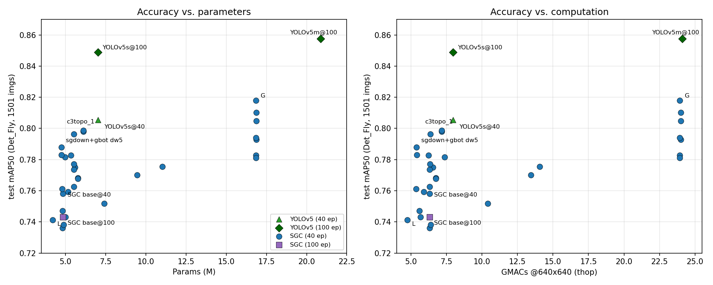
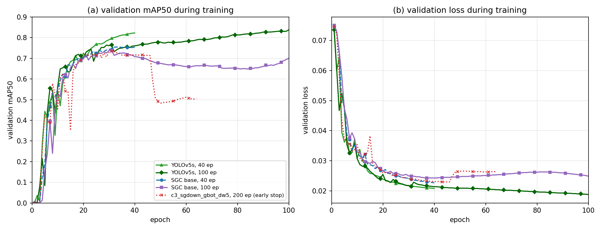

# SGC-YOLOv5：面向小目标无人机检测的 Ghost 轻量化——消融分析与精度补偿

> **草稿说明**：本稿为论文格式的初稿。所有数值均来自配套的 `SGC_YOLOv5_实验报告.md`（已逐项核对日志）。作者信息、数据来源、硬件环境与参考文献需在投稿前补全与核对。

**作者**：[作者姓名 1]，[作者姓名 2]（[单位]）
**通讯作者**：[待补充]

---

## 摘要

无人机图像中目标尺寸小、数量多，而机载平台的算力与功耗十分有限，因此轻量化检测器具有现实需求。Ghost 类结构以廉价操作生成“幽灵”特征，有望降低参数量与计算量，但其在小目标检测中的精度代价尚缺乏系统研究。本文以 YOLOv5s 为基线，构建可配置的 SGC-YOLOv5 结构族（SGhost 下采样、SDGhost 块、GSConv/VOVGCSP 类颈部与 CBAM 注意力），并在单类无人机数据集 Det_Fly 上开展单因素消融。除长训练对照外，所有对比均采用 40 epoch 的统一预算。通过“标准骨干→轻量骨干”的阶梯分解与“C3 拓扑对齐”实验，本文得到以下结论：（1）残差式块拓扑相对 YOLO C3 拓扑造成约 3.0 个 mAP50 点的损失，改用 C3 拓扑后精度（0.799）与标准骨干（0.798）相当；（2）主卷积由 1×1 改为 3×3 可恢复约 2.5 点精度，但参数量由 4.85M 增至 16.84M；（3）将 Ghost 瓶颈 3×3 段的廉价深度卷积核由 1 增至 7，可将瓶颈的精度代价由 3.6 点降至 0.3 点；（4）结合 SGhost 下采样与 5×5 廉价核的 Ghost 瓶颈，得到参数量 4.74M、计算量 5.40 GMACs、mAP50 为 0.788 的轻量模型，相对 YOLOv5s 减少约 32% 的参数量与计算量，精度下降 1.7 点。此外，训练预算会改变比较结论：YOLOv5s 训练 100 epoch 时 mAP50 升至 0.849，而 SGC 基础版反而下降。因此，轻量化方法的比较应统一训练预算，并同时报告长训练结果。

**关键词**：无人机检测；小目标检测；YOLOv5；Ghost 卷积；轻量化；消融实验

---

## 1 引言

无人机在巡检、安防与应急搜救中的应用日益广泛。与通用场景相比，机载图像中的目标通常仅占很少的像素，且背景复杂、尺度变化大；同时，机载平台的算力、存储与功耗约束严格，使参数量与计算量成为部署的硬性指标。因此，兼顾精度与效率的轻量化检测器是该领域的重要研究方向。

YOLO 系列检测器在速度与精度之间取得了良好平衡，被广泛用作工程基线 [5][6][8]。其中 YOLOv5 采用 C3（CSP 瓶颈）模块、SPPF 与 PANet 颈部 [7][8][9]，是许多轻量化改进的出发点。

在轻量化卷积方面，GhostNet 提出以少量本征卷积加上廉价的深度卷积生成幽灵特征，从而以较低代价获得与常规卷积相近数量的特征通道 [1]；GhostNetV2 进一步引入 DFC 注意力以补充长距离空间信息 [2]。Slim-neck 则将 GSConv 与 VoV-GSCSP 引入检测颈部，以降低颈部的计算开销 [11]。然而，上述工作多在通用数据集或分类任务上评估。对于以小目标为主、依赖局部空间细节的检测任务，Ghost 类结构的精度代价如何、损失又来自哪些结构因素，尚缺乏系统分析。

本文以 YOLOv5s 为基线，构建可配置的 SGC-YOLOv5 结构族，并在 Det_Fly 单类无人机数据集上设计一系列单因素消融实验，试图回答三个问题：(i) 精度损失主要来自哪些结构因素？(ii) 能否通过结构设计，在可接受的精度代价下获得明显的轻量化收益？(iii) 训练预算如何影响此类比较的结论？

本文的主要贡献包括：

1. 提出可配置的 SGC-YOLOv5 结构族。通过统一的超参数接口（主卷积核、廉价核、块拓扑、瓶颈类型、投影类型、下采样方式、颈部类型）支持严格的单因素消融。
2. 通过“标准骨干→轻量骨干”的阶梯分解与“C3 拓扑对齐”实验，定量分离出残差拓扑（约 3.0 点）与 Ghost 瓶颈（约 3.2 点）造成的精度损失，并验证 SDGhost 的 C3 拓扑实现与标准骨干一致。
3. 揭示 Ghost 瓶颈中廉价深度卷积核的作用：将其由 1 增至 7，可把瓶颈的精度代价由 3.6 点降至 0.3 点。据此给出一组在 40 epoch 预算下的轻量配置（4.74M 参数，mAP50 为 0.788）。
4. 量化训练预算对结论的影响：YOLOv5s 由 40 epoch 增至 100 epoch 提升 4.3 点，而 SGC 基础版下降 1.5 点。这提示轻量化方法的比较应统一训练预算，并同时报告长训练结果。

本文第 2 节介绍相关工作，第 3 节描述方法，第 4 节给出实验设置，第 5 节报告实验结果，第 6 节讨论结论的含义，第 7 节列出局限性，第 8 节总结全文。

---

## 2 相关工作

**轻量化卷积。** MobileNet 利用深度可分离卷积降低计算量 [3]；ShuffleNet 利用分组逐点卷积与通道混洗，在降低计算量的同时保持通道间的信息交互 [4]。GhostNet 认为特征图之间存在冗余，通过少量本征卷积与廉价线性变换生成幽灵特征 [1]；GhostNetV2 将长距离注意力引入廉价变换，以缓解其空间感受野受限的问题 [2]。这些方法大多以分类精度为主要评估指标。

**YOLO 与 CSP 结构。** YOLO 将目标检测表述为单次回归问题 [5]。YOLOv4 综合使用了 CSP 思想与 Mosaic 数据增强等技术 [6]。CSPNet 通过分阶段切分与融合，减少重复的梯度信息与计算量 [7]。YOLOv5 将这一思想实现为 C3 模块，并与 SPPF、PANet 结合 [8][9]。YOLOv8 进一步改进了检测头与损失设计 [10]。

**轻量化颈部与注意力。** Slim-neck 通过 GSConv 与 VoV-GSCSP 模块降低颈部的计算量，同时尽量保持特征交互能力 [11]。CBAM 依次施加通道注意力与空间注意力，以增强特征表示 [12]。

**无人机小目标检测。** 针对无人机图像，已有工作常通过引入 Transformer 预测头、增强高分辨率特征或加入注意力机制来改进 YOLO 系列检测器 [13]。这类方法的主要目标是提升精度，较少系统评估轻量化结构带来的代价。

---

## 3 方法

### 3.1 总体结构

SGC-YOLOv5 由骨干网络、颈部网络与检测头三部分组成。骨干网络首先使用 6×6、步长为 2 的 Stem 卷积，随后经过四个阶段，每个阶段依次执行“下采样 + SDGhost 块堆叠”，最后一个阶段接 SPPF。颈部采用 PANet 结构，包含一次自顶向下与一次自底向上的特征融合；融合块可选 VOVGCSP、VOVGCSPYolo 或标准 C3，下采样使用 GSConv。三个输出尺度的特征分别经过 CBAM 后，由 YOLOv5 的 Detect 头预测。在 s 规模（深度系数 0.33，宽度系数 0.5）下，P3、P4、P5 的通道数分别为 128、256 与 512，各阶段 SDGhost 块的重复次数为 1、2、3、1。

### 3.2 Ghost 卷积与通道混洗

设输入特征为 $X \in \mathbb{R}^{C_{in}\times H\times W}$，目标输出通道数为 $C_{out}$，压缩比为 $r$。Ghost 卷积首先以 $k\times k$ 主卷积生成 $c=\lceil C_{out}/r\rceil$ 个本征特征，再以 $d\times d$ 深度卷积对每个本征特征生成 $r-1$ 个幽灵特征，最后拼接并截取前 $C_{out}$ 个通道：

$$
Y' = \phi\big(\mathrm{Conv}_{k\times k}(X)\big),\qquad
Y'' = \phi\big(\mathrm{DWConv}_{d\times d}(Y')\big),\qquad
Y = \big[\,Y'\,;\,Y''\,\big]_{1:C_{out}}
$$

其中 $\phi$ 表示 BN 与 SiLU 激活。与同尺寸标准卷积的参数量 $C_{in}C_{out}k^2$ 相比，Ghost 卷积的参数量约为 $C_{in}\,c\,k^2 + c(r-1)d^2$；当 $r=2$ 且 $d$ 较小时，主卷积部分约为标准卷积的一半。

SGhost 在 Ghost 卷积之后增加通道混洗（ChannelShuffle）。分组数为 $C/g$，其中 $g$ 为 `groups_ratio`，即每组包含 $g$ 个通道。因此 $g$ 增大时组数减少、每组通道增多。

### 3.3 SDGhost 块：两种拓扑与两种瓶颈

SDGhost 是 SGC 版本的 C3 块，可选两种拓扑。残差拓扑为

$$
Y = G_2\big(G_1(X) + B(G_1(X))\big),
$$

即先以 $G_1$ 将通道压缩到 $c_h = e\cdot C$，经瓶颈 $B$ 处理后再以 $G_2$ 映射回 $C$ 个通道，残差只作用于压缩后的特征。C3 拓扑为

$$
Y = \mathrm{Conv}_{1\times1}\Big(\mathrm{Concat}\big[\,B(\mathrm{Conv}_{1\times1}(X)),\ \mathrm{Conv}_{1\times1}(X)\,\big]\Big),
$$

与 YOLOv5 的 C3 模块一致。其中 $G_1$、$G_2$ 以及 C3 拓扑中的三个 $1\times1$ 投影，既可以是 Ghost 投影（GBS），也可以是标准 $1\times1$ 卷积。

瓶颈 $B$ 有两种：

- 稠密瓶颈 $B_d(x)=\mathrm{Conv}_{3\times3}(\mathrm{Conv}_{1\times1}(x))+x$，即 YOLOv5 的原始设计；
- Ghost 瓶颈 $B_g(x)=\mathrm{SG}_2\big(\mathrm{SG}_1(x)\odot\mathrm{DFC}(x)\big)+\mathrm{DW}_{3\times3}(x)$，其中 $\mathrm{SG}$ 为 SGhost 卷积，$\mathrm{DFC}$ 为 GhostNetV2 的注意力分支。

Ghost 瓶颈的第二层（即 3×3 段）可以单独设置廉价深度卷积核 `mid_dw`，以便研究感受野的作用。

### 3.4 颈部与注意力

GSConv 将标准卷积的输出与深度卷积的输出拼接，并通过通道混洗进行信息交互 [11]。VOVGCSP 将输入按通道切分，其中一支经过 GS 瓶颈，另一支直接投影。VOVGCSPYolo 采用 C3 式的双路 1×1 投影，主路为 1×1→3×3 的 GS 瓶颈，并保留残差连接。CBAM 依次施加通道注意力与空间注意力 [12]。

### 3.5 训练目标

检测损失与 YOLOv5 一致，包括框回归、目标性与分类三项，各尺度的平衡系数为 [4.0, 1.0, 0.4]，正样本匹配阈值 anchor_t 为 4.0。

---

## 4 实验设置

### 4.1 数据集

实验数据集为 Det_Fly，单类别（drone）。训练集、验证集与测试集分别包含 7000、1500 与 1501 张图像，输入分辨率为 640×640。前期统计表明，约 95% 的目标小于 32×32 像素，属于典型的小目标场景。数据来源与标注协议：[待补充]。

### 4.2 训练与评估配置

表 1 给出所有实验共用的训练与评估配置。除明确标注的长训练对照外，所有 SGC 消融实验均使用 40 epoch。

**表 1 训练与评估配置**

| 项目 | 设置 |
|:--|:--|
| 优化器 | SGD，初始学习率 0.01，动量 0.937，权重衰减 5×10⁻⁴ |
| 学习率调度 | 线性衰减至初始值的 1%，预热 3 个 epoch |
| 训练轮数 | 40（统一预算）；另设 100 与 200 epoch 对照 |
| 批大小 | 16 |
| 数据增强 | Mosaic（概率 1.0），水平翻转（概率 0.5） |
| 训练技巧 | 自动混合精度（AMP）；指数滑动平均（EMA，衰减 0.9999） |
| 随机种子 | 42 |
| 测试设置 | 置信度阈值 0.001，NMS 的 IoU 阈值 0.6，最大检测数 300 |
| 模型选择 | 按验证集 mAP50-95 选择最优权重，并在测试集上报告 |

### 4.3 评估指标与计算量统计

精度指标包括 mAP50、mAP50-95、精确率（P）与召回率（R），均在测试集上计算。参数量为模型可训练参数的总数。计算量以 GMACs（十亿次乘加运算）表示，由 thop 在 1×3×640×640 的输入上统计，本文中 YOLOv5s 的统计值为 7.97 GMACs。若按 GFLOPs 的常用口径换算，应乘以 2。

### 4.4 实验设计

实验遵循四条原则：

1. **单因素消融**：每组对照只改变一个结构因素（如主卷积核、廉价核、拓扑或瓶颈类型），其余设置保持不变。
2. **阶梯分解**：从标准骨干出发，逐步替换为 SGC 组件（M→L 阶梯），以定位每一步的精度代价。
3. **拓扑对齐**：将 SDGhost 的拓扑改为 C3 形式，检验其实现与标准骨干的一致性，并在此基础上逐步加回 Ghost 组件。
4. **重复与预算检验**：对同一配置做两次同 seed 训练，以估计随机波动；对基线与部分模型做 100 或 200 epoch 的长训练，检验比较结论对预算的敏感性。

各配置的关键参数见附录表 A1，完整的运行索引见配套的实验报告。

---

## 5 实验结果

### 5.1 主要结果

表 2 汇总了代表性模型在测试集上的结果，图 1 给出精度与参数量、计算量之间的关系。

**表 2 代表性模型的测试集结果**

| 模型 | 轮数 | 参数量 (M) | GMACs (G) | mAP50 | mAP50-95 | P | R |
|:--|:--:|:--:|:--:|:--:|:--:|:--:|:--:|
| YOLOv5s | 40 | 7.02 | 7.97 | 0.805 | 0.494 | 0.920 | 0.771 |
| YOLOv5s | 100 | 7.02 | 7.97 | **0.849** | **0.537** | 0.917 | 0.823 |
| YOLOv5m | 100 | 20.87 | 24.11 | 0.858 | 0.550 | 0.918 | 0.810 |
| SGC 基础版 | 40 | 4.85 | 6.32 | 0.758 | 0.444 | 0.917 | 0.712 |
| SGC 基础版 | 100 | 4.85 | 6.32 | 0.743 | 0.429 | 0.887 | 0.694 |
| 配置 G（k=3, dw=1, g=4） | 40 | 16.84 | 23.93 | **0.818** | 0.489 | **0.935** | 0.773 |
| c3topo_1（C3 拓扑） | 40 | 6.11 | 7.17 | 0.799 | 0.483 | 0.905 | 0.769 |
| c3_ghostbot_dw7 | 40 | 5.53 | 6.37 | 0.796 | 0.468 | 0.920 | 0.768 |
| c3_sgdown_gbot_dw5 | 40 | **4.74** | **5.40** | 0.788 | 0.470 | 0.892 | 0.762 |
| L（J 骨干 + VOVGCSPYolo） | 40 | 4.21 | 4.74 | 0.741 | 0.428 | 0.908 | 0.696 |

在 40 epoch 的统一预算下，配置 G 取得最高精度（0.818），比 YOLOv5s（0.805）高 1.3 点，但其参数量与计算量分别为 YOLOv5s 的 2.4 倍与 3.0 倍。在计算量受限的设定下，c3_sgdown_gbot_dw5 取得了较好的折中：参数量为 4.74M，计算量为 5.40 GMACs，相对 YOLOv5s 分别减少约 32%，mAP50 为 0.788，低于 YOLOv5s 1.7 点。L 是表中参数量最少的模型（4.21M），但其精度下降约 6.4 点，说明过度轻量化会带来较大的精度损失。

**图 1** 测试集 mAP50 与参数量（左）、计算量（右）的关系。三角形为 40 epoch 的 YOLOv5s，菱形为 100 epoch 的 YOLOv5 系列，圆点为 40 epoch 的 SGC 变体，方块为 100 epoch 的 SGC 基础版。

### 5.2 Ghost 参数的影响

表 3 汇总了主卷积核 k、廉价核 dw 与通道混洗参数 g 的组合结果。

**表 3 Ghost 参数消融（40 epoch）**

| 配置 | k | dw | g | 参数量 (M) | GMACs (G) | mAP50 | mAP50-95 |
|:--:|:--:|:--:|:--:|:--:|:--:|:--:|:--:|
| A | 1 | 3 | 2 | 4.87 | 6.39 | 0.738 | 0.431 |
| B | 3 | 3 | 2 | 16.87 | 24.01 | 0.793 | 0.478 |
| C | 3 | 3 | 4 | 16.87 | 24.01 | 0.805 | 0.494 |
| D | 3 | 1 | 2 | 16.84 | 23.93 | 0.783 | 0.471 |
| E | 3 | 1 | 3 | 16.84 | 23.93 | 0.781 | 0.461 |
| F | 3 | 3 | 8 | 16.87 | 24.01 | 0.810 | 0.481 |
| G | 3 | 1 | 4 | 16.84 | 23.93 | **0.818** | **0.489** |
| H | 3 | 1 | 8 | 16.84 | 23.93 | 0.794 | 0.465 |

以基础版（k=1, dw=1, g=2，mAP50 为 0.758）为参照，可以得到三点观察。第一，只增大廉价核（A，dw=3）反而使 mAP50 下降 2.0 点，说明在 1×1 主卷积下，廉价分支的空间扩展无法弥补主卷积缺乏空间感受野的问题。第二，将主卷积核改为 3×3（D）使 mAP50 提升 2.5 点。第三，k=3 的代价是参数量由 4.85M 增至 16.84M，计算量由 6.32 增至 23.93 GMACs。这是因为主卷积的参数量与 $k^2$ 成正比，而 SDGhost 在全通道宽度下堆叠了多个 Ghost 模块。

在 k=3 的设置中，g 与 dw 的影响呈现交互。dw=1 时 g=4 最优（G 对比 H 为 0.818 对 0.794）；dw=3 时 g=8 略优（F 对比 C 为 0.810 对 0.805）。由于 dw 取 1 与 3 之间的差异在 ±1.5 点以内，且接近第 5.6 节估计的随机波动，本文不将其视为确定性结论。

### 5.3 拓扑与骨干的精度分解

为定位精度损失的来源，表 4 给出从标准骨干到 SGC 骨干的逐步替换结果。该阶梯以标准骨干加 VOVGCSPYolo 颈部（M）为起点，每一步只改变一个因素。

**表 4 M→L 阶梯分解与 C3 拓扑对齐（40 epoch）**

| 配置 | 相对上一步的改动 | 参数量 (M) | GMACs (G) | mAP50 | mAP50-95 | Δ mAP50 |
|:--|:--|:--:|:--:|:--:|:--:|:--:|
| M | 标准骨干（Conv + C3） | 6.11 | 7.17 | 0.798 | 0.484 | — |
| m2l_1 | SDGhost 改为残差拓扑；投影为 1×1 卷积；瓶颈为稠密 | 5.76 | 6.75 | 0.768 | 0.462 | −3.0 |
| m2l_2 | 投影改为 Ghost 投影 | 5.59 | 6.54 | 0.775 | 0.471 | +0.7 |
| m2l_3 | 瓶颈改为 Ghost 瓶颈 | 4.99 | 5.68 | 0.743 | 0.430 | −3.2 |
| L | 下采样改为 SGhost | 4.21 | 4.74 | 0.741 | 0.428 | −0.2 |
| c3topo_1 | 将 m2l_1 的残差拓扑改为 C3 拓扑 | 6.11 | 7.17 | 0.799 | 0.483 | +3.1（相对 m2l_1） |
| c3topo_2 | 投影改为 Ghost 投影 | 5.77 | 6.76 | 0.768 | 0.462 | −3.1 |
| c3topo_3 | 瓶颈改为 Ghost 瓶颈 | 5.17 | 5.90 | 0.759 | 0.455 | −0.9 |

注：Δ 列对于 m2l 系列为相对上一行的变化，对于 c3topo_1 为相对 m2l_1 的变化。

M→L 的总降幅为 5.7 点（0.798 → 0.741）。其中，残差拓扑的贡献为 −3.0 点（M → m2l_1），Ghost 瓶颈的贡献为 −3.2 点（m2l_2 → m2l_3），而投影改为 Ghost 投影（+0.7）与 SGhost 下采样（−0.2）的影响均在随机波动范围内。

c3topo_1 与 M 的参数量和计算量完全一致（6.11M，7.17 GMACs），精度仅相差 0.1 点。由于二者结构等价，这一结果可作为 SDGhost 的 C3 拓扑实现与标准骨干一致的校验。在 C3 拓扑下，将瓶颈改为 Ghost 后仅下降 0.9 点（c3topo_2 → c3topo_3），远小于残差拓扑下的 3.2 点。

### 5.4 Ghost 组件的逐步加回

在 c3topo_1 的基础上，表 5 逐步加入 Ghost 组件，并考察瓶颈 3×3 段廉价核 mid_dw 的作用。

**表 5 以 c3topo_1 为基线的 Ghost 组件加回（40 epoch）**

| 配置 | 相对 c3topo_1 的改动 | 参数量 (M) | GMACs (G) | mAP50 | mAP50-95 | Δ mAP50 |
|:--|:--|:--:|:--:|:--:|:--:|:--:|
| c3topo_1 | 基线 | 6.11 | 7.17 | 0.799 | 0.483 | — |
| c3_sgdown | 下采样改为 SGhost | 5.33 | 6.23 | 0.783 | 0.479 | −1.6 |
| c3_ghostbot | 瓶颈改为 Ghost 瓶颈（mid_dw = 1） | 5.51 | 6.31 | 0.763 | 0.466 | −3.6 |
| c3_ghostbot_dw3 | 同上，mid_dw = 3 | 5.52 | 6.32 | 0.774 | 0.458 | −2.5 |
| c3_ghostbot_dw5 | 同上，mid_dw = 5 | 5.52 | 6.34 | 0.777 | 0.463 | −2.2 |
| c3_ghostbot_dw7 | 同上，mid_dw = 7 | 5.53 | 6.37 | 0.796 | 0.468 | −0.3 |
| c3_sgdown_gbot_dw5 | 下采样 SGhost + Ghost 瓶颈（mid_dw = 5） | 4.74 | 5.40 | 0.788 | 0.470 | −1.1 |
| c3_sgdown_gbot_dw7 | 同上，mid_dw = 7 | 4.75 | 5.43 | 0.783 | 0.479 | −1.6 |

结果显示：（1）SGhost 下采样使 mAP50 下降 1.6 点，同时减少 0.78M 参数与 0.94 GMACs。（2）Ghost 瓶颈的精度代价随 mid_dw 增大而减小：mid_dw 取 1、3、5、7 时，mAP50 分别为 0.763、0.774、0.777、0.796。mid_dw=7 时代价仅为 0.3 点，但参数量只减少 0.58M。（3）SGhost 下采样与 mid_dw=5 的 Ghost 瓶颈组合后，mAP50 为 0.788，略高于 c3_sgdown（0.783），但差异处于随机波动范围内。（4）当 mid_dw 增至 7 时，与 SGhost 下采样组合的结果降至 0.783，召回率由 0.762 降至 0.724。这说明大核廉价分支与 SGhost 下采样之间存在负交互，将在第 6.3 节讨论。

### 5.5 训练预算与收敛行为

表 6 与图 2 比较了不同训练预算下的表现。

**表 6 训练预算对结论的影响**

| 模型 | 轮数 | 验证集最优（mAP50-95，epoch） | 测试集 mAP50 |
|:--|:--:|:--|:--:|
| YOLOv5s | 40 | 0.499（E40） | 0.805 |
| YOLOv5s | 100 | 0.531（E100） | 0.849 |
| SGC 基础版 | 40 | 0.444（E40） | 0.758 |
| SGC 基础版 | 100 | 0.419（E36） | 0.743 |
| c3_sgdown_gbot_dw5 | 40 | 0.474（E37） | 0.788 |
| c3_sgdown_gbot_dw5 | 200（E64 早停） | 0.428（E34） | 未评估 |

**图 2** 不同训练预算下的验证集表现：（a）验证集 mAP50；（b）验证集损失。横轴为 epoch；学习率调度随总轮数不同而不同，因此同一 epoch 的学习率水平并不相同。

YOLOv5s 在 100 epoch 训练中，自 epoch 40 起验证损失单调下降，验证 mAP50 持续上升至 0.838。SGC 基础版的验证损失在 epoch 40 左右达到最低（0.0243），此后回升至 0.026 左右；其验证 mAP50 在 epoch 30 附近达到峰值，之后下降，直到 epoch 90 之后才明显回升（epoch 100 为 0.700）。与此同时，其训练损失仍在下降。这一现象是过拟合的典型特征。

200 epoch 的 c3_sgdown_gbot_dw5 在 epoch 34 时仍处于较高学习率阶段（约 8×10⁻³），随后在 epoch 45 至 48 之间验证 mAP50 由 0.715 骤降至 0.510，之后未能恢复，并在 epoch 64 早停。这表明线性学习率调度的总轮数会改变同一 epoch 的学习率水平，因此不能将长日程的中间 epoch 与短日程的最终结果直接对比。

### 5.6 随机性估计

为估计随机波动，本文对 m2l 系列的三个配置各做了一次同 seed 的重复训练（V2）。表 7 给出验证集结果的差异。

**表 7 同配置同 seed 的重复训练（验证集 mAP50-95）**

| 配置 | 第一次（V1） | 第二次（V2） | 差值 |
|:--|:--:|:--:|:--:|
| m2l_1 | 0.4641 | 0.4616 | 0.0025 |
| m2l_2 | 0.4733 | 0.4556 | 0.0177 |
| m2l_3 | 0.4281 | 0.4401 | 0.0120 |

重复训练之间的差异在 0.25 至 1.8 点之间。其中，m2l_1 与 m2l_2 在测试集上相差 0.7 点，但在 V2 中两者的验证排序发生了反转。因此，本文将 1 点以内的差异视为随机波动，仅对 3 点以上的效应作出结论。需要说明的是，这组统计只基于三对重复，估计本身的不确定性较大。

### 5.7 SGC-m 规模的训练失败

将 SGC 结构放大到 m 规模（13.52M 参数）后，训练多次失败。在 lr 0.01 且开启 AMP 的设置下，损失出现 NaN；在 lr 0.005 且关闭 AMP 的设置下，验证 mAP 长时间为 0。同样的训练流程下，YOLOv5m（lr 0.01，AMP 开启）则正常收敛至 0.858。因此，该失败与 SGC 结构在大规模设置下的优化稳定性有关，与卷积核大小没有直接对应关系。由于 m 版本尚未用配置 G 的参数训练，“卷积核太小”这一假设仍待检验。

---

## 6 讨论

### 6.1 小目标场景下 Ghost 的感受野与参数权衡

实验结果表明，1×1 主卷积在小目标检测中存在明显不足。表 3 显示，仅将主卷积由 1×1 改为 3×3 即带来 2.5 点提升，而只增大廉价核则无效。这一结果与直觉一致：1×1 卷积只能在像素内做通道混合，无法利用邻域的形状信息；而小目标在低分辨率特征图上仅占数个像素，邻域上下文对其分类与定位尤为重要。

然而，主卷积核的增大会抵消 Ghost 的参数优势。由于 Ghost 卷积的主卷积参数随 $k^2$ 增长，k=3 时整体模型参数量达到 YOLOv5s 的 2.4 倍。因此，在本文的设定中，Ghost 的“廉价”主要体现在深度卷积部分，而不是整体结构。

### 6.2 块拓扑决定精度上限

在算子完全相同的情况下，残差拓扑比 C3 拓扑低 3.0 点（m2l_1 对比 c3topo_1）。我们推测其原因在于输出的表达维度。以 e=0.5 的配置为例，残差拓扑的输出是对 C/2 维中间特征经 1×1 映射得到的，相当于在 C/2 维子空间内扩展；而 C3 拓扑的输出是两路 C/2 特征的拼接，不受此限制。这一推测尚未直接验证，但与观察到的现象一致。

C3 拓扑还显著降低了 Ghost 瓶颈的代价：残差拓扑下瓶颈改为 Ghost 损失 3.2 点，而 C3 拓扑下仅损失 0.9 点。因此，拓扑选择是 SGC 块设计中的首要问题，算子替换应在合适的拓扑内进行。

### 6.3 大核廉价分支的感受野补偿与负交互

Ghost 瓶颈的精度随 mid_dw 增大而单调提升，说明瓶颈的主要不足在于空间聚合能力，而非 Ghost 算子本身。深度卷积核的扩大使廉价特征的空间支撑范围增大，从而补充了主卷积所缺失的上下文信息。

然而，当大核廉价分支与 SGhost 下采样同时存在时，测试集召回率由 0.762 下降至 0.724（mid_dw 由 5 增至 7）。我们推测，过大的空间平滑可能进一步削弱了下采样后低分辨率特征中的小目标响应。这一负交互提示，轻量化组件的组合不能简单叠加，需要联合设计。

### 6.4 训练预算与比较的公平性

实验显示，YOLOv5s 的精度随训练轮数增加而显著提升（40 epoch 为 0.805，100 epoch 为 0.849），而 SGC 基础版在 100 epoch 下反而下降。若仅比较 40 epoch 的结果，配置 G 可以超过 YOLOv5s；若以 YOLOv5s 的 100 epoch 结果为基线，配置 G 则低 3.1 点。这一对比说明，轻量化方法的结论可能强烈依赖训练预算。

SGC 基础版的验证损失在约 40 epoch 后回升，而训练损失仍在下降，提示其在长训练中出现了泛化退化。可能的原因包括：Ghost 与 DFC 模块在 7000 张训练图像上的容量偏大、指数滑动平均与长学习率日程之间的交互，或线性学习率衰减本身的影响。这些假设需要进一步的诊断实验加以检验。

在实践中，许多轻量化工作以各自的默认轮数训练基线与改进模型，这可能掩盖预算差异带来的影响。我们建议，报告轻量化结果时应明确训练预算，并至少在一种更长的预算下检验主要结论。

### 6.5 实践建议

基于本文的结果，对于在小目标检测中使用 Ghost 类结构，我们提出以下建议：

1. 保持 C3 式的双路拓扑，避免将残差拓扑作为默认选择；
2. 在主卷积中保留 3×3 的空间感受野；若需控制参数量，应优先考虑以 SGhost 替换下采样；
3. 若使用 Ghost 瓶颈，应为其 3×3 段配置较大的廉价核（本文中为 5 至 7），并检验其与下采样组合时的召回率；
4. 在统一预算下比较，并同时报告重复实验的波动范围。

---

## 7 局限性与未来工作

本文的主要局限如下。第一，实验以单一数据集（Det_Fly，单类）和单一检测器家族为对象，结论的泛化性尚需在其他数据集与检测器上验证。第二，除 m2l 系列外，其余配置均只训练了一次，统计可靠性有限，尤其是对 1 点以内的差异。第三，对比实验以 40 epoch 为主，仅对部分模型做了 100 或 200 epoch 的长训练，缺少对配置 G、c3topo_1 与 c3_sgdown_gbot_dw5 在 100 epoch 下的系统对照，这是后续工作的重点。第四，本文未统计 FPS、模型文件大小与边缘端延迟，计算量以 GMACs 表示。第五，SGC-m 的训练失败尚未解决。

未来工作包括：（1）在统一的 100 epoch 预算下重训主要配置，并进行多随机种子实验；（2）诊断 SGC 长训练中的过拟合现象；（3）针对 m 规模的稳定性问题，尝试梯度裁剪、更长的预热以及配置 G 的参数；（4）在边缘设备上测量实际推理延迟。

---

## 8 结论

本文以 YOLOv5s 为基线，系统研究了 Ghost 类轻量化结构 SGC-YOLOv5 在小目标无人机检测中的精度代价与补偿方法。通过阶梯分解与拓扑对齐，我们发现残差式块拓扑是此前精度损失的主要来源，改用 C3 拓扑后精度可恢复至与标准骨干相当。主卷积的空间感受野是小目标检测的关键，但会抵消 Ghost 的参数优势。Ghost 瓶颈的精度代价可以通过增大廉价深度卷积核而显著减小。由此得到的轻量配置在 40 epoch 预算下，以 1.7 点的精度损失换取约 32% 的参数量与计算量降低。此外，训练预算会改变比较结论，此类研究应统一预算并报告重复实验。这些结果表明，Ghost 类轻量化在小目标检测中的可行性取决于结构设计，而非廉价操作本身。

---

## 参考文献

> 注：以下条目为初稿整理，投稿前需逐条核对作者、题名、页码、DOI 与 arXiv 编号。

[1] Han K, Wang Y, Tian Q, et al. GhostNet: More features from cheap operations[C]//Proceedings of the IEEE/CVF Conference on Computer Vision and Pattern Recognition (CVPR). 2020.

[2] Tang Y, Han K, Guo J, et al. GhostNetV2: Enhance cheap operation with long-range attention[C]//Advances in Neural Information Processing Systems (NeurIPS). 2022.

[3] Howard A G, Zhu M, Chen B, et al. MobileNets: Efficient convolutional neural networks for mobile vision applications[J]. arXiv preprint arXiv:1704.04861, 2017.

[4] Zhang X, Zhou X, Lin M, et al. ShuffleNet: An extremely efficient convolutional neural network for mobile devices[C]//CVPR. 2018.

[5] Redmon J, Divvala S, Girshick R, et al. You only look once: Unified, real-time object detection[C]//CVPR. 2016.

[6] Bochkovskiy A, Wang C-Y, Liao H-Y M. YOLOv4: Optimal speed and accuracy of object detection[J]. arXiv preprint arXiv:2004.10934, 2020.

[7] Wang C-Y, Liao H-Y M, Wu Y-H, et al. CSPNet: A new backbone that can enhance learning capability of CNN[C]//CVPR Workshops. 2020.

[8] Jocher G, et al. YOLOv5 by Ultralytics[EB/OL]. https://github.com/ultralytics/yolov5, 2020.

[9] Liu S, Qi L, Qin H, et al. Path aggregation network for instance segmentation[C]//CVPR. 2018.

[10] Jocher G, Chaurasia A, Qiu J. Ultralytics YOLOv8[EB/OL]. 2023.

[11] Li H, Li J, Wei H, et al. Slim-neck by GSConv: A better design paradigm of detector architectures for autonomous vehicles[J]. arXiv preprint arXiv:2206.02424, 2022.

[12] Woo S, Park J, Lee J-Y, et al. CBAM: Convolutional block attention module[C]//ECCV. 2018.

[13] Zhu X, Lyu S, Wang X, et al. TPH-YOLOv5: Improved YOLOv5 based on transformer prediction head for object detection on drone-captured scenarios[C]//ICCV Workshops. 2021.

---

## 附录 A 关键配置速查

**表 A1 代表性配置的关键参数**（“—”表示该参数对此配置不起作用）

| 配置 | 拓扑 | 下采样 | 投影 | 瓶颈 | k | mid_k | dw | mid_dw | g | e | 颈部 |
|:--|:--|:--|:--|:--|:--:|:--:|:--:|:--:|:--:|:--:|:--|
| SGC 基础版 | 残差 | SGhost | Ghost | Ghost | 1 | 1 | 1 | 1 | 2 | 1.0 | VOVGCSP |
| 配置 G | 残差 | SGhost | Ghost | Ghost | 3 | 3 | 1 | 1 | 4 | 1.0 | VOVGCSP |
| M（标准骨干） | 标准 C3 | Conv | — | 稠密 | — | — | — | — | 4 | — | VOVGCSPYolo |
| c3topo_1 | C3 | Conv | 1×1 Conv | 稠密 | — | — | — | — | 4 | 0.5 | VOVGCSPYolo |
| c3_sgdown | C3 | SGhost | 1×1 Conv | 稠密 | — | — | 1 | — | 4 | 0.5 | VOVGCSPYolo |
| c3_ghostbot_dw7 | C3 | Conv | 1×1 Conv | Ghost | 1 | 3 | 1 | 7 | 4 | 0.5 | VOVGCSPYolo |
| c3_sgdown_gbot_dw5 | C3 | SGhost | 1×1 Conv | Ghost | 1 | 3 | 1 | 5 | 4 | 0.5 | VOVGCSPYolo |
| L | 残差 | SGhost | Ghost | Ghost | 1 | 3 | 1 | 1 | 4 | 0.5 | VOVGCSPYolo |

注：c3topo_1 与 c3_sgdown 的瓶颈为稠密 YOLO 瓶颈（1×1→3×3），不使用 k、mid_k、dw 与 mid_dw；M 使用标准 Conv+C3 骨干，不含 SDGhost 参数。

---

## 附录 B 复现与数据说明

- **模型代码**：`src/models/detection/YOLO/SGC_YOLOv5/sgc_yolov5.py`（SGC 主模型、SDGhost、Bottleneck、VOVGCSP / VOVGCSPYolo 等）；`src/models/detection/YOLO/SGC_YOLOv5/sgc_yolov5_ablation.py`（NoCBAM、C3Neck、StdEarly、StdBackbone 等消融结构）；`src/module/conv/GhostConv/GhostConv.py`（Ghost 卷积）。
- **训练与评估**：`experiments/detection/project2_2611/train.py`，`experiments/detection/project2_2611/analyze.py`；配置文件位于 `experiments/detection/project2_2611/configs/models/`。
- **运行索引与完整结果**：`experiments/detection/project2_2611/SGC_YOLOv5_实验报告.md`（附录 A）。
- **数据集**：Det_Fly，划分为 7000 / 1500 / 1501 张；数据来源与获取方式：[待补充]。
- **计算环境**：[GPU 型号、CUDA 与 PyTorch 版本待补充]。
- **随机种子**：42；AMP 与 EMA 对 s 规模模型均开启。

**致谢**：[待补充]
**基金资助**：[待补充]

---

*注：本稿中的数值以 `SGC_YOLOv5_实验报告.md` 为准。若后续补充了 100 epoch 对照或重复实验，应同步更新第 5 节与第 8 节的结论。*
