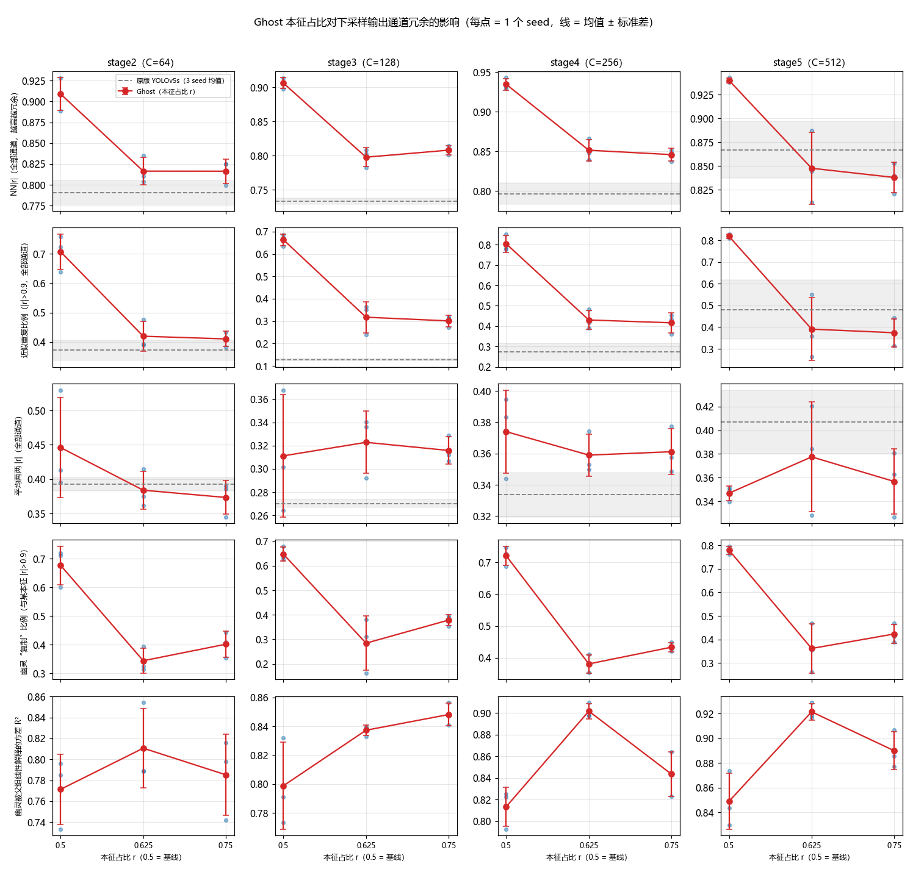

| Name                               | Backbone                    | Neck            | Attention / 残差                    | Seed         | mAP50             | mAP50-95          | Params (M) | FLOPs (G) | 状态                                                      |
| ---------------------------------- | --------------------------- | --------------- | --------------------------------- | ------------ | ----------------- | ----------------- | ---------- | --------- | ------------------------------------------------------- |
| YOLOv5s                            | 标准 YOLOv5 Conv + C3 + SPPF  | 标准 YOLOv5 C3    | 无                                 | 42/43/44     | 0.808 ± 0.003     | 0.492 ± 0.003     | 7.02       | 15.94     | 3 seed 完成                                               |
| c3topo_1                           | dense + Conv↓               | VOVGCSPYolo     | CBAM（full）                        | 42           | 0.799             | 0.483             | 6.11       | 14.34     | 单 seed                                                  |
| c3_sgdown                          | dense + SGhost↓             | VOVGCSPYolo     | CBAM（full）                        | 42           | 0.783             | 0.479             | 5.33       | 12.46     | 单 seed                                                  |
| c3_ghostbot_dw3                    | ghost-bot dw3 + Conv↓       | VOVGCSPYolo     | CBAM（full）+ DFC + dw 残差           | 42/43/44     | 0.775 ± 0.021     | 0.459 ± 0.016     | 5.52       | 12.64     | 3 seed test（`026`+`032`/`033`）                          |
| c3_ghostbot_dw5                    | ghost-bot dw5 + Conv↓       | VOVGCSPYolo     | CBAM（full）+ DFC + dw 残差           | 42/43/44     | 0.773 ± 0.012     | 0.464 ± 0.003     | 5.52       | 12.68     | 3 seed test（`027`+`034`/`035`）                          |
| c3_ghostbot_dw7                    | ghost-bot dw7 + Conv↓       | VOVGCSPYolo     | CBAM（full）+ DFC + dw 残差           | 42/43/44     | 0.782 ± 0.015     | 0.470 ± 0.009     | 5.53       | 12.74     | 3 seed test（`028`+`030`/`031`）                          |
| c3_sgdown_gbot_dw3                 | ghost-bot dw3 + SGhost↓     | VOVGCSPYolo     | CBAM（full）+ DFC + dw 残差           | 42/43/44     | 0.765 ± 0.005     | 0.456 ± 0.006     | 4.73       | 10.76     | 3 seed（`2026-11-19_025`～`027`，test）                     |
| **c3_sgdown_gbot_dw5**             | **ghost-bot dw5 + SGhost↓** | **VOVGCSPYolo** | **CBAM（full）+ DFC strip + dw 残差** | **42/43/44** | **0.765 ± 0.018** | **0.456 ± 0.016** | **4.74**   | **10.80** | 3 seed（s42=`018_rerun_V2`）；+s45 见下节 **0.770±0.018**（4 seed） |
| c3_sgdown_gbot_dw5（DFC GhostV2）  | ghost-bot dw5 + SGhost↓     | VOVGCSPYolo     | CBAM + **dfc_type=ghostv2** + dw 残差 | 42           | 0.757             | 0.444             | 4.74       | —         | 单 seed（`033_dfcGhostV2`；低于 strip DFC s42 **0.785**）   |
| c3_sgdown_gbot_dw5（P3 去 SAM）       | ghost-bot dw5 + SGhost↓     | VOVGCSPYolo     | P3 仅 CAM，P4/P5 CBAM + DFC + dw 残差 | 42           | 0.782             | 0.469             | 4.74       | 10.80     | 单 seed（`2026-11-17_006_…_cbamCamP3_V1`）                 |
| c3_sgdown_gbot_dw5（无 DFC）          | ghost-bot dw5 + SGhost↓     | VOVGCSPYolo     | CBAM（full）+ 无 DFC + dw 残差         | 42/43/44     | 0.785 ± 0.008     | 0.470 ± 0.006     | 4.73       | 10.75     | 3 seed（`007`+`2026-11-19_019`/`020`，test）               |
| c3_sgdown_gbot_dw5（恒等残差）           | ghost-bot dw5 + SGhost↓     | VOVGCSPYolo     | CBAM（full）+ DFC + 恒等残差            | 42/43/44     | 0.765 ± 0.010     | 0.456 ± 0.007     | 4.73       | 10.74     | 3 seed（`008`+`2026-11-19_023`/`024`，test）               |
| c3_sgdown_gbot_dw5（无 CBAM）         | ghost-bot dw5 + SGhost↓     | VOVGCSPYolo     | 无 CBAM + DFC + dw 残差              | 42/43/44     | 0.782 ± 0.009     | 0.467 ± 0.011     | 4.69       | 10.79     | 3 seed（`005`+`2026-11-19_021`/`022`，test）               |
| c3_sgdown_gbot_dw5（无 DFC + 无 CBAM） | ghost-bot dw5 + SGhost↓     | VOVGCSPYolo     | 无 CBAM + 无 DFC + dw 残差            | 42/43/44/45  | 0.795 ± 0.018     | 0.476 ± 0.018     | 4.69       | 10.75     | 4 seed（`015`～`017`+`032_seed45`）；s44 仍最高 **0.818**      |
| c3_sgdown_gbot_dw5（本征占比 0.625）     | ghost-bot dw5 + SGhost↓     | VOVGCSPYolo     | CBAM（full）+ DFC + dw 残差           | 42/43/44     | 0.773 ± 0.004     | 0.461 ± 0.007     | 5.12       | 11.90     | 3 seed 完成（test，1501 张）                                  |
| c3_sgdown_gbot_dw5（本征占比 0.75）      | ghost-bot dw5 + SGhost↓     | VOVGCSPYolo     | CBAM（full）+ DFC + dw 残差           | 42/43/44     | 0.777 ± 0.007     | 0.468 ± 0.004     | 5.45       | 12.69     | 3 seed 完成（test，1501 张）                                  |
| c3_sgdown_gbot_dw7                 | ghost-bot dw7 + SGhost↓     | VOVGCSPYolo     | CBAM（full）+ DFC + dw 残差           | 42/43/44†    | 0.759 ± 0.043     | 0.453 ± 0.036     | 4.75       | 10.85     | †含坏 seed s43；**推荐 42/44/45：0.776±0.014** / 0.466±0.015   |

### 服务器批次（2026-11-21）：seed 45 + DFC GhostV2

- **来源**：`project2_2611/new/` 四 run 已迁入 `SGC_YOLOv5_c3_sgdown_gbot_dw5/runs/`（3 项）与 `…_dw7/runs/`（s45），并完成 test 评估。
- **单 seed test（1501 张）**

| 配置 | Run | seed | mAP50 | mAP50-95 |
|:--|:--|:--:|--:|--:|
| dw5 基线 | `2026-11-20_030_…_seed45_V1` | 45 | 0.785 | 0.457 |
| dw7 | `2026-11-20_031_…_seed45_V1` | 45 | 0.760 | 0.449 |
| 无 DFC+无 CBAM | `2026-11-20_032_…_noDFC_cbamNone_seed45_V1` | 45 | 0.775 | 0.458 |
| dw5 + DFC GhostV2 | `2026-11-20_033_…_dfcGhostV2_seed42_V1` | 42 | 0.757 | 0.444 |

- **与既有 seed 合并汇总**

| 配置 | seeds | mAP50 | mAP50-95 | 备注 |
|:--|:--|:--|:--|:--|
| dw5 strip DFC | 42/43/44（现行） | **0.765 ± 0.018** | 0.456 ± 0.016 | 不变 |
| dw5 strip DFC | **+45 → 四 seed** | **0.770 ± 0.018** | **0.456 ± 0.013** | s45=**0.785** 与 s42 重合，**未缩小 σ** |
| dw7 | 42/43/44 | 0.759 ± 0.043 | 0.453 ± 0.036 | s43 坏点仍在 |
| dw7 **推荐** | **42/44/45** | **0.776 ± 0.014** | **0.466 ± 0.015** | 剔除 s43 后 σ 由 0.043→0.014 |
| 无 DFC+无 CBAM | **42/43/44/45** | **0.795 ± 0.018** | **0.476 ± 0.018** | s45 **0.775** 低于 s44 **0.818**，四 seed 略拉低均值 |
| 无 DFC+无 CBAM | 42/43/45（去 s44） | 0.787 ± 0.011 | 0.469 ± 0.006 | 若要去离群 s44 |

- **解读**
  1. **补 seed 45 没能「治愈」dw5 方差**：四 seed σ 仍为 **0.018**；s45 并非中间值，而是再次落在高侧（0.785），说明离散来自 **42/45 vs 43** 双峰，而非单点偶然。
  2. **dw7 应报告 42/44/45**：s45=0.760 正常，与 s44 同档；含 s43 的统计无参考价值。
  3. **DFC GhostV2（池化门控）单点落后 strip**：test **0.757 / 0.444**，比同 seed strip 基线（rerun s42 **0.785 / 0.474**）低 **~2.8 pt / 3 pt**；**无证据支持**把默认 DFC 换成 GhostV2 池化版（仅 s42，需多 seed 才能定论，但趋势偏负）。
  4. **无 DFC+无 CBAM**：加 s45 后仍 **高于完整 dw5 约 +2.5 pt mAP50**，优势保留；s45 未打破「去模块反而高」的现象，但仍应视为 **seed 噪声内结构对比**，不宜过拟合解释。

### 服务器批次（2026-11-20）：c3_ghostbot_dw3/dw5/dw7（Conv↓）seed 43/44

- **来源**：`project2_2611/new/` 六 run 已迁入 `SGC_YOLOv5_c3_ghostbot_dw{3,5,7}/runs/`，`analyze.py --split test --checkpoint best --no-vis`；seed 42 沿用原 `026`/`027`/`028` 的 test。
- **单 seed test mAP50 / mAP50-95**

| 变体        | s42       | s43   | s44       | 汇总 mAP50          | 汇总 mAP50-95       |
| --------- | --------- | ----- | --------- | ----------------- | ----------------- |
| dw3 Conv↓ | 0.774     | 0.755 | **0.796** | **0.775 ± 0.021** | 0.459 ± 0.016     |
| dw5 Conv↓ | 0.777     | 0.760 | 0.782     | **0.773 ± 0.012** | **0.464 ± 0.003** |
| dw7 Conv↓ | **0.796** | 0.782 | 0.766     | **0.782 ± 0.015** | **0.470 ± 0.009** |

- **解读（Conv↓ vs SGhost↓ dw5 基线 0.765±0.018）**
  1. **Conv↓ 仍整体高于 SGhost↓**：三档 DW 的 test mAP50 均值 **0.773–0.782**，比 **c3_sgdown_gbot_dw5**（0.765）高约 **0.8–1.7 pt**；代价是参数/FLOPs 各多约 **~17% / ~17%**（5.5M vs 4.74M）。
  2. **seed 稳定性好于 SGhost 家族**：dw5 Conv↓ 的 mAP50-95 三 seed std 仅 **0.003**（接近 YOLOv5s 0.003）；dw7 Conv↓ std **0.015**，且 **无 SGhost dw7 式坏 seed**（sgdown dw7 s43 仅 0.709）。
  3. **DW 扫描在 Conv↓ 上仍无单调收益**：dw7 均值仅略高于 dw5（0.782 vs 0.773），差值 **< dw7 自身 std（0.015）**；dw3 与 dw5 几乎持平，s43 偏低（0.755）被 s44 0.796 拉高，方差 **0.021**。
  4. **与轻量化目标**：若必须 SGhost↓，dw3≈dw5 且更省算力；若允许 Conv↓，dw5 已是精度–方差折中点，继续加大瓶颈 DW **不值得**。

### 服务器批次（2026-11-19）：dw3/dw7 与结构消融 43/44

- **来源**：`project2_2611/new/` 已迁入各 `SGC_YOLOv5_*/runs/`，并执行 `analyze.py --split test --checkpoint best --no-vis`（1501 张）。
- **Ghost 瓶颈 DW 扫描（SGhost↓）**

| 变体          | Seed 42 | Seed 43   | Seed 44 | test mAP50        | test mAP50-95 |
| ----------- | ------- | --------- | ------- | ----------------- | ------------- |
| **dw3**     | 0.771   | 0.765     | 0.761   | **0.765 ± 0.005** | 0.456 ± 0.006 |
| **dw5（基线）** | 0.785   | 0.750     | 0.759   | **0.765 ± 0.018** | 0.456 ± 0.016 |
| **dw7**     | 0.783   | **0.709** | 0.785   | **0.759 ± 0.043** | 0.453 ± 0.036 |

- **解读（DW）**
  1. **dw3 与 dw5 几乎等价**：三 seed 方差很小（±0.005），均值与 dw5 基线重合；缩小瓶颈 DW（5→3）**不带来精度收益，也未改善种子稳定性**。
  2. **dw7 仍不稳定**：seed 43 test mAP50 仅 **0.709**（比同配置 val 最佳 ~0.75 跌约 4pt），把三 seed 标准差拉回到 **0.043**（与早期 dw5 同量级）。seed 42/44 仍在 0.783–0.785，说明 **dw7 对初始化敏感，不是一致性的“更大感受野”收益**。
  3. **相对 Conv↓ 对照**（见上节 3 seed）：SGhost↓ dw5/dw3 test 均值 **0.765**，仍低于 Conv↓ dw5/dw7（**0.773–0.782**）；轻量化（SGhost↓）在 test 上稳定牺牲约 **1 pt mAP50**。
- **结构消融 3 seed（相对 dw5 基线 0.765 / 0.456）**

| 消融             | mAP50（3 seed）     | mAP50-95          | 相对基线                             |
| -------------- | ----------------- | ----------------- | -------------------------------- |
| 无 DFC          | **0.785 ± 0.008** | 0.470 ± 0.006     | mAP50 **+0.020**（意外偏高，需结合延迟再论）   |
| 无 CBAM         | 0.782 ± 0.009     | 0.467 ± 0.011     | mAP50 +0.017                     |
| 无 DFC + 无 CBAM | **0.802 ± 0.015** | **0.482 ± 0.016** | mAP50 **+0.037**，mAP50-95 +0.026 |
| 恒等残差           | 0.765 ± 0.010     | 0.456 ± 0.007     | 与基线重合（单 seed 0.754 属 seed 噪声）    |

- **解读（消融）**
  1. 补齐 43/44 后，**去 DFC / 去 CBAM** 均值略高于 dw5 三 seed，但优势 **小于 dw5 seed 间 std（0.018）**。
  2. **无 DFC + 无 CBAM**（`015`/`016_V2`/`017`，`train=7000`）test 均值 **高于完整 dw5 基线**（mAP50 0.802 vs 0.765）；与「无效 14/3 训练」无关，early test=0 为误读。seed 44 达 **0.818**，seed 间 std 0.015，仍高于 YOLOv5s（0.003），但优于多数 SGhost 变体。
  3. **恒等残差** 三 seed 与基线持平；dw 残差主要影响延迟/动力学，非平均 test AP。

### 基线 3 seed：seed 42 重训（2026-11-18）

- **动机**：首训 `2026-11-13_029_SGC_c3_sgdown_gbot_dw5_s_V1` 在同配置下 test mAP50 **略高于** 43/44，拉高三 seed 汇总离散度；保留 **V1 不删**，官方三 seed 基线 **seed 42 改用 rerun `2026-11-18_018_…_rerun_V2`**。
- **重训**：`sgc_yolov5s_c3_sgdown_gbot_dw5_seed42_rerun`（与 `sgc_yolov5s_c3_sgdown_gbot_dw5` 同结构，seed=42，40 epoch）。

**seed 42 前后对比**（test，`analyze.py --split test --checkpoint best`，1501 张）：

|  | Run | best ep | mAP50 | mAP50-95 | P | R | val@last mAP50（对照） |
|:--|:--|--:|--:|--:|--:|--:|--:|
| **重训前（首训）** | `2026-11-13_029_…_V1` | 37 | **0.788** | 0.470 | 0.892 | **0.762** | 0.799 |
| **重训后（rerun）** | `2026-11-18_018_…_rerun_V2` | 40 | **0.785** | **0.474** | **0.934** | 0.740 | 0.784 |
| **Δ（rerun − V1）** | — | — | **−0.003** | **+0.004** | +0.042 | −0.023 | −0.015 |

- **解读（单 seed 42）**：test mAP50 仅降 **0.3 pt**，mAP50-95 略升；**精确率升、召回降**（高 P 低 R），与 val 上 V1 尾 epoch mAP50 偏高、rerun 更贴 test 的现象一致。重训目的主要是 **压低 seed 42 离群对三 seed 均值的拉动**，不是追求更高单点 AP。

**三 seed 汇总：重训前 vs 重训后**（43/44 不变，仅替换 seed 42 run）：

|  | seed 42 | seed 43 | seed 44 | mAP50 | mAP50-95 |
|:--|--:|--:|--:|--:|--:|
| **重训前** | 0.788（`029_V1`） | 0.750 | 0.759 | **0.766 ± 0.020** | **0.455 ± 0.013** |
| **重训后（现行）** | 0.785（`018_rerun_V2`） | 0.750 | 0.759 | **0.765 ± 0.018** | **0.456 ± 0.016** |
| **Δ 均值** | — | — | — | −0.001 | +0.001 |
| **Δ σ** | — | — | — | 0.020→0.018 | 0.013→0.016 |

- **现行三 seed 明细**（与主表 **c3_sgdown_gbot_dw5** 一致）：

| Seed | Run | mAP50 | mAP50-95 |
|:--:|:--|--:|--:|
| 42 | `2026-11-18_018_SGC_c3_sgdown_gbot_dw5_s_seed42_rerun_V2` | 0.785 | 0.474 |
| 43 | `2026-11-17_001_SGC_c3_sgdown_gbot_dw5_s_seed43_V1` | 0.750 | 0.446 |
| 44 | `2026-11-17_002_SGC_c3_sgdown_gbot_dw5_s_seed44_V1` | 0.759 | 0.448 |

- **结论**：重训后三 seed mAP50 标准差由 **0.020→0.018**，均值几乎不变；**seed 43 仍偏低（0.750）**，整体仍远高于 YOLOv5s（**±0.003**）。seed 42 偏高不是方差大的唯一来源。

### 无 DFC + 无 CBAM：test 评估（2026-11-18 训练，2026-11-20 补评）

- **训练**：三 seed 均在 **完整 Det_Fly**（`train=7000 / val=1500`）上 40 epoch 完成；`train.log` 可查。早期 record 误写「train=14」系另一批失败 run，**与** `015`**/**`016`**/**`017` **无关**。
- **test**（`analyze.py --split test --checkpoint best --no-vis`）：

| Seed | Run                 | mAP50 | mAP50-95 |
| ---- | ------------------- | ----- | -------- |
| 42   | `…_015_…_seed42_V1` | 0.797 | 0.465    |
| 43   | `…_016_…_seed43_V2` | 0.790 | 0.483    |
| 44   | `…_017_…_seed44_V1` | 0.818 | 0.497    |

- **汇总**：mAP50 **0.802 ± 0.015**，mAP50-95 **0.482 ± 0.016**（高于 dw5 基线 **0.765 / 0.456**）。参数 **4.69M**（少 CBAM）。**无需再入** `run_ablation_sgc.sh` **训练队列**。

### 通道冗余对比：Ghost 本征占比 0.5 / 0.625 / 0.75（2026-11-18）

- **对象**：`c3_sgdown_gbot_dw5` 的 SGhost 下采样输出（`backbone.stage{2..5}.0`）。r=0.5（基线，`ratio=2`）、0.625、0.75 各 3 个 seed（42/43/44），共 9 个 run。test 集随机 20 张（与 `redundancy_analysis.py` 相同抽样），逐图计算后平均。
- **脚本**：`redundancy_ir_analysis.py`，输出 `redundancy_ir/`（`ir_redundancy.json`、`ir_metrics.png`、`ir_corr_stage3.png`）。
- **指标**：全部通道的 NNr、dup%、meanr（与 `redundancy_analysis.py` 同口径）。幽灵相关指标：copy_frac（与任一本征 r>0.9 的幽灵比例）、R2_group（幽灵被其父组线性回归解释的方差）、dup_gg（幽灵之间的近似重复比例）。3 seed 标准差为样本标准差（ddof=1），与上表 test 指标口径一致。

**表 1 全部通道（三组通道数相同，可直接比较）**

| 本征占比 r  | 参数量 (M) | test mAP50    | dup%：s2 / s3 / s4 / s5    | NN|r|：s2 / s3 / s4 / s5   | mean|r|：s2 / s3 / s4 / s5 |
| ------- | ------- | ------------- | ------------------------- | ------------------------- | ------------------------- |
| 0.5（基线） | 4.74    | 0.765 ± 0.018 | 0.71 / 0.66 / 0.80 / 0.82 | 0.91 / 0.91 / 0.93 / 0.94 | 0.45 / 0.31 / 0.37 / 0.35 |
| 0.625   | 5.12    | 0.773 ± 0.004 | 0.42 / 0.32 / 0.43 / 0.39 | 0.82 / 0.80 / 0.85 / 0.85 | 0.38 / 0.32 / 0.36 / 0.38 |
| 0.75    | 5.45    | 0.777 ± 0.007 | 0.41 / 0.30 / 0.42 / 0.37 | 0.82 / 0.81 / 0.85 / 0.84 | 0.37 / 0.32 / 0.36 / 0.36 |

**表 2 幽灵分支的父组结构**

| 本征占比 r | 父组结构                           | copy_frac：s2 / s3 / s4 / s5 | best_par：s2 / s3 / s4 / s5 | R2_group：s2 / s3 / s4 / s5 | dup_gg：s2 / s3 / s4 / s5  |
| ------ | ------------------------------ | --------------------------- | -------------------------- | -------------------------- | ------------------------- |
| 0.5    | 1 本征 → 1 幽灵（深度卷积，单父）           | 0.68 / 0.65 / 0.72 / 0.78   | 0.89 / 0.90 / 0.92 / 0.93  | 0.77 / 0.80 / 0.81 / 0.85  | 0.37 / 0.14 / 0.31 / 0.22 |
| 0.625  | 5 本征 → 3 幽灵（分组卷积，`groups=gcd`） | 0.34 / 0.28 / 0.38 / 0.36   | 0.80 / 0.78 / 0.84 / 0.84  | 0.81 / 0.84 / 0.90 / 0.92  | 0.26 / 0.19 / 0.29 / 0.30 |
| 0.75   | 3 本征 → 1 幽灵（分组卷积，`groups=幽灵数`） | 0.40 / 0.38 / 0.43 / 0.42   | 0.83 / 0.84 / 0.85 / 0.86  | 0.79 / 0.85 / 0.84 / 0.89  | 0.14 / 0.08 / 0.23 / 0.23 |

图：`redundancy_ir/ir_metrics.png`（每点为一个 seed，线为均值 ± 标准差）；`redundancy_ir/ir_corr_stage3.png`（stage3 同一测试图的 r 矩阵，青线为本征/幽灵分界）。

**结论**

1. **近似复制显著减少。** r 从 0.5 增至 0.625 / 0.75 后，幽灵与任一本征 r>0.9 的比例（copy_frac）从 0.65–0.78 降到 0.28–0.43。全部通道的近似重复比例在 stage3–5 下降约 0.3–0.4（dup 0.66–0.82 → 0.30–0.43），NNr 从 0.91–0.94 降到 0.80–0.85。
2. **冗余没有消失，而是从“单通道复制”变成“组合可预测”。** 分组卷积后的幽灵仍有 R2_group 0.79–0.92，基线单父为 0.77–0.85，r=0.625 时最高。幽灵基本是父组的线性组合。
3. **平均两两 r 在三组之间几乎不变**（0.31–0.45），再次说明只看平均值会低估结构性冗余。
4. **0.625 与 0.75 结果接近。** 0.75 的父组更小（3→1），幽灵之间的近似重复（dup_gg）最低（0.08–0.23）。
5. **精度没有显著收益，参数增加。** test mAP50 为 0.765 ± 0.018 → 0.773 ± 0.004 → 0.777 ± 0.007，差异小于基线 seed 间标准差（0.018）。参数量分别增加 8%（0.625）和 15%（0.75），来自本征主卷积和分组幽灵卷积的增长。
6. **混杂因素。** 本征通道数随 r 增加（stage3：64 → 80 → 96），copy 与 NN 对候选数量敏感。参数量同时变化，卷积结构也变了，不是只改冗余的纯对照。只用 20 张图，每组 3 个 seed。

**与轻量化的关系**：提高本征占比能降低“复制型”冗余，但没有带来显著精度收益，还增加了 8–15% 参数，对轻量化不利。复制型冗余在基线上并不是精度瓶颈。若目标是轻量化，应从减少算子数和计算量入手（见 2026-11-17 的延迟分析）。

**代码改动（需注意）**：为运行本分析，修复了 `src/models/detection/YOLO/SGC_YOLOv5/sgc_yolov5.py` 的导入：`CAM` 改为 `from src.module.attention.CAM.cam import CAM`。原因是提交 `821137d`（DSTFP）把 `src/module/attention/__init__.py` 改为只导出 `SelfAttention`，SGC 模型构建时报 `'module' object is not callable`。这同样影响服务器上的训练队列。`__init__.py` 未改动，本次修复尚未提交，需要确认后再入库。

**复现**：`python experiments/detection/project2_2611/redundancy_ir_analysis.py --num 20`（仓库根目录，CPU 约 100 s）。

**FLOPs (G) 口径**（2026-11-20 补全表中 `—`）：`thop.profile`，输入 1×3×640，`FLOPs (G) = 2 × GMACs`（与 `docs/SGC_YOLOv5_实验报告.md` §2.3 一致）。dw3/dw5/dw7 随瓶颈 `mid_dw_kernel_size` 略变（10.76 / 10.80 / 10.85）；无 CBAM 几乎不变；本征占比 0.625/0.75 为 11.90 / 12.69。

# Test Metrics 三 Seed 汇总（1501 张）

来源：本地 `predictions/test/metrics.json`（1501 张）。
Δ = 该 seed 值 − 组内三 seed 均值；带 `*` 的为该配置组内 |Δ| 最大的 seed。
对照：record 里 YOLOv5s 三 seed 约 **0.808 ± 0.003**（本地无 metrics 文件，未列入下表）。

## 表 1：test mAP50（含逐 seed 偏离）

| 配置                    |         s42 |        Δ42 |         s43 |        Δ43 |         s44 |        Δ44 | 均值 μ |     σ | 最大\|Δ\| |
| :---------------------- | ----------: | ---------: | ----------: | ---------: | ----------: | ---------: | -----: | ----: | --------- |
| **c3_sgdown_gbot_dw7**  |       0.783 |     +0.024 | **0.709\*** | **−0.050** |       0.785 |     +0.026 |  0.759 | 0.043 | **s43**   |
| c3_ghostbot_dw3 Conv↓   |       0.774 |     −0.001 |       0.755 |     −0.020 | **0.796\*** | **+0.021** |  0.775 | 0.021 | s44       |
| c3_sgdown_gbot_dw5 基线 | **0.785\*** | **+0.020** |       0.750 |     −0.015 |       0.759 |     −0.006 |  0.765 | 0.018 | s42       |
| dw5 无 DFC+无 CBAM      |       0.797 |     −0.005 |       0.790 |     −0.012 | **0.818\*** | **+0.016** |  0.802 | 0.015 | s44       |
| c3_ghostbot_dw7 Conv↓   | **0.796\*** | **+0.015** |       0.782 |     +0.001 |       0.766 |     −0.015 |  0.782 | 0.015 | s42/s44   |
| c3_ghostbot_dw5 Conv↓   |       0.777 |     +0.004 | **0.760\*** | **−0.013** |       0.782 |     +0.009 |  0.773 | 0.012 | s43       |
| dw5 无 CBAM             | **0.787\*** |     +0.005 | **0.771\*** | **−0.011** |       0.787 |     +0.005 |  0.782 | 0.009 | s43       |
| dw5 恒等残差            | **0.754\*** | **−0.011** |       0.765 |      0.000 |       0.775 |     +0.010 |  0.765 | 0.011 | s42       |
| dw5 无 DFC              |       0.792 |     +0.007 | **0.776\*** | **−0.009** |       0.786 |     +0.001 |  0.785 | 0.008 | s43       |
| 本征 0.75               | **0.769\*** |     −0.008 |       0.783 |     +0.006 |       0.778 |     +0.001 |  0.777 | 0.007 | s42       |
| c3_sgdown_gbot_dw3      | **0.771\*** |     +0.005 |       0.765 |     −0.001 |       0.761 |     −0.004 |  0.766 | 0.005 | s42       |
| 本征 0.625              | **0.768\*** |     −0.005 |       0.775 |     +0.002 |       0.776 |     +0.003 |  0.773 | 0.004 | s42       |

## 表 2：test mAP50-95（含逐 seed 偏离）

| 配置                    |         s42 |        Δ42 |         s43 |        Δ43 |         s44 |        Δ44 | 均值 μ |     σ | 最大\|Δ\| |
| :---------------------- | ----------: | ---------: | ----------: | ---------: | ----------: | ---------: | -----: | ----: | --------- |
| **c3_sgdown_gbot_dw7**  |       0.783 |     +0.024 | **0.709\*** | **−0.050** |       0.785 |     +0.026 |  0.759 | 0.043 | **s43**   |
| c3_ghostbot_dw3 Conv↓   |       0.774 |     −0.001 |       0.755 |     −0.020 | **0.796\*** | **+0.021** |  0.775 | 0.021 | s44       |
| c3_sgdown_gbot_dw5 基线 | **0.785\*** | **+0.020** |       0.750 |     −0.015 |       0.759 |     −0.006 |  0.765 | 0.018 | s42       |
| dw5 无 DFC+无 CBAM      |       0.797 |     −0.005 |       0.790 |     −0.012 | **0.818\*** | **+0.016** |  0.802 | 0.015 | s44       |
| c3_ghostbot_dw7 Conv↓   | **0.796\*** | **+0.015** |       0.782 |     +0.001 |       0.766 |     −0.015 |  0.782 | 0.015 | s42/s44   |
| c3_ghostbot_dw5 Conv↓   |       0.777 |     +0.004 | **0.760\*** | **−0.013** |       0.782 |     +0.009 |  0.773 | 0.012 | s43       |
| dw5 无 CBAM             | **0.787\*** |     +0.005 | **0.771\*** | **−0.011** |       0.787 |     +0.005 |  0.782 | 0.009 | s43       |
| dw5 恒等残差            | **0.754\*** | **−0.011** |       0.765 |      0.000 |       0.775 |     +0.010 |  0.765 | 0.011 | s42       |
| dw5 无 DFC              |       0.792 |     +0.007 | **0.776\*** | **−0.009** |       0.786 |     +0.001 |  0.785 | 0.008 | s43       |
| 本征 0.75               | **0.769\*** |     −0.008 |       0.783 |     +0.006 |       0.778 |     +0.001 |  0.777 | 0.007 | s42       |
| c3_sgdown_gbot_dw3      | **0.771\*** |     +0.005 |       0.765 |     −0.001 |       0.761 |     −0.004 |  0.766 | 0.005 | s42       |
| 本征 0.625              | **0.768\*** |     −0.005 |       0.775 |     +0.002 |       0.776 |     +0.003 |  0.773 | 0.004 | s42       |

## 按 seed 看谁更容易跑偏（|Δ|>0.01 的显眼离群）

| Seed   | 典型角色     | 代表                                                                                                                             |
| ------ | -------- | ------------------------------------------------------------------------------------------------------------------------------ |
| **43** | **偏低最多** | **SGhost dw7**：mAP50 **0.709**（Δ−0.050）、mAP50-95 **0.412**；基线 dw5 **0.750**；Conv↓ dw3 **0.755**、dw5 **0.760**；无 CBAM **0.771** |
| **42** | 基线类常偏高   | dw5 基线 **0.785**（Δ+0.020）；Conv↓ dw7 **0.796**；恒等残差 **0.754**（Δ−0.010 为组内最低）                                                    |
| **44** | 部分配置冲高   | 无 DFC+无 CBAM **0.818**；Conv↓ dw3 **0.796**；SGhost dw7 **0.785**（与 s42 一起抬高均值，反衬 s43 更异常）                                       |

## 表 4：三 seed 汇总（μ ± σ，便于横向比较）

| 配置                    | mAP50 μ ± σ   | mAP50-95 μ ± σ | 备注                |
| :---------------------- | :------------ | :------------- | :------------------ |
| c3_sgdown_gbot_dw7      | 0.759 ± 0.043 | 0.453 ± 0.036  | s43 严重离群        |
| c3_ghostbot_dw3 Conv↓   | 0.775 ± 0.021 | 0.459 ± 0.016  | s44 偏高            |
| c3_sgdown_gbot_dw5 基线 | 0.765 ± 0.018 | 0.456 ± 0.016  | s42 偏高 / s43 偏低 |
| dw5 无 DFC+无 CBAM      | 0.802 ± 0.015 | 0.482 ± 0.016  | 均值最高            |
| c3_ghostbot_dw7 Conv↓   | 0.782 ± 0.015 | 0.470 ± 0.009  | s42 偏高 / s44 偏低 |
| c3_ghostbot_dw5 Conv↓   | 0.773 ± 0.012 | 0.464 ± 0.003  | mAP50-95 最稳       |
| dw5 无 CBAM             | 0.782 ± 0.009 | 0.466 ± 0.011  | 较稳                |
| dw5 恒等残差            | 0.765 ± 0.011 | 0.456 ± 0.007  | s42 偏低            |
| dw5 无 DFC              | 0.785 ± 0.008 | 0.470 ± 0.006  | 较稳                |
| 本征 0.75               | 0.777 ± 0.007 | 0.468 ± 0.004  | 稳                  |
| c3_sgdown_gbot_dw3      | 0.766 ± 0.005 | 0.455 ± 0.006  | 最稳（mAP50）       |
| 本征 0.625              | 0.773 ± 0.004 | 0.461 ± 0.007  | 稳                  |

## 一眼结论

1. **最大单点离群**：**c3_sgdown_gbot_dw7 · seed 43**（不是「43 全局都差」，而是这一条训练/收敛明显坏掉）。
2. **次要离群**：基线 **dw5 seed 42 偏高**、**seed 43 偏低**（差约 3.5 pt）。
3. **相对稳**：**c3_sgdown_gbot_dw3**、**本征 0.625/0.75**、**Conv↓ dw5**（σ≈0.003～0.012）。
4. **没有「某个 seed 在所有模型上都差」**：43 在 dw7 上灾难，在 本征 0.625 上并不差。

