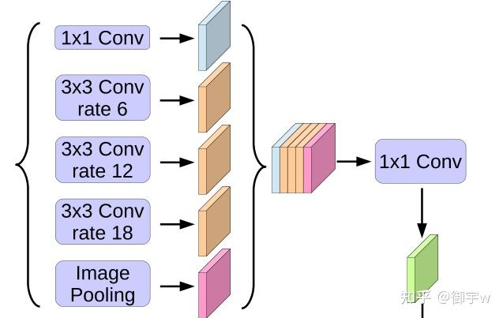
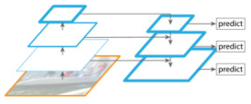
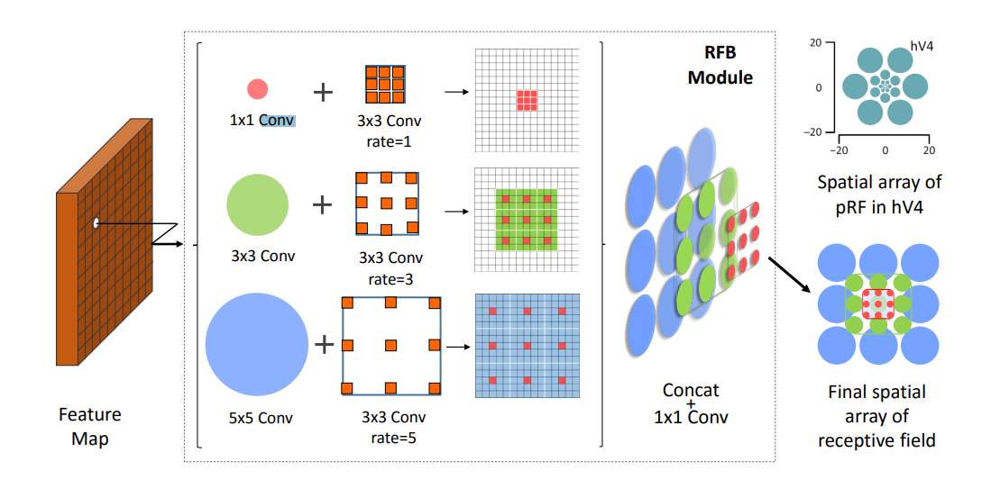
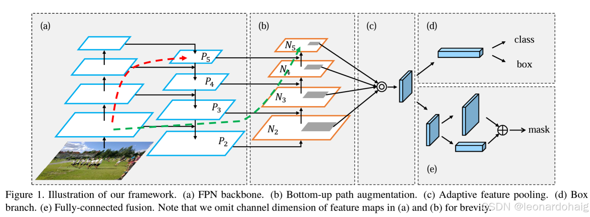
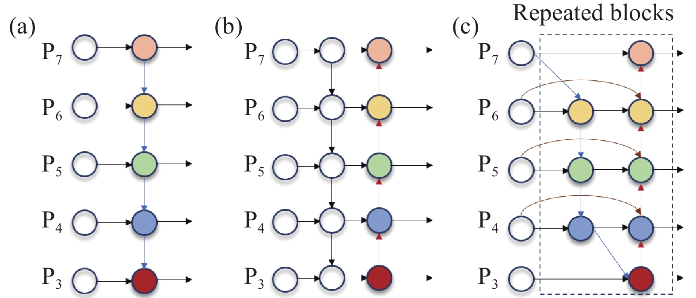
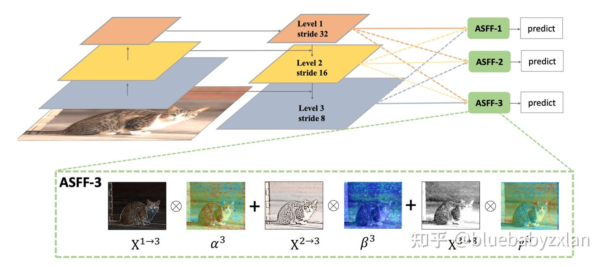

# 特征融合模块 (Feature Fusion) 发展脉络

本目录收录了计算机视觉中常见的多尺度特征提取与特征融合模块。文档按照论文**首次公开的时间**排序，每个模块都说明：

- **解决的问题**：前人方法有什么不足；
- **做了什么**：论文的核心做法；
- **改进了什么**：相对前作带来的提升；
- **本仓库实现**：对应的代码文件与简化之处。

## 总览

| # | 模块 | 首次公开 | 出处 | 核心思想 | 本仓库状态 |
|---|------|----------|------|----------|------------|
| 1 | SPP | 2014.06 | ECCV 2014 / TPAMI 2015 | 多尺度最大池化后拼接 | 已实现（YOLO 变体） |
| 2 | Inception | 2014.09 | CVPR 2015 | 多分支并行 + 1x1 降维 | 已实现 |
| 3 | ASPP | 2016.06 | DeepLab v2 / v3 | 空洞卷积金字塔 + 图像级池化 | 已实现（v3 结构） |
| 4 | FPN | 2016.12 | CVPR 2017 | 自顶向下路径 + 横向连接 | 已实现（3 尺度） |
| 5 | RFB | 2017.11 | ECCV 2018 | 多分支 + 空洞卷积模拟感受野 | 已实现（RFB 结构） |
| 6 | PANet | 2018.03 | CVPR 2018 | 在 FPN 上增加自底向上路径 | 已实现（颈部，3 尺度） |
| 7 | BiFPN | 2019.11 | CVPR 2020 | 双向路径 + 可学习加权融合 + 堆叠 | 已实现（3 尺度） |
| 8 | ASFF | 2019.11 | arXiv 2019 | 空间自适应加权融合 | 已实现（3 尺度） |
| 9 | SPPF | 2020.06 | YOLOv5（无论文） | 串联小核池化，SPP 的加速版 | 已实现 |
| 10 | LEM | 待确认 | 待确认 | 条带池化 + 多尺度卷积 + 通道注意力 | 已修复（可运行） |

---

## 1. SPP：空间金字塔池化（2014）

- **论文**：[Spatial Pyramid Pooling in Deep Convolutional Networks for Visual Recognition](https://arxiv.org/abs/1406.4729)（ECCV 2014 / TPAMI 2015）
- **解决的问题**：当时的 CNN 全连接层要求固定尺寸输入，图像必须裁剪或缩放，容易丢失信息或产生形变。
- **做了什么**：在最后一层卷积特征图上，用多种网格（如 4x4、2x2、1x1）做自适应最大池化，每个格子取最大值，再把结果拼接成固定长度的向量。
- **改进了什么**：
  - 支持任意尺寸输入；
  - 同时利用多个尺度的空间信息；
  - 整张图只需计算一次卷积。
- **本仓库实现**（`SPP/SPP.py`）：
  - 采用 YOLOv3-SPP 的写法：1x1 降维 → 多个 `stride=1` 的 k×k 最大池化（保持空间尺寸）→ 拼接 → 1x1 投影；默认 `pool_sizes=(5, 9, 13)`。
  - **注意**：原版 SPPNet 输出的是固定长度向量，主要用于分类；本仓库的版本输出仍是特征图，用于检测网络。

## 2. Inception：多分支并行（2014）

- **论文**：[Going Deeper with Convolutions](https://arxiv.org/abs/1409.4842)（CVPR 2015，即 GoogLeNet / Inception v1）
- **解决的问题**：物体大小差异大，很难人工决定该用几号卷积核；直接加深加宽网络又会让计算量急剧增加。
- **做了什么**：同一层并行使用 1x1、3x3、5x5 卷积和 3x3 最大池化四个分支，最后在通道维度拼接；在 3x3 和 5x5 卷积之前用 1x1 卷积降维。
- **改进了什么**：
  - 网络自己在多个尺度之间做选择；
  - 1x1 降维显著减少了后面大核卷积的计算量。
- **本仓库实现**（`Inception/Inception.py`）：
  - 四个分支结构与原文一致，`out_channels` 平均分给四个分支，余数归最后一个分支；
  - 卷积层使用仓库的 `BaseConv`，默认带 BN 和 SiLU。原版 Inception v1 没有 BN（BN 是 v2 才引入的），这是有意的工程选择。

## 3. ASPP：空洞空间金字塔池化（2016 → 2017）

- **论文**：
  - [DeepLab v2: Semantic Image Segmentation with Deep Convolutional Nets, Atrous Convolution, and Fully Connected CRFs](https://arxiv.org/abs/1606.00915)（2016，TPAMI 2018）；
  - [Rethinking Atrous Convolution for Semantic Image Segmentation (DeepLab v3)](https://arxiv.org/abs/1706.05587)（2017）。
- **解决的问题**：语义分割是稠密预测任务，需要保持较高的分辨率。SPP 那样靠池化扩大感受野，会让特征图越来越小。
- **做了什么**：
  - 用不同膨胀率（rate）的 3x3 空洞卷积并行提取特征，再加上 1x1 卷积；
  - DeepLab v3 又加入了**图像级池化**分支（全局平均池化 → 1x1 卷积 → 上采样回原尺寸）；
  - 五个分支拼接后用 1x1 卷积投影。
- **改进了什么**：
  - 空洞卷积在不降低分辨率的前提下扩大感受野，等效感受野为 \(k_{eff} = k + (k-1)(r-1)\)。例如 3x3、rate=6 的等效感受野为 13；
  - 图像级池化补充了全图的全局上下文。
- **本仓库实现**（`ASPP/ASPP.py`）：
  - 按 DeepLab v3 结构实现，五个分支全部写成显式变量，默认 `atrous_rates=(6, 12, 18)`，投影后接 Dropout 0.5；
  - 图像级池化分支含 BN，训练时 batch size 必须大于 1。

## 4. FPN：特征金字塔网络（2016 → 2017）

- **论文**：[Feature Pyramid Networks for Object Detection](https://arxiv.org/abs/1612.03144)（CVPR 2017）
- **解决的问题**：多尺度检测时，图像金字塔计算量太大；而只用单一尺度的特征，要么分辨率低，要么语义弱。
- **做了什么**：
  - 复用 backbone 的多层特征；
  - **自顶向下路径**：把深层特征上采样；
  - **横向连接**：用 1x1 卷积统一通道数后，与浅层特征相加；
  - 每层再用 3x3 卷积做平滑，减轻上采样带来的混叠。
- **改进了什么**：每个尺度的特征同时具有高分辨率和强语义信息，额外计算开销很小。
- **本仓库实现**（`FPN/FPN.py`）：固定 3 个尺度（由浅到深输入），最近邻上采样 + 逐元素相加 + 3x3 平滑，输出通道统一为 `out_channels`。

## 5. RFB：感受野模块（2017 → 2018）

- **论文**：[Receptive Field Block Net for Accurate and Fast Object Detection](https://arxiv.org/abs/1711.07767)（ECCV 2018）
- **解决的问题**：人眼视网膜上的感受野大小随偏心率变化（中心小、周边大），而普通 CNN 的感受野是单一的。作者希望用轻量的方式让检测器特征同时具备多种感受野。
- **做了什么**：
  - 三条分支分别使用 1x1 + 3x3、1x1 + 3x3 + 3x3、1x1 + 5x5 + 3x3 的结构，末端的 3x3 卷积分别使用 rate=1、3、5 的空洞卷积；
  - 三条分支拼接后用 1x1 卷积做线性融合，再与 shortcut 相加，最后 ReLU；
  - 论文还给出了 RFB-s 版本（用 3x3 小核替代 5x5，速度更快）。
- **改进了什么**：相比 Inception 和 ASPP，每条分支先降维再使用不同大小的核和空洞率，感受野更丰富；加入残差连接，训练更稳定。
- **本仓库实现**（`RFB/RFB.py`）：
  - 实现了 RFB（参考图 (a) 的结构），`scale` 默认 0.1、`map_reduce` 默认 8，与官方实现的默认值一致；
  - **未实现** RFB-s。

## 6. PANet：路径聚合网络（2018）

- **论文**：[Path Aggregation Network for Instance Segmentation](https://arxiv.org/abs/1803.01534)（CVPR 2018）
- **解决的问题**：FPN 的信息只能自顶向下流动，浅层中精确的定位信息（边缘、位置）要经过很多层才能传到深层，影响定位和分割精度。
- **做了什么**：
  - 保留 FPN 的自顶向下路径；
  - 增加一条**自底向上路径**：用步幅为 2 的卷积逐级下采样，再与对应层的特征相加，最后用 3x3 卷积融合；
  - 论文还提出了自适应特征池化（融合所有层的 ROI 特征）和全连接融合分支（用于 mask 预测）。
- **改进了什么**：浅层到深层的信息路径大幅缩短，定位更加精确。
- **本仓库实现**（`PANet/PANet.py`）：
  - 实现了颈部（neck）部分：FPN 式自顶向下路径 + 自底向上路径，输出 3 个尺度；
  - **未实现**自适应特征池化和 mask 分支，这两部分属于检测头的内容。

## 7. BiFPN：双向特征金字塔（2019 → 2020）

- **论文**：[EfficientDet: Scalable and Efficient Object Detection](https://arxiv.org/abs/1911.09070)（CVPR 2020）
- **解决的问题**：PANet 等结构在每个融合节点上都是等权相加，但不同分辨率的输入对输出的贡献并不相同；同时 PANet 的参数量和计算量也较大。
- **做了什么**：
  1. 删除只有一个输入、没有融合作用的节点；
  2. 在输入节点与同一层级的输出节点之间增加一条额外的边，让原始特征直接参与融合；
  3. 每个融合节点使用**快速归一化融合**（Fast Normalized Fusion）：可学习的权重经过 ReLU 保证非负，再除以总和进行归一化：
     \[
     O = \sum_i \frac{w_i}{\epsilon + \sum_j w_j}\, I_i, \qquad w_i \ge 0
     \]
  4. 融合之后使用深度可分离卷积（DSConv）；
  5. 整个结构可以堆叠多次（重复 block）。
- **改进了什么**：相比 PANet，精度更高，参数量和计算量更低。配合 EfficientNet 的复合缩放，得到了 EfficientDet 系列。
- **本仓库实现**（`BiFPN/BiFPN.py`）：
  - 为了与其他 3 尺度模块保持一致，这里实现的是 **3 个尺度**的简化版（论文使用 P3–P7 共 5 个尺度）；
  - 输入先经过 1x1 卷积统一通道数，`num_layers` 控制堆叠层数，每层拥有独立的参数；
  - 融合节点使用仓库中的 `DSConv`，加权融合由 `WeightedFusion` 实现。

## 8. ASFF：自适应空间特征融合（2019）

- **论文**：[Learning Spatial Fusion for Single-Shot Object Detection](https://arxiv.org/abs/1911.09516)（arXiv 2019）
- **解决的问题**：FPN 直接把不同尺度的特征相加，但同一个空间位置在不同尺度上的语义可能互相冲突（例如某个位置在浅层是背景、在深层是目标）。等权相加会把这种冲突也一起传递下去。
- **做了什么**：
  - 对于目标层 \(l\)，先把所有尺度都统一到该层的分辨率和通道数（分辨率高的用步幅卷积下采样，分辨率低的用插值上采样）；
  - 把三个尺度拼接后，用 1x1 卷积预测三张空间权重图，经过逐像素 softmax 归一化；
  - 按像素加权求和：
    \[
    y^{l}_{ij} = \alpha^{l}_{ij}\, x^{1\rightarrow l}_{ij} + \beta^{l}_{ij}\, x^{2\rightarrow l}_{ij} + \gamma^{l}_{ij}\, x^{3\rightarrow l}_{ij}, \qquad \alpha^{l}_{ij}+\beta^{l}_{ij}+\gamma^{l}_{ij}=1
    \]
- **改进了什么**：相比 FPN 的等权相加，网络可以在每个像素位置选择更可靠的尺度，减轻尺度之间的不一致；推理时只增加了一个 1x1 卷积和 softmax，额外开销很小。
- **本仓库实现**（`ASFF/ASFF.py`）：固定 3 个尺度，通过 `level` 参数选择输出层（0、1、2 分别对应从高到低的分辨率）。

## 9. SPPF：快速空间金字塔池化（2020）

- **论文**：无正式论文，来自 Ultralytics 的 [YOLOv5](https://github.com/ultralytics/yolov5)（2020）。
- **解决的问题**：SPP 并行使用 5、9、13 三个大核池化，计算量较大，在对速度敏感的检测器中会成为瓶颈。
- **做了什么**：只使用一个 5×5 的最大池化，并把它串联三次：\(y_1 = P(x)\)，\(y_2 = P(y_1)\)，\(y_3 = P(y_2)\)，然后拼接 \([x, y_1, y_2, y_3]\) 再用 1x1 卷积投影。
- **改进了什么**：两次 5×5 最大池化的感受野等价于 9×9，三次等价于 13×13，因此结果与 SPP(5, 9, 13) **完全相同**，但计算量更低。
- **本仓库实现**（`SPPF/SPPF.py`）：实现了 YOLOv5 的写法。测试中，在两者共享相同卷积权重的情况下，SPPF 与 `SPP(pool_sizes=(5, 9, 13))` 的输出最大误差为 0。

## 10. LEM（论文出处待确认）

- **论文**：待确认。我没有在公开资料中找到与 `LEM` 结构对应的论文，所以这里没有填写链接，请补充。
- **结构**（根据代码归纳）：
  1. **条带池化**：分别沿宽度和高度做平均池化，得到水平方向和竖直方向的描述（与 Coordinate Attention、Strip Pooling 的思路相近）；
  2. 两个方向**共享**一个 1x1 卷积降维（C → C/r），再拆分、升维，分别与原特征相乘，得到 `x_x`（水平方向增强）和 `x_y`（竖直方向增强）；
  3. 对两者分别使用 1、3、5、7 四种卷积核，相加后得到四个尺度的特征；
  4. 对四个尺度求和后做全局池化，经过四组全连接和 BN 得到每个尺度的通道权重，再经 sigmoid 与对应尺度相乘后求和。这一步与 SKNet 的选择性核（Selective Kernel）思路相近。
- **本仓库修复**（`LEM/LEM.py`）：原代码无法运行，主要修复了以下问题（修改处均带有 `[修复]` 注释）：
  - `split` 的调用参数写错，改为先卷积再沿 `dim=2` 切分；
  - `self.avgpool` 未定义，补充 `nn.AdaptiveAvgPool2d(1)`；
  - 线性层的输入维度应为 `in_channels`，而不是 `feature_channels`；
  - 对 `[B, 4C]` 的二维张量使用了 `BatchNorm2d`，改为 `BatchNorm1d(4C)`。
- **注意**：`feature_channels` 参数目前未被使用，仅为保持接口不变；训练时 batch size 需大于 1。

---

## 发展脉络小结

| 阶段 | 代表模块 | 核心突破 |
|------|----------|----------|
| 2014 | SPP、Inception | 多尺度信息如何同时利用：池化拼接、多核并行 |
| 2016 | ASPP | 空洞卷积：扩大感受野但不降低分辨率，适合分割 |
| 2016–2017 | FPN | 自顶向下金字塔：每一层都兼顾分辨率与语义 |
| 2017–2018 | RFB、PANet | 感受野多样化（RFB）；缩短浅层到深层的信息路径（PANet） |
| 2019–2020 | ASFF、BiFPN | 融合从"等权相加"变成"可学习加权"，并支持双向与堆叠 |
| 2020 | SPPF | 在结果不变的前提下，把大核池化改为串联，提升速度 |

整体趋势可以概括为三点：

1. **感受野**：从池化拼接，到空洞卷积，再到多分支的感受野设计；
2. **信息流**：从单向的自顶向下，到双向路径，再到缩短路径长度；
3. **融合方式**：从等权相加，到注意力加权，再到可学习、空间自适应的权重。

## 本仓库验证情况

- 所有模块都通过了前向形状检查（3 尺度模块使用 `[128, 256, 512]` 通道，空间尺寸为 `32 / 16 / 8`）；
- BiFPN、PANet、Inception、SPP、SPPF、RFB、LEM 都通过了反向传播检查，所有参数均有梯度；
- SPPF 与 SPP(5, 9, 13) 在共享权重下输出完全一致。
